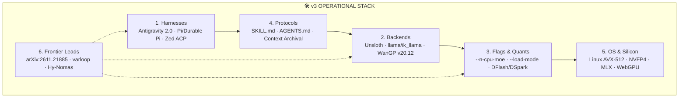

# 🛠️ AI Swiss Knife — Engineering, Harnesses & Underground Atlas (`v3.0.0-ecosystem`)
> Operational brain covering how the AI stack actually runs, connects, optimizes, and ships—from Durable Harnesses and WanGP v20.12 to 2026 llama.cpp flags and OS/Silicon exclusives.

**Navigation:** 🌐 [**Cloud APIs (`README.md`)**](README.md) · 🖥️ [**Local Models (`LOCAL_AI.md`)**](LOCAL_AI.md) · 🛠️ **Ecosystem Atlas (`ECOSYSTEM.md`)**

> [!IMPORTANT]
> **Scope:** Verified against primary GitHub releases, model cards, and arXiv papers through **Nov 2026**. `v1` (`README.md`) and `v2` (`LOCAL_AI.md`) tell you **what** runs; `v3` (`ECOSYSTEM.md`) tells you **how** to run it at peak efficiency.

---



---

## 1. Agent Harnesses, IDEs & Durable Execution
*The model gets the credit, but the harness decides whether multi-hour agent loops succeed or crash.*

| Harness / Platform | Core Architecture | Standout Capabilities (Nov 2026) | Best Pairing & Gotcha |
| :--- | :--- | :--- | :--- |
| **Google Antigravity**<br><sub>`2.0 Desktop` · `CLI` · `SDK`</sub> | Unified Google agentic harness<br><sub>Shared config across GUI + CLI</sub> | Live w/ **`Gemini 3.8 Flash`** (default) + **`Gemini 4 Neon / Orchestrator / Hydrogen`**; `/agents` parallel subagents, `ctrl+k` approval, `@conversation` cross-import. | ✅ Export directly from AI Studio Build into local Antigravity with full context intact. |
| **Pi (`v0.83`) & `Durable Pi`**<br><sub>`pi.dev` · `disler/durable-pi`</sub> | MIT minimalist TUI/RPC/SDK +<br><sub>SQLite crash-resumable backend</sub> | Built-in **`MCP + Codemode`** (JS sandbox without context bloat), `/tree` branching, **atomic shared JSON app state**, background compaction (200K/250K), live mid-run tool hot-swap. | 🏆 Thinking Machines' reference harness for `Inkling 2 Mini` (**71.6%** Terminal Bench 2.1). |
| **Zed Editor + `ACP`**<br><sub>Agent Client Protocol (`Apache-2.0`)</sub> | Native IDE multi-file review UI<br><sub>Zero Zed server telemetry</sub> | Official **ACP Registry** unifies `Pi`, `Claude Agent`, `Codex`, `Gemini CLI`, `OpenCode`, `Cursor`, & `Poolside` while forwarding local MCP servers. | ✅ Eliminates terminal diff blindness when running local or cloud CLI coding agents. |
| **OpenCode · Claude Code · OpenClaw**<br><sub>Vendor-agnostic & swarm CLIs</sub> | Terminal agent loops +<br><sub>Pre/post shell lifecycle hooks</sub> | `Claude Code` wires cleanly to local models via **Unsloth's Anthropic endpoint**; `OpenCode` pairs cloud planners with local Qwen/Inkling edits. | ⚠️ Always wrap destructive bash tools behind a System-1 `Laya` or `Gemini Decision 1` gate. |

---

## 2. Inference Studios, Engines & Low-VRAM Media Backends
*Choosing the right serving kernel unlocks 2×–5× speedups and halves VRAM ceilings on 16GB cards.*

| Backend / Runtime | Target Workload | Key Breakthroughs (Nov 2026) | Strict Compatibility Gotcha |
| :--- | :--- | :--- | :--- |
| **Unsloth Runtime & Studio**<br><sub>`v0.1.923-beta` (Tauri + CLI)</sub> | Local LLMs, Decisions, & RL/LoRA<br><sub>OpenAI + Anthropic API server</sub> | **1.9×** faster `Inkling 2 Mini`, **3×** faster VRAM-exceeding MoE GGUFs, **4.1×** faster `Laya`, `AsyncGRPO`, retrieval Context Archival, AMD NPU, & `FastWan`. | ✅ **Mandatory** for `Inkling 2 Mini` looped-layer GGUFs and self-healing JSON/XML tool calls. |
| **`llama.cpp` vs `ik_llama.cpp`**<br><sub>Mainline vs. SOTA Perf Fork</sub> | GGUF CPU + GPU hybrid inference<br><sub>CUDA, Metal, Vulkan, ROCm</sub> | `ik_llama.cpp` leads bleeding-edge kernels: **FlashMLA**, **IQK AVX-512 (`HAVE_FANCY_SIMD`)**, Trellis quants (`IQ2_KS`/`IQ3_KT`), dynamic MoE caching. | ⚠️ `ik_llama.cpp` is **CPU + NVIDIA CUDA only**; avoid `-rtr` on k-quants w/ MoE offload & avoid raw `f16` `_XL` tensors. |
| **`WanGP v20.12` + `MMGP v4`**<br><sub>`deepbeepmeep/WanGP`</sub> | Low-VRAM Video, Image & Avatars<br><sub>`Wan 2.2`, `H3`, `LTX-2.5`, `SenseNova`</sub> | **Extreme Chunker** (**5.9 GB VRAM** for 15s 1080p H3), **`pi-H3` DWD** (2–4 steps), **Infinite Sliding Windows**, **`SageGP 1.0.2`**, `Deepy Prime` MCP + `Deepy Apps`. | ✅ Install `WGPKernels 1.5.0` & `SageGP 1.0.2` (PyTorch 2.10; Triton 3.6+ for RTX 50xx adaptive Sage2/3). |
| **`ComfyUI v0.46` & `SGLang-Omni`**<br><sub>Node graphs & multimodal serving</sub> | Custom media pipelines & TTS<br><sub>`Fish Drama 3`, `Qwen-Image-2.1`</sub> | `ComfyUI v0.46`: `SenseNova`, `RMBG 3.0`, RAFT `Video Deflicker`, `KJNodes` block-swap; `SGLang-Omni` serves `Fish Audio Drama 3`. | 💡 Use `stable-diffusion.cpp` for lightweight CLI `Qwen-Image-2.1` (`Q4_K_M`, 9.1 GB VRAM). |

---

## 3. Acceleration, Quantization & The 2026 Flag Bible
*Exact mechanics for maximizing a 16GB VRAM + 64GB RAM workstation without hitting the PCIe cliff.*

| Mechanic / Flag | Exact Syntax / Spec | What It Does Under the Hood | Critical Tuning Trap |
| :--- | :--- | :--- | :--- |
| **The `--n-cpu-moe` Sweep**<br><sub>Zone 2 Hybrid MoE Law</sub> | `-ngl 99 -fa on --n-cpu-moe N` | Pins **100% of Attention + KV cache** on your 16GB GPU while pushing only sparse FFN experts of the first `N` layers to 64GB DDR5 RAM. | ⚠️ **Never lower `-ngl` on MoEs.** Sweep `N` down by 2 until VRAM spills, then step up by 1–2. |
| **Unified Load Mode**<br><sub>Replaces `--no-mmap` / `--mlock`</sub> | `--load-mode none` or `mlock`<br><sub>Env: `LLAMA_ARG_LOAD_MODE`</sub> | Replaces deprecated `--no-mmap` / `--mlock` flags in modern `llama.cpp` to prevent OS page-cache thrashing on 64GB RAM loads. | ⚠️ If partial MoE offload + CUDA graphs outputs gibberish, add **`-cuda graphs=0`**. |
| **KV Cache Quantization**<br><sub>Memory-fitting vs. Speed</sub> | `-ctk q8_0 -ctv q8_0`<br><sub>Requires `-fa on` (Flash Attn)</sub> | Halves KV cache VRAM so 24B–27B dense models (`Qwen3.8-27B`) and 120K MoE contexts fit cleanly inside 16GB VRAM. | ⚠️ **Not a speed boost:** Keep `f16` KV cache whenever it fits in VRAM; use `q8_0` only to prevent RAM spill. |
| **Next-Gen Multi-Token Tech**<br><sub>`DFlash` · `DSpark` · `MTP` · `N-gram`</sub> | `--spec-draft-n-max 2` (Inkling)<br><sub>`Dynamic v3.1` (`UD-*`) quants</sub> | `DFlash` drafts **16 tokens/pass** (`Muse Glimmer`/`Bolt`); `DSpark` (1 GB) accelerates `Inkling 2 Mini`; `N-gram` prefetches 51B tables from RAM (`Qwen3.8-Flash`). | ⚠️ On `Inkling 2 Mini`, raising `--spec-draft-n-max` above 2 can degrade looped-layer acceptance. |

<details>
<summary>🛠️ <b>Click to expand Copy-Paste 2026 Verification & Sweep Commands (16GB VRAM + 64GB RAM)</b></summary>
<br>

```bash
# 1. Zone 2 Heavy Coding MoE Sweep (Attention 100% on 16GB GPU, 29 Expert Layers in 64GB RAM)
GGML_CUDA_GRAPH_OPT=1 llama-server \
  -m Qwen3-Coder-Next-UD-Q4_K_XL.gguf \
  -ngl 99 -fa on -c 120000 --load-mode none \
  --n-cpu-moe 29 --batch-size 4096 --ubatch-size 4096 \
  -ctk q8_0 -ctv q8_0 --temp 0

# 2. Inkling 2 Mini (Looped Transformer via Unsloth Runtime + Vision mmproj)
unsloth run unsloth/Inkling-2-Mini-GGUF:UD-Q4_K_XL --spec-draft-n-max 2

# 3. Zone 1 Pure 16GB VRAM Dense Brain (Qwen3.8-27B IQ4_XS + Q8 KV Cache)
llama-server -m Qwen3.8-27B-IQ4_XS.gguf -ngl 99 -fa on -c 32768 -ctk q8_0 -ctv q8_0
```
</details>

---

## 4. Protocols, Skills & Context Engineering
*How to keep prompt caches warm, stop context rot, and wire tools cleanly across every harness.*

| Pattern / Protocol | Standard / File | Why It Beats Legacy Approaches | Production Guardrail |
| :--- | :--- | :--- | :--- |
| **Progressive Skills (`SKILL.md`)**<br><sub>vs. Bloated MCP Tool Lists</sub> | `skills/<name>/SKILL.md` +<br><sub>`Pi` / `Antigravity` / `Deepy Skills`</sub> | Loads instructions & scripts **on demand** instead of stuffing 30+ MCP schemas into the system prompt (which destroys KV prompt caching). | ✅ Use `Pi` **MCP + Codemode** when you need complex multi-tool orchestration in a JS sandbox. |
| **Layered Context Files**<br><sub>Global -> Repo -> Subdir</sub> | `AGENTS.md` · `CLAUDE.md`<br><sub>`llms.txt` · `llms-local.txt`</sub> | Gives agents deterministic foraging routes and repo invariants in <500 tokens before reading a single source file. | ⚠️ Never let `AGENTS.md` grow into a 5,000-token manual—keep micro-details in on-demand skills. |
| **Retrieval Context Archival**<br><sub>vs. Lossy Rolling Summaries</sub> | Unsloth Archival · `Durable Pi`<br><sub>`/tree` + `search_history`</sub> | Archives old turns to searchable SQLite/vector history at 200K tokens rather than overwriting nuances via destructive summarization. | ✅ Pair with `Laya` + `all-MiniLM-L6-v2` (23 MB) for auditable memory invalidation ledgers. |
| **`ACP` vs `MCP`**<br><sub>Editor Bridge vs. Tool Bus</sub> | Zed `ACP` (`Apache-2.0`)<br><sub>Anthropic `MCP`</sub> | **ACP** connects IDEs to external coding agents cleanly; **MCP** connects agents to external tools/data (Zed forwards MCP over ACP). | ✅ Use both: ACP for the human review surface, MCP/Skills for agent tool execution. |

---

## 5. OS, Sandboxing & Silicon-Exclusive Stacks
*Exploiting hardware-specific accelerators and OS-native sandboxes for safe, fast local execution.*

| OS / Silicon Tier | Key Engines & Kernels | Exclusive Performance / Safety Edge | Hardware Reality Check |
| :--- | :--- | :--- | :--- |
| **Linux (First-Class Host)**<br><sub>CUDA · ROCm · Zen 4/5 AVX-512</sub> | `Bwrap` Sandbox · `ik_llama.cpp`<br><sub>Kernel Hugepages · `HAVE_FANCY_SIMD`</sub> | Fastest 64GB DDR5 MoE streaming (AVX-512 IQK kernels) + Unsloth OS-enforced **`Bwrap`** bash/python sandboxing. | ✅ Preferred host OS for 16GB NVIDIA + 64GB DDR5 hybrid MoE workstations. |
| **NVIDIA Ada / Blackwell**<br><sub>RTX 40xx / 50xx & DGX Spark</sub> | `NVFP4` · `SageGP 1.0.2`<br><sub>`FlashMLA` · CUDA Graphs</sub> | RTX 50xx gets native `NVFP4` + adaptive `Sage2/3 GP` precision; RTX 20xx–40xx gain `SageGP` Extreme Chunker kernels for `WanGP`. | ⚠️ Update to PyTorch 2.10 + Triton 3.6+ for Blackwell `sage3 gp` adaptive modes. |
| **macOS (Apple Silicon)**<br><sub>Unified Memory + `Seatbelt`</sub> | `MLX` (`mlx-lm` / `mlx-vlm`)<br><sub>Unsloth Mac **2.8×** Speculative</sub> | Zero PCIe copy bottleneck for MoEs up to unified RAM ceiling + macOS **`Seatbelt`** sandbox. | ⚠️ Prompt prefill lags dedicated NVIDIA Tensor Cores; 32GB+ unified RAM recommended for `Inkling 2 Mini`. |
| **AMD NPU, Windows & WebGPU**<br><sub>Tri-Hybrid & Zero-Server Browser</sub> | Unsloth AMD NPU · Win **`MXC`**<br><sub>WebGPU (`Phonon 31M` / `Laya`)</sub> | Run `Laya` decisions on AMD NPU/CPU or `Phonon 31M` TTS at **130× RT (4.9ms)** directly in browser WebGPU while GPU stays 100% free. | ✅ Windows users get native **`MXC`** sandboxing in Unsloth Studio and Redtash1 one-click `WanGP` builds. |

---

## 6. Frontier Research & Underground Playbooks
*Verified late-2026 breakthroughs shifting how local agents and creative pipelines operate.*

| Lead / Playbook | Primary Source | Why It Matters Right Now | How to Experiment Today |
| :--- | :--- | :--- | :--- |
| **Gradient-Free Self-Rewriting**<br><sub>Weight Editing via Reasoning</sub> | UIUC (`arXiv:2611.21885`)<br><sub>Published Nov 16–20, 2026</sub> | Demonstrates an LLM diagnosing failures via pure reasoning and rewriting its own weights across sessions with **zero gradients or training runs**. | 🔬 Track for next-gen persistent local agents that permanently patch recurring coding mistakes. |
| **Variable-Loop Test-Time Compute**<br><sub>Dynamic Depth per Token</sub> | `thinkingmachines/TML-d24-varloop-research` | Companion to `Inkling 2 Mini` allowing you to dial `loop_num_passes` at inference time—trading latency for reasoning depth without swapping models. | 🧪 Combine with a `Laya` complexity router to pass easy queries in 1 loop and hard bugs in 3+ loops. |
| **Playable Worlds + Auto-Directed Video**<br><sub>`Hy-Nomas` + `Deepy Apps`</sub> | `Tencent-Hunyuan/Hy-Nomas`<br>`WanGP v20.12 Deepy Apps` | Generates WASD-navigable interactive worlds on 1 GPU (`Hy-Nomas`) and packages generated video/audio assets into playable 3D `.wgpapp` scenes (`Deepy Apps`). | 🎬 Wire Claude Code / Antigravity into `Deepy Prime` via MCP to auto-direct, inspect frames, and iterate. |
| **Zero-Cost Local Claude Code Loop**<br><sub>Anthropic Proxy + Decision Gate</sub> | Unsloth Anthropic API +<br>`Laya` (`localhost:8888`) | Point `Claude Code` or `OpenCode` to local `Inkling 2 Mini` / `Qwen3.8-27B` while gating shell commands through `laya-typed-decisions`. | 🛡️ Cap output tokens/turns on `Inkling 2 Mini` to prevent repetitive debug loops. |

