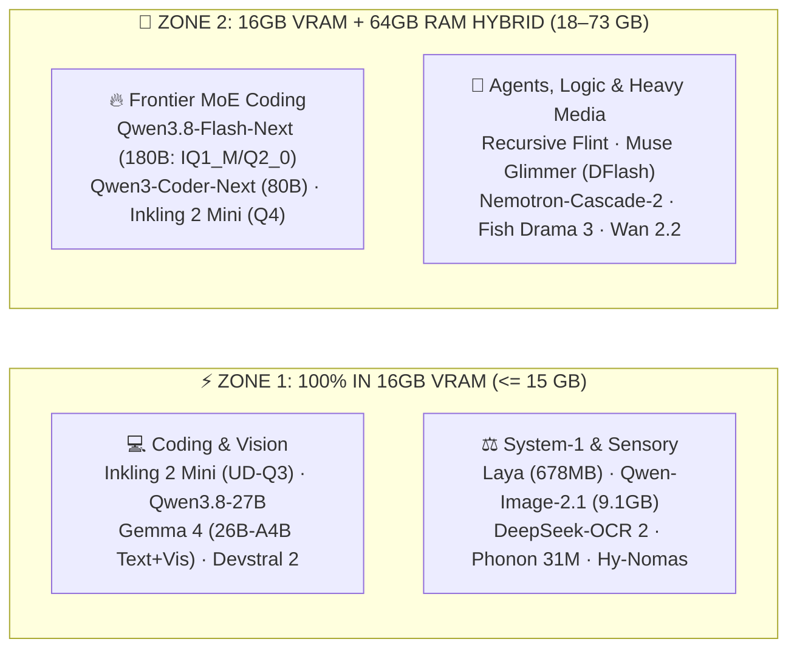

# 🖥️ AI Swiss Knife — Local AI Dimension (`v2.0.0-local`)
> **Hardware Envelope:** `16GB VRAM + 64GB System RAM (~80 GB Total Pool)` — Pure local model roster verified for 16GB GPU + 64GB DDR5 workstations—split into Pure-VRAM Resident (Zone 1) and Hybrid MoE Offload (Zone 2).

**Navigation:** 🌐 [**Cloud APIs (`README.md`)**](README.md) · 🖥️ **Local Models (`LOCAL_AI.md`)** · 🛠️ [**Backends & Flags (`ECOSYSTEM.md`)**](ECOSYSTEM.md) · 🤖 [**Local Manifest (`llms-local.txt`)**](llms-local.txt)

> [!IMPORTANT]
> **Curation Policy:** Includes elite community/research-licensed local models (`qwen-community`, `Fish Community`, `LTX Community`) explicitly badged. Models exceeding 80 GB total memory or closed cloud APIs (`Wan 3.0`, `FLUX 3`, `GLM-5.3-Flash`) are enforced in the [Local Graveyard](#-5-the-local-hardware-wall-graveyard).

---

## 🧭 1. The Two-Zone Physics Map (`16GB VRAM + 64GB RAM`)


<br>

## 🧠 2. Local Text, Coding & Reasoning Roster

| Role & Memory Zone | Verified Local Models | Origin, License & Footprint | Benchmark Proof & Hardware Gotcha |
| :--- | :--- | :--- | :--- |
| **Looped MoE Coding Star**<br><sub>Zone 1 (`Q3`) & Zone 2 (`Q4`/`Q8`)</sub> | **`Inkling 2 Mini`**<br><sub>**26.4B** total / **3.4B** base (**5.4B** eff.) · **1M ctx**</sub><br><sub>24 layers (middle 12 looped 3×) + `DSpark` drafter</sub> | `US` · `Apache-2.0` + AUP<br><sub><kbd>7.76–22.87 GB</kbd> GGUF (`UD-Q4_K_XL` **17.6 GB** + `639 MB` vision)</sub> | 🏆 **79.2%** SWE-bench Verified, **77.9%** SWE-Pro v2 Hard, **0.703** IPW (*lab-reported*; 20.1 AA Index).<br>⚠️ **Caveats:** Trails `Qwen3.8-27B` on strict chat (`50%` MultiChallenge, `-8.6` AA-Omniscience); requires Unsloth runtime + `--spec-draft-n-max 2`. |
| **Pure 16GB VRAM Kings**<br><sub>Zone 1 · <= 15 GB Footprint</sub> | **`Qwen3.8-27B`** · `Dense Vision+Text`<br><sub>Beats Flint on Terminal-Bench (**73.0**) & SWE-Pro (**94.9**)</sub><br>**`Gemma 4 (26B-A4B)`** · `Text+Vision Only`<br><sub>**3.8B active** · ~140 tok/s in 16GB VRAM</sub> | `CN` · `Apache-2.0`<br>`US` · `Apache-2.0`<br><sub><kbd>13–15 GB</kbd> (`IQ4_XS` / `UD-IQ3_S`)</sub> | ✅ **`Qwen3.8-27B`** is #1 for strict instruction-following & dense coding.<br>⚠️ **Gemma 4 Audio Trap:** Only `E2B`/`E4B`/`12B` process audio—`26B-A4B` is **Text + Vision only**. |
| **Rescued 180B Frontier Flash**<br><sub>Zone 2 Ceiling · 66–73 GB Total</sub> | **`Qwen3.8-Flash-Next`**<br><sub>**180B** (125B MoE + 51B N-gram + 4B MTP) / **6B active**</sub><br><sub>Unsloth Dynamic v3.1 (`UD-IQ1_S` / `IQ1_M` / `Q2_0`)</sub> | `CN` · `qwen-community-1.0`<br><sub><kbd>66.4–70.5 GB</kbd> + **1.9–2.8 GB** MTP (9–13 GB OS margin)</sub> | 🏆 **91.9** DeepSWE 1.1; 51B N-gram prefetches asynchronously from 64GB DDR5 at near-GPU speed.<br>⚠️ **Hard Cap:** Never load `UD-Q2_K_XL` (79.6 GB) on 16+64 GB—leaves 0 GB for OS/KV cache. |
| **Hybrid Agentic Coders**<br><sub>Zone 2 · 19–49 GB Sparse MoE</sub> | **`Qwen3-Coder-Next (80B-A3B)`** (~49 GB)<br>**`Recursive Flint (39.8B-A2.5B)`** (~25 GB)<br>**`North-Mini-Code-1.0 (30B-A3B)`** (~19 GB) | `CN/US/CA` · `Apache-2.0`<br><sub><kbd>19–49 GB</kbd> (`UD-Q4_K_XL`) · 2.5B–3B active</sub> | 🏆 `80B-A3B`: 512-expert workhorse; `North-Mini-Code`: multi-harness specialist.<br>⚠️ `Flint` scores (**89.7%** SWE-Pro v2) are *vendor-reported* and trail `Qwen3.8-27B` on Unsloth evals. |
| **Olympiad Logic, Agents & Speed**<br><sub>Zone 1 & 2 · 4–24 GB</sub> | **`Nemotron-Cascade-2 (30B-A3B)`** (90.9% AIME)<br>**`Meta Muse Glimmer (30B + DFlash)`** (~20 GB)<br>**`Nemotron-3.5-Bolt (74B-A9B)`** (24 GB 2-bit QAT)<br>**`DiffusionGemma (26B-A4B)`** & **`Devstral Small 2`** | `US/EU` · `Apache-2.0` / `OpenMDW`<br><sub><kbd>15–24 GB</kbd> · `DFlash` 16-tok drafter</sub> | 🏆 `Muse Glimmer` (**94.7%** AIME, **65.9%** OSWorld) drafts 16 tokens/pass; `DiffusionGemma` denoises 256-tok blocks in parallel. |

---

## ⚖️ 3. System-1 Local Decision Models (Non-Autoregressive)

| Role & Job | Verified Local Models | Memory & Latency | Wiring & Calibration Gotcha |
| :--- | :--- | :--- | :--- |
| **Zero-Token Agent Gates**<br><sub>Tool safety, trace audit, memory</sub> | **`Laya`** (`convaiinnovations/laya`)<br><sub>• `laya-typed-decisions` (**846 MB**)<br>• `laya-multilingual` (**678 MB**, 100+ langs)</sub> | <kbd>678–846 MB</kbd> (CPU/NPU/WebGPU)<br><sub>⚡ **<100–500ms** · 64 questions/pass</sub> | 🔌 Serve via **Unsloth Decision API** (`localhost:8888`, `typesafe-sdk`) or `laya.cpp`.<br>⚠️ Threshold on `probabilities` (not `confidence`); review borderline *superseded vs contradicted* cases. |
| **Custom 16K Clef-Head**<br><sub>Domain-tuned local classifier</sub> | **`Qwen3.5-4B` / `Qwen3.8` / `Gemma 4`**<br><sub>+ `Clef Head` via `Unsloth DecisionTrainer`</sub> | <kbd>3–15 GB VRAM</kbd><br><sub>⚡ Single pass up to **16,384 tok**</sub> | 🏆 1-epoch 4-bit LoRA (`r=16`/`64`) lifts routing accuracy from ~35% zero-shot to **78%–81%** with zero output tokens generated. |

---

## 🎨 4. Local Multimodal, World, Voice & Retrieval Roster

| Modality & Niche | Verified Local Models | License & Memory Profile | Why It Wins & Hardware Gotcha |
| :--- | :--- | :--- | :--- |
| **Image Gen & Native RGBA**<br><sub>2048px typography & 10-ref lock</sub> | **`Qwen-Image-2.1` (7B DiT)**<br><sub>#1 VDEBench · Native RGBA layers</sub><br>**`FLUX.2 Klein`** & **`FLUX.1 Kontext`**<br>**`SenseNova-U1.5 (8B)`** (4K infographics) | `Qwen Research` *(Custom)*<br>`Apache-2.0` (`FLUX.2 Klein`)<br><sub><kbd>8–14 GB VRAM</kbd> (`2.1` = **9.1 GB** Q4)</sub> | ✅ Separate `Qwen-Image-2.1` (7B, fits 16GB easily) from `nvidia/Qwen-Image-Flash` (20.4B DiT, requires RAM offload).<br>⚠️ Use `FLUX.2 Klein` for commercial products. |
| **Video + Audio & World Models**<br><sub>1080p video & WASD interactive worlds</sub> | **`Wan 2.2 (5B & A14B)`** · `Apache-2.0`<br>**`LTX-2.5 (22B Video+Audio)`** · `Kandinsky 6.0 Lite`<br>**`Tencent Hy-Nomas`** (Interactive World Model) | `Apache-2.0` / `LTX Community` / `MIT`<br><sub><kbd>5.9–15 GB VRAM</kbd> + 64GB RAM swap</sub> | 🏆 **`WanGP v20.12`** Extreme Chunker runs 15s 1080p `Hailuo H3` in **5.9 GB VRAM**.<br>🏆 **`Hy-Nomas`** generates WASD-walkable worlds on 1 GPU (pair w/ `LTX-2.5` for sound). |
| **Directed Voice, TTS & ASR**<br><sub>16-speaker acting & 4.9ms WebGPU</sub> | **`Fish Audio Drama 3 (35B-A3B)`** (1245 Elo)<br>**`Ming-3.0-tts`** & **`ZONOS3 Mini`** (43 langs)<br>**`Phonon 31M`** (64.5 MB) · **`Qwen3-ASR (1.7B)`** | `Fish Community (<$500K)`<br>`Apache-2.0` (`Phonon 31M`, `Ming`, `ASR`)<br><sub><kbd>0.06–20 GB</kbd> (`Drama 3` in Zone 2)</sub> | 🏆 **`Phonon 31M`** runs in browser WebGPU at **115×–130× RT** (**4.9ms** latency, English-only; `40M` is `CC BY-NC`).<br>🏆 **`Drama 3`** supports 16 speakers + word inpainting via `SGLang-Omni`. |
| **Causal OCR, GUI & Multimodal RAG**<br><sub>PDF reading order & zero-VRAM RAG</sub> | **OCR:** **`DeepSeek-OCR 2 (3B)`** · `olmOCR-2`<br>**GUI:** **`UI-TARS (7B)`** · `North Micro Vision`<br>**RAG:** **`EmbeddingGemma 2`** · **`Qwen3-VL-Embed`** | `CN/US` · `Apache-2.0` / `Open`<br><sub><kbd>1.5–10 GB</kbd> (Run RAG on CPU RAM)</sub> | ✅ `DeepSeek-OCR 2` uses Visual Causal Flow for multi-column tables (<4 GB VRAM). Pin `EmbeddingGemma 2` in 64GB RAM so RAG uses **0 MB VRAM**. |

<details>
<summary>🛠️ <b>Click to expand Verified Local Launch Profiles (<code>python scripts/build.py forage &lt;id&gt; --local</code>)</b></summary>
<br>

```bash
# [inkling-coding] Zone 1/2 (13-18 GB) — unsloth/Inkling-2-Mini-GGUF (UD-Q3_K_XL or UD-Q4_K_XL + mmproj)
unsloth run unsloth/Inkling-2-Mini-GGUF:UD-Q4_K_XL --spec-draft-n-max 2

# [qwen-27b-vram] Zone 1 (100% in 16GB VRAM) — unsloth/Qwen3.8-27B-GGUF (IQ4_XS / UD-IQ3_S)
llama-server -m Qwen3.8-27B-IQ4_XS.gguf -ngl 99 -fa on -c 32768 -ctk q8_0 -ctv q8_0

# [qwen-flash-180b] Zone 2 Ceiling (66.4-70.5 GB + MTP) — unsloth/Qwen3.8-Flash-Next-GGUF (UD-IQ1_S / UD-IQ1_M / UD-Q2_0)
llama-server -m Qwen3.8-Flash-Next-UD-IQ1_M.gguf -ngl 99 -fa on --n-cpu-moe 36 --load-mode none

# [flint-coding] Zone 2 Sweet Spot (25.05 GB) — unsloth/Recursive-Flint-GGUF (UD-Q4_K_XL)
llama-server -m Recursive-Flint-UD-Q4_K_XL.gguf -ngl 99 -fa on -c 65536 --n-cpu-moe 18

# [laya-decision] Zone 1 CPU/NPU (678-846 MB) — convaiinnovations/laya-typed-decisions
unsloth serve-decision convaiinnovations/laya-typed-decisions --port 8888

```
</details>

---

## 🪦 5. The Local Hardware Wall Graveyard

> [!WARNING]
> Models below either have no published weights or physically overflow `16GB VRAM + 64GB RAM` (~80 GB).

* ❌ **`Wan 3.0`, `Wan 2.6`, and `FLUX 3 Video`:** Closed cloud APIs with no published weights. Use `Wan 2.2`, `LTX-2.5`, or `Kandinsky 6.0 Lite` locally.
* ❌ **`Inkling 2 Small` (594B) & `Inkling` Flagship (975B):** Require 354–600 GB NVFP4/4-bit memory (cloud/Tinker API only). Use `Inkling 2 Mini` (26.4B) locally.
* ❌ **`GLM-5.3-Flash` (320B), `Kimi K2.7-Code` (1T), `DeepSeek-V4.1-Flash` (552B):** Smallest usable checkpoints need 100–584 GB memory—exceeding your 80 GB total pool. Use via `v1` Cloud APIs.
* ❌ **`Qwen3.8-Flash-Next` at `UD-Q2_K_XL` (79.6 GB) or Larger:** Leaves zero headroom for OS, MTP weights (2 GB), and KV cache on 16GB+64GB. Strictly cap at `UD-IQ1_S`/`IQ1_M`/`Q2_0`.
* ❌ **`Nemotron-3.5-Super-VL` (120B-A12B) & Dense 70B Offloads:** Super-VL requires 82 GB+ RAM; dense 70B CPU offloading crawls at 2–4 tok/s (obsoleted by Zone 2 sparse MoEs).
