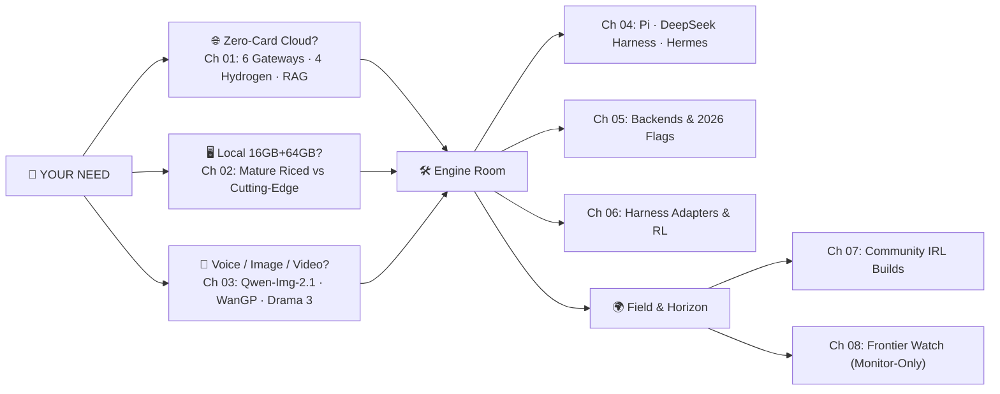

# ⚡ AI Swiss Knife — Field Book (`v2.1.0`)
> A lean, benchmark-verified, 3-part dual-interface Field Book for Zero-Card Cloud APIs, Local 16GB+64GB AI (Mature vs. Cutting-Edge), Harnesses, RL Adapters, IRL Community Builds, and Frontier Watch.

**Hardware Local Envelope:** `16GB VRAM + 64GB System RAM (~80 GB Total Pool)` · **Design Rules:** [`DESIGN_SYSTEM.md`](docs/DESIGN_SYSTEM.md) · **Agent Manifests:** [`llms.txt`](llms.txt) · [`llms-full.txt`](llms-full.txt)

> [!IMPORTANT]
> **Editorial Constitution:** Every actionable entry is verified against primary documentation (Nov 2026), carries an explicit trade-off (`⚠️ Gotcha`), and obeys a strict 4-column grid. Dead tiers and >80 GB local walls are blocked by CI in the Graveyard; apex closed/rack models stay isolated in Ch 08 (Frontier Watch).

## 🧭 The 3-Second Universal Compass



## 📖 Field Book Contents (3 Parts · 8 Chapters + Graveyard)

| Chapter | Part | Scope & Core Verdict | Direct Link |
| :--- | :--- | :--- | :--- |
| **01 · Cloud APIs** | `PART I: MODELS & ACCESS` | Only 6 cloud gateways remain genuinely card-free as of Nov 2026—pair Google AI Studio (Gemini 4 Hydrogen / 3.8 Flash) and Z.ai (GLM-4.7-Flash) for agent loops, Cloudflare/Google for $0-output System-1 decisions, and keyless Jina/Firecrawl/Exa for RAG. | [**Open Chapter →**](book/01-cloud-apis.md) |
| **02 · Local Models** | `PART I: MODELS & ACCESS` | Separate your local stack into two tracks: Mature & Fully Riced daily drivers (Qwen3.8-27B + Harness Adapters, Qwen3-Coder-Next, Gemma 4) vs. Cutting-Edge experimental architectures (Inkling 2 Mini looped MoE, varloop, DiffusionGemma, Muse Glimmer) that require newer runtimes and stricter turn caps. | [**Open Chapter →**](book/02-local-16vram-64ram.md) |
| **03 · Multimodal** | `PART I: MODELS & ACCESS` | Use zero-card cloud APIs for fast audio STT (Groq Whisper), multi-PDF vision (Gemini 3.8 Flash), and keyless FLUX drafts— but pivot immediately to local open weights for RGBA editing, directed multi-speaker TTS, interactive world models, and 1080p video. | [**Open Chapter →**](book/03-multimodal-sensory.md) |
| **04 · Harnesses** | `PART II: THE ENGINE ROOM` | Organize harnesses by architectural role: treat Pi / Pi Durable as your minimal building-block kernel, DeepSeek Harness (dsh) as the Cordis plugin-everything platform, and Hermes Agent as the self-improving autonomous daemon—all shielded by safeagents. | [**Open Chapter →**](book/04-harnesses-protocols.md) |
| **05 · Backends & Flags** | `PART II: THE ENGINE ROOM` | Serving kernels and memory flags matter as much as model weights: `--n-cpu-moe` unlocks 64GB RAM MoEs without touching `-ngl`, Unsloth accelerates looped & VRAM-exceeding GGUFs 1.9×–3×, and `WanGP v20.12` squeezes 1080p video into 5.9 GB VRAM. | [**Open Chapter →**](book/05-backends-flags-silicon.md) |
| **06 · Harness Adapters & RL** | `PART II: THE ENGINE ROOM` | Instead of chasing giant base models, freeze one strong 27B backbone and train lightweight RL LoRA adapters directly inside your unmodified shipping harness— cutting tool calls by 53–73% while gaining +13 to +25 points, and merging orthogonal adapters at rank 96 with zero retraining. | [**Open Chapter →**](book/06-adaptation-frontier.md) |
| **07 · Community IRL** | `PART III: FIELD & HORIZON` | The biggest real-world gains rarely come from raw model drops alone—they come from community alt-engines (3×–6× faster on 12–16GB GPUs), discipline skill packs (obra/superpowers), two-pass audit loops, and multi-tool indie pipelines chained together on consumer hardware. | [**Open Chapter →**](book/07-community-irl.md) |
| **08 · Frontier Watch** `MONITOR-ONLY` | `PART III: FIELD & HORIZON` | This chapter tracks the absolute apex of closed and rack-scale AI strictly to monitor capability ceilings, harness/caching breakthroughs, and open-weight trickle-down signals—never mixing paid or datacenter giants into Ch 01 ($0 Cloud) or Ch 02 (16GB+64GB Local). | [**Open Chapter →**](book/08-frontier-watch.md) |
| **99 · The Graveyard** | `APPENDIX` | Machine-enforced cut list of dead cloud tiers & >80 GB local walls. | [**Inspect Cuts →**](book/99-graveyard.md) |

## 🤖 Dual-Interface CLI & Agent Self-Foraging
```bash
python scripts/build.py forage coding-agent                   # Cloud/local/keyless auto-foraging
python scripts/build.py forage qwen-27b-super-adapter --local # Track A: Mature Riced 16GB VRAM
python scripts/build.py forage inkling-coding --local         # Track B: Cutting-Edge Looped MoE
python scripts/build.py all                                   # Lint + compile Cover, Book, & llms*.txt
```

---
*Built from `data/*.yaml` via `scripts/build.py`. See [`CONTRIBUTING.md`](CONTRIBUTING.md) and [`CHANGELOG.md`](CHANGELOG.md).*
