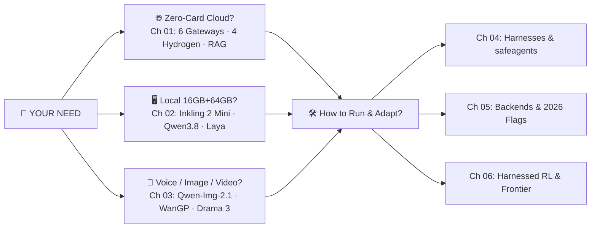

# ⚡ AI Swiss Knife — Field Book (`v2.0.0-beta.1`)
> A lean, benchmark-verified, dual-interface resource book for zero-card Cloud APIs, Local 16GB+64GB AI, Multimodal Media, Harnesses, and Agentic RL.

**Hardware Local Envelope:** `16GB VRAM + 64GB System RAM (~80 GB Total Pool)` · **Design Rules:** [`DESIGN_SYSTEM.md`](docs/DESIGN_SYSTEM.md) · **Agent Manifests:** [`llms.txt`](llms.txt) · [`llms-full.txt`](llms-full.txt)

> [!IMPORTANT]
> **Editorial Constitution:** Every entry is cross-checked against primary documentation (Nov 2026), carries an explicit trade-off (`⚠️ Gotcha`), and obeys a strict 4-column visual grid. Dead tiers and hardware-wall models are blocked by CI in the Graveyard.

## 🧭 The 3-Second Universal Compass



## 📖 Field Book Contents

| Chapter | Part | Scope & Core Verdict | Direct Link |
| :--- | :--- | :--- | :--- |
| **01 · Cloud APIs** | `PART I: MODELS & ACCESS` | Only 6 cloud gateways remain genuinely card-free as of Nov 2026—pair Google AI Studio (Gemini 4 Hydrogen / 3.8 Flash) and Z.ai (GLM-4.7-Flash) for agent loops, Cloudflare/Google for $0-output System-1 decisions, and keyless Jina/Firecrawl/Exa for RAG. | [**Open Chapter →**](book/01-cloud-apis.md) |
| **02 · Local Models** | `PART I: MODELS & ACCESS` | Never spill dense >16GB models into system RAM (the PCIe cliff). Keep dense 24B–27B brains + Harness Adapters 100% inside 16GB VRAM (Zone 1), and exploit your 64GB DDR5 RAM exclusively for sparse MoEs activating 2.5B–6B parameters per token (Zone 2). | [**Open Chapter →**](book/02-local-16vram-64ram.md) |
| **03 · Multimodal** | `PART I: MODELS & ACCESS` | Use zero-card cloud APIs for fast audio STT (Groq Whisper), multi-PDF vision (Gemini 3.8 Flash), and keyless FLUX drafts— but pivot immediately to local open weights for RGBA editing, directed multi-speaker TTS, interactive world models, and 1080p video. | [**Open Chapter →**](book/03-multimodal-sensory.md) |
| **04 · Harnesses** | `PART II: THE ENGINE ROOM` | The model gets the credit, but the harness decides whether multi-hour agent loops finish cleanly or burn tokens. Pair modular harnesses (Antigravity, Pi/Durable Pi, Zed ACP) with on-demand Skills, retrieval Context Archival, and a `safeagents` proxy. | [**Open Chapter →**](book/04-harnesses-protocols.md) |
| **05 · Backends & Flags** | `PART II: THE ENGINE ROOM` | Serving kernels and memory flags matter as much as model weights: `--n-cpu-moe` unlocks 64GB RAM MoEs without touching `-ngl`, Unsloth accelerates looped & VRAM-exceeding GGUFs 1.9×–3×, and `WanGP v20.12` squeezes 1080p video into 5.9 GB VRAM. | [**Open Chapter →**](book/05-backends-flags-silicon.md) |
| **06 · Adaptation & RL** | `PART II: THE ENGINE ROOM` | Freezing a strong 27B base model and training lightweight RL LoRA adapters inside the unmodified shipping harness delivers double-digit pass@1 gains while slashing tool calls by more than half—and orthogonal LoRAs merge with zero retraining. | [**Open Chapter →**](book/06-adaptation-frontier.md) |
| **99 · The Graveyard** | `APPENDIX` | Machine-enforced cut list of dead cloud tiers & >80 GB local walls. | [**Inspect Cuts →**](book/99-graveyard.md) |

## 🤖 Dual-Interface CLI & Agent Self-Foraging
```bash
python scripts/build.py forage coding-agent             # Cloud/local/keyless auto-foraging
python scripts/build.py forage inkling-coding --local   # Local 16GB+64GB launch profile
python scripts/build.py forage qwen-27b-super-adapter --local
python scripts/build.py all                             # Lint + compile Cover, Book, & llms*.txt
```

---
*Built from `data/*.yaml` via `scripts/build.py`. See [`CONTRIBUTING.md`](CONTRIBUTING.md) and [`CHANGELOG.md`](CHANGELOG.md).*
