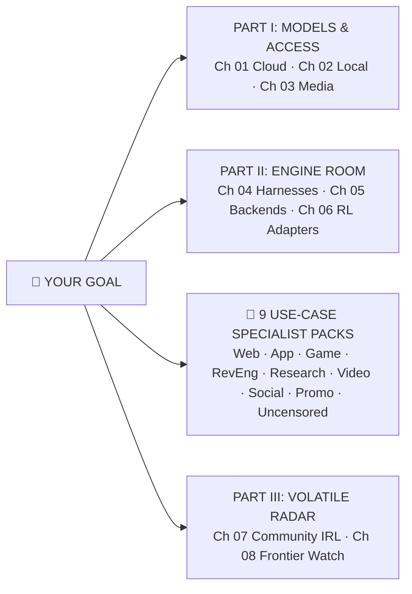

# ⚡ AI Swiss Knife — Modular Field Book (`v3.0.0-modular`)
> A pace-layered, headless-first, self-policing AI Field Book for humans and autonomous agents.

**Snapshot Date:** `2026-11-26` · **Entities:** `89` (`88` agent-eligible) · **Use-Case Packs:** `9` · **Aging/Stale/Degraded:** `0 / 0 / 0`

**Agent Manifests (Freshness-Gated):** [`llms.txt`](llms.txt) · [`llms-full.txt`](llms-full.txt) · [`dist/registry.json`](dist/registry.json)

## 🧭 The 3-Second Universal Compass



## 📖 Core Field Book Chapters

| Chapter | Part | Focus | Direct Link |
| :--- | :--- | :--- | :--- |
| **01 · Cloud APIs & Grounding** | `PART I` | Verified no-card gateways, Gemini 4 Hydrogen, System-1 Decisions & RAG | [**Open →**](book/01-cloud-apis.md) |
| **02 · Local AI (16GB+64GB)** | `PART I` | **Track A:** Mature Riced (`Qwen3.8+LoRA`) vs **Track B:** Cutting-Edge (`Inkling 2 Mini`) | [**Open →**](book/02-local-16vram-64ram.md) |
| **03 · Multimodal, 3D & Worlds** | `PART I` | Cloud-free vs local pivot for Image, Video (`WanGP`), Voice (`Drama 3`/`Phonon`) & 3D | [**Open →**](book/03-multimodal-sensory.md) |
| **04 · Harnesses & Safety** | `PART II` | `Pi` Kernel, `DeepSeek Harness (dsh)`, `Hermes Agent`, `Antigravity` & `safeagents` | [**Open →**](book/04-harnesses-protocols.md) |
| **05 · Backends & 2026 Flags** | `PART II` | `Unsloth`, `llama/ik_llama`, `WanGP v20.12`, `--n-cpu-moe` & OS/Silicon | [**Open →**](book/05-backends-flags-silicon.md) |
| **06 · Harness Adapters & RL** | `PART II` | In-Harness `AsyncGRPO`, `OpenEnv`, Rank-96 Super-Adapter & Frontier RL | [**Open →**](book/06-adaptation-rl.md) |
| **07 · Community IRL Builds** | `PART III` | Consumer 12–16GB engine hacks, `obra/superpowers`, & indie pipelines (`TTL 21d`) | [**Open →**](book/07-community-irl.md) |
| **08 · Frontier Watch** | `PART III` | `MONITOR-ONLY` apex radar (`Claude Fable/Mythos`, `GPT-6.2`, `Gemini 4 Carbon`, `Qwen4-Max`) | [**Open →**](book/08-frontier-watch.md) |
| **99 · The Graveyard** | `APPENDIX` | Machine-enforced cut list of dead cloud tiers & >80 GB local walls | [**Inspect →**](book/99-graveyard.md) |

## 🎯 Independent Use-Case Specialist Packs (`packs/*.yaml`)

| Domain Pack | Category | Live Health | Playbook |
| :--- | :--- | :--- | :--- |
| **Mobile App Development (iOS, Android & Expo)** | `engineering` | 🟢 `Fresh` | [**Open Playbook →**](book/packs/pack-app-dev.md) |
| **Game Development & Local 16GB 3D Assets** | `engineering` | 🟢 `Fresh` | [**Open Playbook →**](book/packs/pack-game-dev.md) |
| **Product Promotion, Launch Videos & Growth** | `growth` | 🟢 `Fresh` | [**Open Playbook →**](book/packs/pack-promotion.md) |
| **Deep Research & Cited Literature Synthesis** | `knowledge` | 🟢 `Fresh` | [**Open Playbook →**](book/packs/pack-research.md) |
| **Reverse Engineering & Binary Triage** | `engineering` | 🟢 `Fresh` | [**Open Playbook →**](book/packs/pack-reverse-eng.md) |
| **Social Media Automation & Audience Ops** | `growth` | 🟢 `Fresh` | [**Open Playbook →**](book/packs/pack-social-media.md) |
| **Uncensored & Operator-Aligned Local Stacks** | `specialized` | 🟢 `Fresh` | [**Open Playbook →**](book/packs/pack-uncensored.md) |
| **Video Editing, Motion Graphics & Local AI Footage** | `creative` | 🟢 `Fresh` | [**Open Playbook →**](book/packs/pack-video-edit.md) |
| **Web Development & Visual QA** | `engineering` | 🟢 `Fresh` | [**Open Playbook →**](book/packs/pack-web-dev.md) |

## 🤖 Freshness-Gated CLI
```bash
python scripts/cli.py validate                       # Zero-HTML-leak, ref integrity & Graveyard check
python scripts/cli.py query pack pack-reverse-eng    # Resolve fresh specialist stack as JSON
python scripts/cli.py query local --lifecycle mature # Mature Riced local profiles only
python scripts/cli.py build                          # Validate + compile Book, Packs & llms*.txt
```
