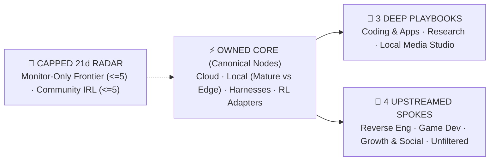

# ⚡ AI Swiss Knife (`v4.0.0-beta`)
> A lean, Hub-and-Spoke, self-policing AI Field Book with built-in live health, implicit graph state, and freshness-gated agent manifests.

**🏠 Hub** &nbsp;·&nbsp; [☁️ Cloud](book/cloud.md) &nbsp;·&nbsp; [🖥️ Local](book/local.md) &nbsp;·&nbsp; [⚙️ Harnesses & RL](book/harnesses-and-rl.md) &nbsp;·&nbsp; [📘 Playbooks](book/playbooks.md) &nbsp;·&nbsp; [🧭 Spokes](book/spokes.md) &nbsp;·&nbsp; [📡 Radar](book/radar.md) &nbsp;·&nbsp; [🪦 Graveyard](book/graveyard.md)

**Live Pulse (`2026-11-27`):** `31` Core Nodes (`31` agent-eligible) · `3` Deep Playbooks · `4` Upstreamed Spokes · Alerts: `0` Aging / `0` Stale / `0` Upstream / `0` Degraded

**Agent Surface (Freshness-Gated):** [`llms.txt`](llms.txt) · [`llms-full.txt`](llms-full.txt) · [`dist/graph.json`](dist/graph.json)

## 🖥️ Start From Your Hardware Profile
> Entry points below are data-driven (`graph/profiles.yaml`) and expandable without code changes.

| Profile | Hardware Envelope | Active Core Nodes | Jump In |
| :--- | :--- | :---: | :--- |
| **Zero-Card Cloud** (`zero-card-cloud`) | Verified $0 cloud gateways, System-1 decisions, and keyless RAG requiring no credit card. | `15` | [**Open Blueprint →**](book/cloud.md) |
| **16GB VRAM + 64GB RAM Workstation** (`16vram-64ram`) | Zone 1 pure 16GB VRAM dense brains + Zone 2 64GB DDR5 sparse MoE hybrid. | `17` | [**Open Blueprint →**](book/local.md) |
| **Apple Silicon Mac (Unified Memory / MLX)** (`mac-apple-silicon`) | Unified memory local inference via MLX and llama.cpp Metal (zero PCIe cliff). | `16` | [**Open Blueprint →**](book/local.md) |

## 🧭 Hub-and-Spoke Topology



## 🗺️ Directory Map

### Owned Core (Domain-Native Blueprints)
- **☁️ [Cloud Gateways & Grounding](book/cloud.md)** — Verified zero-card APIs, Gemini 4 Hydrogen, System-1 Decisions & RAG routing circuit.
- **🖥️ [Local AI Blueprints](book/local.md)** — Track A (*Mature Riced*) vs. Track B (*Cutting-Edge*), hot-swappable LoRAs, & System-1 `Laya 0.5`.
- **⚙️ [Harnesses, Backends & RL Lab Dossier](book/harnesses-and-rl.md)** — `Pi` Kernel, `DeepSeek Harness`, `Hermes Agent`, `safeagents`, & HF Harness Adapters lab tables.

### Horizons & Monitoring
- **📘 [3 Deep Owned Playbooks](book/playbooks.md)** — End-to-end runbooks for *Coding & Apps*, *Research & Grounding*, and *Local Media Studio*.
- **🧭 [4 Upstreamed Horizon Spokes](book/spokes.md)** — Lean, live-monitored entry points into *Reverse Engineering*, *Game Dev & 3D*, *Growth & Social*, and *Unfiltered Sovereign*.
- **📡 [Capped 21-Day Radar](book/radar.md)** — Monitor-Only Frontier Watch & Community IRL Field Log.
- **🪦 [The Graveyard](book/graveyard.md)** — CI-enforced cut list with live replacement pointers.

## 🤖 Implicit State CLI
```bash
python scripts/cli.py validate                                   # Canonical URL Law + Budgets + 4-Edge check
python scripts/cli.py resolve coding-and-apps --profile 16vram-64ram
python scripts/cli.py resolve reverse-engineering --profile 16vram-64ram
python scripts/cli.py build                                      # Compile GitHub Views, llms*.txt & graph.json
```
