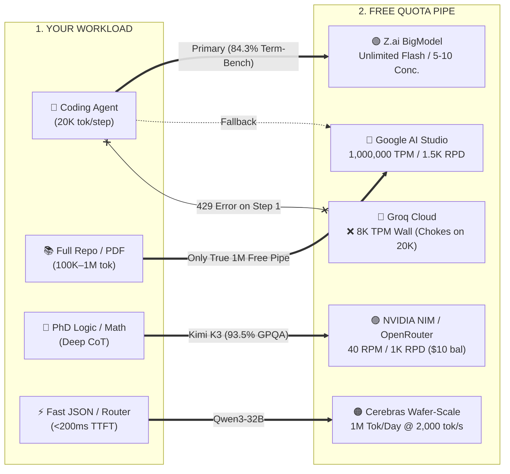
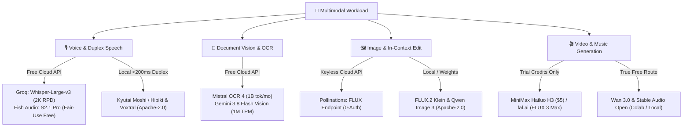

# ⚡ AI Swiss Knife (`v1.0.0`)
> A lean, benchmark-filtered, upstream-synced directory of zero-cost AI APIs, frontier open weights, and agent grounding tools.

> [!IMPORTANT]
> **Editorial Standard:** Every endpoint in this repository is verified live, requires **zero credit card** to start, and is stress-tested against real multi-step agent workloads (~20K tokens/step). Dead, bait-and-switch, or card-gated tiers are actively stripped to the [Graveyard](#-5-the-graveyard-what-we-cut--why).

---

## 🧭 1. The Routing Circuit: Where Should Your Workload Go?
*Visualizing why thin TPM pipes (like Groq's 8K cap) choke on 20K-token coding agent turns, while wide pipelines (Google 1M TPM, Z.ai Unlimited Flash, Mistral 1B/mo) sustain autonomous loops.*



<br>

## ⚡ 2. Task-Routed Intelligence Matrix (Text & Code)

| Task & Workload | Primary Winner & Proof | Free Gateway & Quota Pipe | The Catch (`Gotcha` & Privacy) |
| :--- | :--- | :--- | :--- |
| **Autonomous Coding**<br><sub>Multi-file edits, Bash, MCP loops</sub> | **`GLM-5.3-Flash`** · `MIT`<br><sub>🏆 **84.3%** Terminal-Bench 2.1</sub><br>**`DeepSeek-V4-Pro`** · `MIT`<br><sub>🏆 **80.6%** SWE-bench Verified</sub> | [**Z.ai BigModel**](https://open.bigmodel.cn/)<br><sub><kbd>No Card</kbd> Unlimited daily Flash tokens</sub><br>[**OpenRouter `:free`**](https://openrouter.ai/)<br><sub><kbd>$10 Bal</kbd> Unlocks 1,000 RPD (vs 50)</sub> | ⚠️ **Z.ai** caps at 5–10 concurrent streams.<br>🔒 **Privacy:** Standard free-tier logging; use **Unsloth Local** (`UD-Q4_K_XL`) for private repos. |
| **Massive Context (1M)**<br><sub>Whole codebase / multi-PDF ingest</sub> | **`Gemini 3.8 Flash`**<br><sub>🏆 True **1M** effective free context</sub><br>**`Llama 4 Scout`**<br><sub>🏆 High-speed long-context recall</sub> | [**Google AI Studio**](https://aistudio.google.com/)<br><sub><kbd>No Card</kbd> **1,000,000 TPM** · 1,500 RPD</sub><br>[**Cerebras Cloud**](https://cloud.cerebras.ai/)<br><sub><kbd>No Card</kbd> **1,000,000 TPD** · 30 RPM</sub> | ⚠️ **Google Pro Trap:** `Gemini Pro` is throttled to **2 RPM / 50 RPD** on free tier—always use `Flash` for agent loops.<br>🔒 **Trains on data** outside EU/UK/CH. |
| **PhD Logic & Math**<br><sub>Architecture, proofs, synthesis</sub> | **`Kimi K3`** · `Open`<br><sub>🏆 **93.5%** GPQA · **56.0%** HLE</sub><br>**`MiniMax M3`**<br><sub>🏆 **93.0%** GPQA Diamond</sub> | [**NVIDIA NIM**](https://build.nvidia.com/)<br><sub><kbd>No Card</kbd> ~40 RPM Dev Catalog</sub><br>[**Google AI Studio**](https://aistudio.google.com/)<br><sub><kbd>No Card</kbd> `Gemini 2.5 Pro` (50 RPD)</sub> | ⚠️ **NIM** is non-production prototyping only and can cold-start queue on massive MoE weights. |
| **FIM & Fast Router**<br><sub><150ms IDE tab-complete & JSON</sub> | **`Codestral`** · `80+ Lang FIM`<br><sub>🏆 Dedicated low-latency FIM endpoint</sub><br>**`Qwen3-32B` / `Gemma 4 31B`**<br><sub>🏆 **2,000+ tok/s** schema extraction</sub> | [**Mistral Plateforme**](https://console.mistral.ai/)<br><sub><kbd>No Card</kbd> **~1 Billion tok/mo** free</sub><br>[**Cerebras**](https://cloud.cerebras.ai/) & [**Groq**](https://console.groq.com/)<br><sub><kbd>No Card</kbd> 1M TPD (Cerebras) / 1K RPD (Groq)</sub> | ⚠️ **Groq 8K TPM Wall:** Never send >6K token prompts to Groq free tier.<br>🔒 **Mistral** free tier requires mandatory opt-in to model training. |
| **Edge & GUI Agents**<br><sub>On-device RAM & desktop clicking</sub> | **`Qwen3-0.6B / 4B`** · `Apache-2.0`<br><sub>🏆 30.6M+ monthly downloads</sub><br>**`UI-TARS` / `Runner H`**<br><sub>🏆 Beats frontier LLMs on OSWorld GUI</sub> | [**Unsloth Local (`UD-GGUF`)**](https://github.com/unslothai/unsloth)<br><sub><kbd>Local</kbd> `unsloth start claude|opencode`</sub> | ✅ **Zero Cloud Leak:** Calibrated `UD-Q4_K_XL` quants fix broken chat templates on Qwen3.8, GLM-5, & Gemma 4. |

<details>
<summary>🛠️ <b>Click to expand Ready-to-Use <code>.env</code> Endpoints & Autonomous Agent Foraging Commands</b></summary>
<br>

```bash
# Let the repo automatically probe your environment keys, local Unsloth server, or keyless fallbacks:
python scripts/build.py forage coding-agent
python scripts/build.py forage repo-1m

# Manual Primary (Z.ai) + Fallback (Google 1M TPM) + Emergency Keyless (Pollinations)
export OPENAI_API_BASE="https://open.bigmodel.cn/api/paas/v4/"
export OPENAI_MODEL="glm-5.3-flash"
export FALLBACK_API_BASE="https://generativelanguage.googleapis.com/v1beta/openai/"
export FALLBACK_MODEL="gemini-3.8-flash"
export KEYLESS_API_BASE="https://text.pollinations.ai/openai"
```
</details>

---

## 🎨 3. Multimodal & Sensory Stack (Cloud Free vs. Open-Weights)

> [!TIP]
> **Why Empty Space Matters Here:** Free cloud GPUs for heavy Video and Music generation rarely exist without watermarks or tiny credit caps. The matrix below explicitly maps **when to use a free cloud API** (Voice STT/TTS, OCR, Flux Images) vs. **when to pivot immediately to Apache-2.0 Open Weights** (`Wan 3.0`, `Kyutai Moshi`, `Stable Audio`) on local or free Colab/Kaggle GPUs.



<br>

| Modality & Job | Top Verified Models | Free Cloud Route & Quota | Open-Weight / Local Alternative & Gotcha |
| :--- | :--- | :--- | :--- |
| **Speech-to-Text (STT)**<br><sub>Real-time transcription & diarization</sub> | **`Whisper-Large-v3` / `Turbo`**<br><sub>🏆 Sub-second multilingual ASR</sub><br>**`Deepgram Nova-3`**<br><sub>🏆 Best streaming speaker diarization</sub> | [**Groq Cloud**](https://console.groq.com/)<br><sub><kbd>No Card</kbd> **20 RPM · 2,000 RPD** free</sub><br>[**Deepgram**](https://deepgram.com/)<br><sub><kbd>No Card</kbd> **$200** starter credit pool</sub> | ⚙️ **Local:** `faster-whisper` / `whisper.cpp`<br>⚠️ **Gotcha:** Groq enforces ~25MB audio file limits; chunk long recordings first. |
| **Voice TTS & Duplex**<br><sub>Cloning, agents, & live translation</sub> | **`Fish Audio S2.1 Pro`**<br><sub>🏆 83-language emotive prosody</sub><br>**`Mistral Voxtral` / `Sonic 4`**<br><sub>🏆 ~40ms–200ms voice agent latency</sub> | [**Fish Audio**](https://fish.audio/)<br><sub><kbd>No Card</kbd> Fair-use free API tier</sub><br>[**Mistral Plateforme**](https://console.mistral.ai/)<br><sub><kbd>No Card</kbd> Free Experiment tier quota</sub> | ⚙️ **Open Weights:** [**Kyutai `Moshi` & `Hibiki`**](https://kyutai.org/) (`Apache-2.0` full-duplex speech)<br>⚠️ **Gotcha:** ElevenLabs free tier blocks commercial API cloning. |
| **Document OCR & Vision**<br><sub>LaTeX math, multi-column PDFs, tables</sub> | **`Mistral OCR 4`**<br><sub>🏆 Beats generic VLMs on complex tables</sub><br>**`Gemini 3.8 Flash Vision`**<br><sub>🏆 1M context multi-PDF ingestion</sub> | [**Mistral Plateforme**](https://console.mistral.ai/)<br><sub><kbd>No Card</kbd> Included in ~1B tok/mo tier</sub><br>[**Google AI Studio**](https://aistudio.google.com/)<br><sub><kbd>No Card</kbd> 15 RPM · 1,500 RPD</sub> | ⚙️ **Open Weights:** `Qwen-VL` / `olmOCR` via **Unsloth Local**<br>⚠️ **Gotcha:** Redact sensitive PII before sending to free cloud OCR tiers. |
| **Image & Scene Editing**<br><sub>Photorealism, typography, in-place edit</sub> | **`FLUX.2` & `FLUX.1 Kontext`**<br><sub>🏆 In-context editing without LoRAs</sub><br>**`Qwen Image 3` / `Seedream 5`**<br><sub>🏆 Best bilingual text & layout control</sub> | [**Pollinations AI**](https://pollinations.ai/)<br><sub><kbd>Keyless</kbd> Zero-auth `Flux` REST URL</sub><br>[**HF Serverless**](https://huggingface.co/)<br><sub><kbd>No Card</kbd> Rate-limited open inference</sub> | ⚙️ **Open Weights:** **`FLUX.2 Klein`** & **`Qwen Image 3`** (`Apache-2.0`)<br>⚠️ **Gotcha:** Pollinations is a shared public pool; add retry backoff. |
| **Video & Music / SFX**<br><sub>T2V, I2V, synchronized stereo audio</sub> | **`FLUX 3 Max` & `Seedance 2.5`**<br><sub>🏆 Tied #1 Elo (~1,139); 12.4s render</sub><br>**`Hailuo H3-Max` / `Wan 3.0`**<br><sub>🏆 Native stereo audio (`H3`) · #1 Open (`Wan`)</sub> | [**MiniMax API**](https://www.minimax.io/)<br><sub><kbd>Trial</kbd> **$5** free signup credits</sub><br>**No Permanent Free Cloud Video API** | ⚙️ **Open Weights:** **`Wan 3.0`**, **`LTX 2.3`** (Video) & **`Stable Audio Open`** (SFX)<br>⚠️ **Gotcha:** Avoid fragile unofficial Suno/Udio cookie scrapers. |

<details>
<summary>🛠️ <b>Click to expand Multimodal Quick-Call Snippets (Zero-Auth FLUX Image & Groq Whisper STT)</b></summary>
<br>

```bash
# 1. Zero-Auth Keyless FLUX Image Generation (Pollinations - No API Key Needed)
curl -L "https://image.pollinations.ai/prompt/minimalist_swiss_grid_architecture_diagram?width=1024&height=1024&model=flux&nologo=true" -o diagram.jpg

# 2. Free Whisper-Large-v3 Audio Transcription (Groq Cloud - 2,000 RPD Free)
curl "https://api.groq.com/openai/v1/audio/transcriptions" \
  -H "Authorization: Bearer $GROQ_API_KEY" \
  -F "model=whisper-large-v3" \
  -F "file=@audio.mp3"
```
</details>

---

## 🔍 4. Grounding, Search, Scraping & RAG Stack (100% Card-Free)

| Grounding Role | Tool & Endpoint | Verified Free Quota | Why It Wins & Technical Gotcha |
| :--- | :--- | :--- | :--- |
| **Keyless Web Scraper**<br><sub>Clean Markdown for LLM context</sub> | [**Firecrawl (`Keyless` & API)**](https://www.firecrawl.dev/)<br><sub>🏆 Lowest token bloat in benchmarks</sub> | <kbd>Keyless</kbd> Daily per-IP free quota<br><sub>+ **500 credits** on standard signup</sub> | ✅ **7,456 median tokens/task** (vs 15K+ on raw HTML scrapers).<br>⚠️ Keyless mode is IP-rate-limited; use API key for concurrency. |
| **Zero-SDK URL / PDF Reader**<br><sub>Instant prefix conversion</sub> | [**Jina Reader (`r.jina.ai`)**](https://jina.ai/reader/)<br><sub>🏆 Zero-install URL-to-Markdown</sub> | <kbd>Keyless</kbd> Free rate-limited prefix<br><sub>+ **10,000,000 free tokens** w/ API key</sub> | ✅ Prepend `https://r.jina.ai/` to any URL or PDF link.<br>⚠️ Use `https://s.jina.ai/?q=query` for keyless web search. |
| **Neural & Deep Agent Search**<br><sub>Semantic web retrieval</sub> | [**Exa 3.0 (`Lite` / `Deep`)**](https://exa.ai/)<br><sub>🏆 Built natively for autonomous agents</sub> | <kbd>No Card</kbd> **$10/mo recurring credits**<br><sub>+ $10 bonus (~2,500 `Lite` searches/mo)</sub> | ✅ Controllable reasoning effort (`Lite` @ $4/1k vs `Deep Search`).<br>⚠️ Capped at **10 QPS** on the free tier. |
| **Pre-Chunked RAG Search**<br><sub>Factual snippet injection</sub> | [**Tavily Search API**](https://tavily.com/)<br><sub>🏆 Skips custom HTML chunking pipelines</sub> | <kbd>No Card</kbd> **1,000 credits/mo forever**<br><sub>Researcher Plan (+ Free Student Tier)</sub> | ✅ Returns scored, pre-chunked context blocks ready for prompt injection.<br>⚠️ `advanced` depth costs 2 credits/call vs 1 for `basic`. |
| **Embeddings & Reranking**<br><sub>Two-stage vector + probability filter</sub> | [**Cohere `Embed 5` & `Rerank 5`**](https://cohere.com/)<br><sub>🏆 Shared `Pro`/`Fast` embedding space</sub> | <kbd>No Card</kbd> **1,000 calls/mo** (Trial Key)<br><sub>10 Rerank/min · 20 Chat/min</sub> | ✅ Index offline w/ `Embed 5 Pro`, query w/ `Embed 5 Fast` (98.4% retention), filter via `Rerank 5` (32K ctx, JSON/YAML native). |
| **Academic & Paper Graph**<br><sub>Citations, abstracts, open PDFs</sub> | [**OpenAlex**](https://openalex.org/) + [**arXiv API**](https://arxiv.org/help/api/)<br><sub>🏆 250M+ scholarly works & citations</sub> | <kbd>Keyless</kbd> **100,000 requests/day**<br><sub>100% free forever</sub> | ✅ Pass `?mailto=you@domain.com` in OpenAlex URLs to enter the fast polite pool with zero auth keys. |

<details>
<summary>🛠️ <b>Click to expand Zero-Auth Foraging Snippets (Jina URL-to-Markdown & OpenAlex Paper Graph)</b></summary>
<br>

```bash
# 1. Convert any live webpage or PDF into clean LLM Markdown (Zero Auth, Zero SDK)
curl -s "https://r.jina.ai/https://example.com"

# 2. Query OpenAlex for latest Open-Access papers (100,000 req/day Free Polite Pool)
curl -s "https://api.openalex.org/works?search=autonomous+coding+agents&filter=is_oa:true&per-page=3&mailto=agent@localhost"
```
</details>

---

## 🪦 5. The Graveyard (What We Cut & Why)

> [!WARNING]
> Most `awesome-*` repositories rot because they never delete dead or bait-and-switch endpoints. These entries are tracked in `data/catalog.yaml` so our upstream sync linter **blocks them from ever being re-added**.

* ❌ **GitHub Models (`models.inference.ai.azure.com`):** Officially retired on July 30, 2026. Still listed in 90% of legacy free API repos, but endpoints are dead.
* ❌ **SambaNova Cloud (Legacy Free Tier):** Restricted free tier access; frontier models (`DeepSeek-V3.1`, `MiniMax-M3`, `Gemma-4-31B`) now require payment method/credits with 30-day deprecations.
* ❌ **Together AI & Fireworks AI ('Free Tiers'):** Shifted from ongoing free tiers to one-time starter credits or card-gated accounts.
* ❌ **Brave Search API (Free Tier):** Requires a credit card on file for the free tier (replaced by card-free Firecrawl Keyless, Jina, Exa 3.0, and Tavily).
* ❌ **Legacy 7B-8B Generalists & `gpt-oss-120b` for Deep Reasoning:** Outclassed on SWE-bench and GPQA Diamond (`gpt-oss` scores <15% on Humanity's Last Exam vs 55%+ for `Kimi K3` / `GLM-5.3`).

---

## 🤖 6. Dual-Interface CLI & Agent Self-Foraging (`llms.txt`)
Point any coding or research agent to [`llms.txt`](llms.txt) or run the built-in CLI:
```bash
python scripts/build.py forage coding-agent   # Auto-detects working env key, local Unsloth, or keyless fallback
python scripts/build.py sync                  # Pulls upstream GitHub commits & strips Graveyard links
python scripts/build.py lint                  # Enforces 4-column layout & relational integrity
python scripts/build.py compile               # Rebuilds README.md and llms.txt from data/catalog.yaml
python scripts/build.py all                   # Runs sync -> lint -> compile
```
