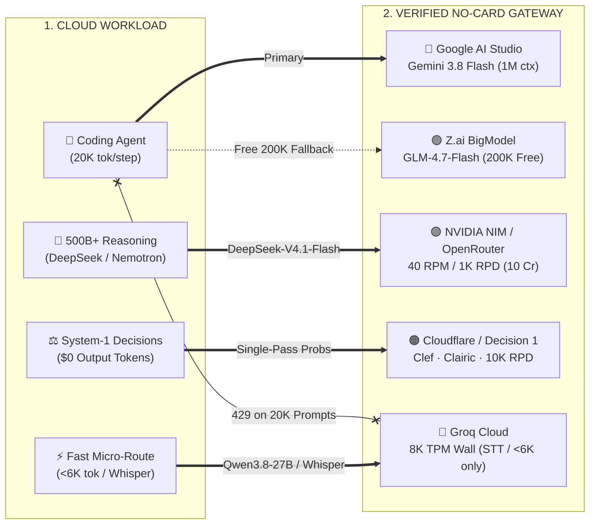

# ⚡ AI Swiss Knife (`v1.1.1`)
> A lean, benchmark-filtered, upstream-synced directory of zero-card AI APIs, System-1 decision models, and agent grounding tools.

**Dimensions:** 🌐 **Cloud APIs (`README.md`)** · 🖥️ [**Local AI: 16GB VRAM + 64GB RAM (`LOCAL_AI.md`)**](LOCAL_AI.md) · 🛠️ [**Harnesses, Backends & Flags (`ECOSYSTEM.md`)**](ECOSYSTEM.md) · 🤖 [**Agent Manifest (`llms.txt`)**](llms.txt)

> [!IMPORTANT]
> **Editorial Standard:** Every cloud endpoint below is verified live as of **Nov 2026**, requires **zero credit card** to start, and is stress-tested against real agent workloads (~20K tokens/step). Card-gated trials (`Cerebras`, `Mistral`, `Brave`) and retired endpoints (`GitHub Models`, `Gemini 2.5`) are enforced in the [Graveyard](#-5-the-graveyard-what-we-cut--why).

---

## 🧭 1. The Cloud Routing Circuit (Verified Card-Free Survivors)
*Only **6 gateways** remain genuinely card-free (`Google AI Studio`, `Z.ai BigModel`, `OpenRouter :free`, `Groq`, `NVIDIA NIM`, `Cloudflare Workers AI`).*


<br>

## ⚡ 2. Task-Routed Cloud Intelligence & Decision Matrix

| Task & Workload | Primary Winner & Proof | Free Gateway & Quota Pipe | The Catch (`Gotcha` & Privacy) |
| :--- | :--- | :--- | :--- |
| **Autonomous Coding**<br><sub>Multi-file edits, Bash, MCP loops</sub> | **`Gemini 4 Hydrogen` / `3.8 Flash`**<br><sub>🏆 Nov 2026 fast successor (Everyday & Thinking modes · 1M ctx)</sub><br>**`GLM-4.7-Flash`** · `MIT`<br><sub>🏆 **79.5** τ²-Bench · 200K ctx / 128K out</sub> | [**Google AI Studio**](https://aistudio.google.com/)<br><sub><kbd>No Card</kbd> Free per-project tier</sub><br>[**Z.ai BigModel**](https://open.bigmodel.cn/)<br><sub><kbd>No Card</kbd> Completely Free Flash tier</sub> | ⚠️ **Z.ai Fix:** Only `glm-4.7-flash` is permanently free (`glm-5.x` is billed).<br>💡 **Cheap Cloud:** `Inkling 2 Mini` on OpenRouter (`io.net`) is **$0.08/M in, $0.35/M out**. |
| **Frontier Heavyweights**<br><sub>500B+ MoEs & PhD reasoning</sub> | **`DeepSeek-V4.1-Flash`** · `552B`<br><sub>🏆 Frontier open VLM/coder (8B active)</sub><br>**`Nemotron-3.5-Super-VL`** · `120B`<br><sub>🏆 & `Inkling 2 Small` / `Kimi` via `:free`</sub> | [**NVIDIA NIM**](https://build.nvidia.com/)<br><sub><kbd>No Card</kbd> ~40 RPM Dev Catalog</sub><br>[**OpenRouter `:free`**](https://openrouter.ai/)<br><sub><kbd>10 Cr</kbd> Unlocks **1,000 RPD** (vs 50)</sub> | ⚠️ **NIM** is prototyping-only with occasional MoE cold-start queues.<br>⚠️ **OpenRouter** returns `402` even on `:free` if balance goes negative. |
| **System-1 Decision & Extract**<br><sub>Single-pass probabilities ($0 out)</sub> | **`Gemini Decision 1`**<br><sub>🏆 Up to **1,000** typed questions/pass (multimodal)</sub><br>**`Clairic` / `Clef` / `Clef-Omni`**<br><sub>🏆 Zero-output extraction, 64-step forecasts, audio/video</sub> | [**Google AI Studio**](https://aistudio.google.com/)<br><sub><kbd>No Card</kbd> **200 RPM · 50K TPM · 10K RPD**</sub><br>[**Cloudflare Workers AI**](https://developers.cloudflare.com/workers-ai/)<br><sub><kbd>No Card</kbd> **10,000 Neurons/day** free</sub> | ✅ **Zero Output Tokens Billed:** Ideal for agent safety gates, routing, and structured span extraction.<br>⚠️ Cloudflare retired legacy models Nov 20, 2026 (`HTTP 410`). |
| **Fast Micro-Routers (<6K)**<br><sub>Sub-second JSON & small prompts</sub> | **`qwen/qwen3.8-27b`**<br><sub>🏆 Verified active on Groq free LPU</sub><br>**`gpt-oss-120b` / `gpt-oss-20b`**<br><sub>🏆 Ultra-fast structured transforms</sub> | [**Groq Cloud**](https://console.groq.com/)<br><sub><kbd>No Card</kbd> **30 RPM · 1K RPD · 200K TPD**</sub><br>[**Google AI Studio**](https://aistudio.google.com/)<br><sub><kbd>No Card</kbd> `4 Hydrogen` / `3.5 Flash-Lite`</sub> | ⚠️ **Groq 8K TPM Wall:** Strictly for <6K token prompts (429s on coding agents). Llama 3.1/3.3 moved to Contact Sales. |

<details>
<summary>🛠️ <b>Click to expand Ready-to-Use <code>.env</code> Endpoints & Agent Foraging Commands</b></summary>
<br>

```bash
python scripts/build.py forage coding-agent
python scripts/build.py forage decision-gate

export OPENAI_API_BASE="https://generativelanguage.googleapis.com/v1beta/openai/"
export OPENAI_MODEL="gemini-3.8-flash"
export FALLBACK_API_BASE="https://open.bigmodel.cn/api/paas/v4/"
export FALLBACK_MODEL="glm-4.7-flash"
export KEYLESS_API_BASE="https://text.pollinations.ai/openai"
```
</details>

---

## 🎨 3. Multimodal & Sensory Stack (Cloud Free vs. Local Pivot)

| Modality & Job | Top Verified Models | Free Cloud Route & Quota | Local Pivot (`LOCAL_AI.md`) & Gotcha |
| :--- | :--- | :--- | :--- |
| **Speech-to-Text (STT)**<br><sub>Real-time transcription & diarization</sub> | **`Whisper-Large-v3` / `Turbo`**<br><sub>🏆 Sub-second multilingual ASR</sub><br>**`Deepgram Nova-3`**<br><sub>🏆 Best streaming speaker diarization</sub> | [**Groq Cloud**](https://console.groq.com/)<br><sub><kbd>No Card</kbd> **20 RPM · 2K RPD · 28.8K sec/day**</sub><br>[**Deepgram**](https://deepgram.com/)<br><sub><kbd>No Card</kbd> **$200** starter credit pool</sub> | ⚙️ **Local (`v2`):** `Qwen3-ASR (1.7B)` + `ForcedAligner-0.6B` or `Whisper-v3-Turbo`.<br>⚠️ Chunk audio files >25 MB before calling Groq. |
| **Voice TTS & Duplex**<br><sub>Cloning, acting, & live agents</sub> | **`Fish Audio S2.1 / Drama 3`**<br><sub>🏆 Multi-speaker acting & audio inpainting</sub><br>**`Kyutai Moshi` / `Phonon 31M`**<br><sub>🏆 <100ms duplex & WebGPU synthesis</sub> | [**Fish Audio**](https://fish.audio/)<br><sub><kbd>No Card</kbd> Fair-use free API tier</sub><br>[**Pollinations Audio**](https://pollinations.ai/)<br><sub><kbd>Keyless</kbd> Zero-auth sandbox TTS</sub> | ⚙️ **Local (`v2`):** `Fish Drama 3` (35B-A3B, <$500K commercial), `Ming-3.0-tts`, or `Phonon 31M` (64.5 MB, 130× RT WebGPU). |
| **Document OCR & Vision**<br><sub>LaTeX math, multi-column PDFs, tables</sub> | **`Gemini 3.8 Flash Vision`**<br><sub>🏆 1M context multi-PDF & media ingest</sub><br>**`DeepSeek-OCR 2 (3B)`**<br><sub>🏆 Human reading-order Visual Causal Flow</sub> | [**Google AI Studio**](https://aistudio.google.com/)<br><sub><kbd>No Card</kbd> Free per-project tier</sub><br>[**NVIDIA NIM**](https://build.nvidia.com/)<br><sub><kbd>No Card</kbd> `DeepSeek-V4.1-Flash` VLM</sub> | ⚙️ **Local (`v2`):** `DeepSeek-OCR 2` (<4 GB VRAM) or `olmOCR-2`.<br>⚠️ Redact PII before calling free cloud vision APIs. |
| **Image & Video Synthesis**<br><sub>Keyless images vs. local video GPUs</sub> | **`FLUX` / `Qwen-Image-2.1`**<br><sub>🏆 Native RGBA & 2048px text rendering</sub><br>**`Hailuo H3` / `Wan 2.2` / `LTX-2.5`**<br><sub>🏆 Top video + synchronized audio</sub> | [**Pollinations AI**](https://pollinations.ai/)<br><sub><kbd>Keyless</kbd> Zero-auth `Flux` REST URL</sub><br>[**MiniMax API**](https://www.minimax.io/)<br><sub><kbd>Trial</kbd> **$5** free signup credits</sub> | ⚙️ **Local (`v2`/`v3`):** No permanent free cloud video API exists—run `Wan 2.2` / `H3` / `LTX-2.5` locally via **`WanGP v20.12`** (5.9 GB Extreme Chunker). |

---

## 🔍 4. Grounding, Search, Scraping & RAG Stack (100% Card-Free)

| Grounding Role | Tool & Endpoint | Verified Free Quota | Why It Wins & Technical Gotcha |
| :--- | :--- | :--- | :--- |
| **Keyless Web Scraper**<br><sub>Clean Markdown for LLM context</sub> | [**Firecrawl (`Keyless` & API)**](https://www.firecrawl.dev/)<br><sub>🏆 Lowest token bloat (**7,456** med. tok/task)</sub> | <kbd>Keyless</kbd> Official agent onboarding skill<br><sub>+ **500 credits** on signup</sub> | ✅ Ships `agent-onboarding/SKILL.md` for zero-key foraging.<br>⚠️ Keyless mode is IP-rate-limited; pass API key for burst jobs. |
| **Zero-SDK URL / PDF Reader**<br><sub>Instant prefix conversion</sub> | [**Jina Reader (`r.jina.ai`)**](https://jina.ai/reader/)<br><sub>🏆 Zero-install URL-to-Markdown</sub> | <kbd>Keyless</kbd> Free rate-limited prefix<br><sub>+ **10,000,000 free tokens** w/ API key</sub> | ✅ Prepend `https://r.jina.ai/` to any URL/PDF or `https://s.jina.ai/?q=` for keyless search. |
| **Neural & Deep Agent Search**<br><sub>Semantic web retrieval</sub> | [**Exa 3.0 (`Lite` / `Deep`)**](https://exa.ai/)<br><sub>🏆 Built natively for autonomous agents</sub> | <kbd>No Card</kbd> **$10/mo recurring credits**<br><sub>+ $10 bonus (**10 QPS** search / **100 QPS** contents)</sub> | ✅ Resets 1st of every month (~2,500 Lite searches) + supports **50 concurrent agent runs**. |
| **Pre-Chunked RAG Search**<br><sub>Factual snippet injection</sub> | [**Tavily Search API**](https://tavily.com/)<br><sub>🏆 Skips custom HTML chunking pipelines</sub> | <kbd>No Card</kbd> **1,000 credits/mo forever**<br><sub>+ Keyless mode for Hermes Agent</sub> | ✅ Pre-scored context chunks ready for prompt injection.<br>⚠️ `advanced` depth costs 2 credits vs 1 for `basic`. |
| **Embeddings & Reranking**<br><sub>Two-stage vector + probability filter</sub> | [**Cohere `Embed 5` & `Rerank 5`**](https://cohere.com/)<br><sub>🏆 Shared `Pro`/`Fast` embedding space</sub> | <kbd>No Card</kbd> **1,000 calls/mo** (Trial Key)<br><sub>10 Rerank/min · 20 Chat/min</sub> | ✅ Index w/ `Embed 5 Pro`, query w/ `Fast` (98.4% retention), rerank via `Rerank 5` (32K ctx, JSON/YAML). |
| **Academic & Paper Graph**<br><sub>Citations, abstracts, open PDFs</sub> | [**OpenAlex**](https://openalex.org/) + [**arXiv API**](https://arxiv.org/help/api/)<br><sub>🏆 250M+ scholarly works & citations</sub> | <kbd>Keyless</kbd> **100,000 requests/day**<br><sub>100% free forever</sub> | ✅ Pass `?mailto=you@domain.com` in OpenAlex URLs to enter the fast polite pool with zero auth keys. |

---

## 🪦 5. The Graveyard (What We Cut & Why)

> [!WARNING]
> Enforced by `scripts/build.py lint` & `sync` so dead or card-gated tiers can never creep back in.

* ❌ **Cerebras Cloud (Legacy 'Free Tier'):** Confirmed Nov 18, 2026: no renewing free tier exists; the $5 / 30-day credit requires a valid payment method.
* ❌ **Mistral La Plateforme (Legacy 'Free Experiment Tier'):** Current billing docs require pay-as-you-go activation for API keys, disqualifying it from our no-card pool.
* ❌ **Gemini 2.5 Pro & 2.5 Flash:** Retiring Dec 1, 2026 (auto-routing to Gemini 3.8 Flash / 3.5 Flash-Lite). GCP $300 trials no longer cover Vertex/Gemini.
* ❌ **GitHub Models (`models.inference.ai.azure.com`):** Officially retired July 30, 2026; endpoints are dead.
* ❌ **SambaNova Cloud & Together AI ('Free Tiers'):** Restricted free access; frontier weights require payment methods or one-time starter credits.
* ❌ **Brave Search API (Free Tier):** Requires a credit card on file (replaced by Firecrawl Keyless, Jina, Exa 3.0, and Tavily).

---

## 🤖 6. Unified CLI & Dual-Interface Agent Foraging
```bash
python scripts/build.py forage coding-agent             # Cloud/local/keyless auto-foraging
python scripts/build.py forage inkling-coding --local   # Local 16GB+64GB launch command
python scripts/build.py all                             # Sync -> Lint (v1+v2+v3) -> Compile all 5 views
```
