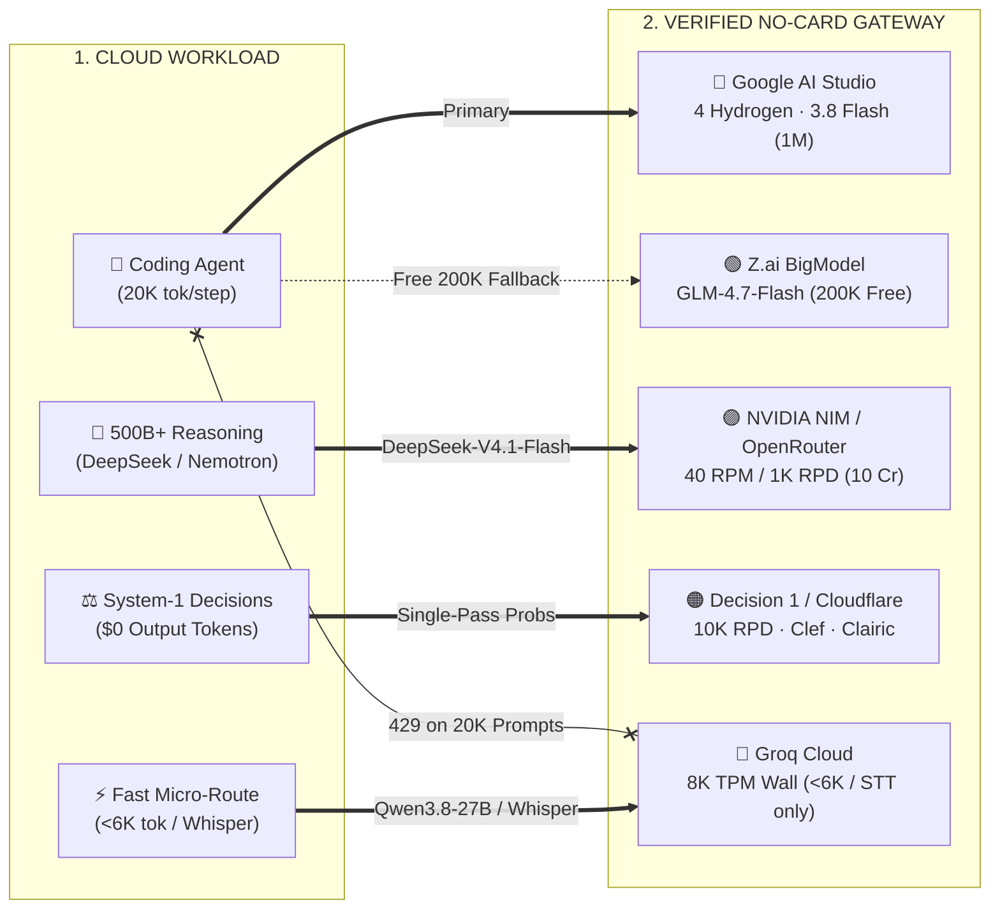

← [🏠 Field Book Cover](../README.md) &nbsp;|&nbsp; [🏠 Cover](../README.md) &nbsp;|&nbsp; [Ch 02: Local Models](02-local-16vram-64ram.md) →

# Chapter 01 · Zero-Card Cloud APIs, Decisions & Grounding

> [!IMPORTANT]
> **Verdict:** Only 6 cloud gateways remain genuinely card-free as of Nov 2026—pair Google AI Studio (Gemini 4 Hydrogen / 3.8 Flash) and Z.ai (GLM-4.7-Flash) for agent loops, Cloudflare/Google for $0-output System-1 decisions, and keyless Jina/Firecrawl/Exa for RAG.
> **Read this chapter if:** You need verified $0 cloud LLM, System-1 decision, or web-grounding endpoints without attaching a credit card.



<br>

## 1. Task-Routed Cloud Intelligence & Decision Matrix

| Task & Workload | Primary Winner & Proof | Free Gateway & Quota Pipe | The Catch (`Gotcha` & Privacy) |
| :--- | :--- | :--- | :--- |
| **Autonomous Coding & Everyday**<br><sub>Multi-file edits, Bash, MCP loops</sub> | **`Gemini 4 Hydrogen` / `3.8 Flash`**<br><sub>🏆 Nov 2026 fast successor (Everyday & Thinking · 1M ctx)</sub><br>**`GLM-4.7-Flash`** · `MIT`<br><sub>🏆 **79.5** τ²-Bench · 200K ctx / 128K out</sub> | [**Google AI Studio**](https://aistudio.google.com/)<br><sub><kbd>No Card</kbd> Free per-project + App Free/Plus/Pro/Ultra</sub><br>[**Z.ai BigModel**](https://open.bigmodel.cn/)<br><sub><kbd>No Card</kbd> Completely Free Flash tier</sub> | ⚠️ **Z.ai Fix:** Only `glm-4.7-flash` is permanently free (`glm-5.x` is billed).<br>💡 **Cheap Cloud:** `Inkling 2 Mini` on OpenRouter (`io.net`) is **$0.08/M in, $0.35/M out**. |
| **Frontier Heavyweights (500B+)**<br><sub>MoE VLM & PhD reasoning</sub> | **`DeepSeek-V4.1-Flash`** · `552B`<br><sub>🏆 Frontier open VLM/coder (8B active)</sub><br>**`Nemotron-3.5-Super-VL`** · `120B`<br><sub>🏆 & `Inkling 2 Small` / `Kimi` via `:free`</sub> | [**NVIDIA NIM**](https://build.nvidia.com/)<br><sub><kbd>No Card</kbd> ~40 RPM Dev Catalog</sub><br>[**OpenRouter `:free`**](https://openrouter.ai/)<br><sub><kbd>10 Cr</kbd> Unlocks **1,000 RPD** (vs 50)</sub> | ⚠️ **NIM** is prototyping-only with occasional MoE cold-start queues.<br>⚠️ **OpenRouter** returns `402` even on `:free` if balance goes negative. |
| **System-1 Decision & Extract**<br><sub>Single-pass probabilities ($0 out)</sub> | **`Gemini Decision 1`**<br><sub>🏆 Up to **1,000** typed questions/pass (multimodal)</sub><br>**`Clairic` / `Clef` / `Clef-Omni`**<br><sub>🏆 Zero-output extraction, 64-step forecasts, audio/video</sub> | [**Google AI Studio**](https://aistudio.google.com/)<br><sub><kbd>No Card</kbd> **200 RPM · 50K TPM · 10K RPD**</sub><br>[**Cloudflare Workers AI**](https://developers.cloudflare.com/workers-ai/)<br><sub><kbd>No Card</kbd> **10,000 Neurons/day** free</sub> | ✅ **Zero Output Tokens Billed:** Ideal for agent safety gates, routing, and structured span extraction.<br>⚠️ Cloudflare retired legacy models Nov 20, 2026 (`HTTP 410`). |
| **Fast Micro-Routers (<6K)**<br><sub>Sub-second JSON & small prompts</sub> | **`qwen/qwen3.8-27b`**<br><sub>🏆 Verified active on Groq free LPU</sub><br>**`gpt-oss-120b` / `gpt-oss-20b`**<br><sub>🏆 Ultra-fast structured transforms</sub> | [**Groq Cloud**](https://console.groq.com/)<br><sub><kbd>No Card</kbd> **30 RPM · 1K RPD · 200K TPD**</sub><br>[**Google AI Studio**](https://aistudio.google.com/)<br><sub><kbd>No Card</kbd> `4 Hydrogen` / `3.5 Flash-Lite`</sub> | ⚠️ **Groq 8K TPM Wall:** Strictly for <6K token prompts (429s on coding agents). Llama 3.1/3.3 moved to Contact Sales. |

## 2. Grounding, Search, Scraping & RAG Stack (100% Card-Free)

| Grounding Role | Tool & Endpoint | Verified Free Quota | Why It Wins & Technical Gotcha |
| :--- | :--- | :--- | :--- |
| **Keyless Web Scraper**<br><sub>Clean Markdown for LLM context</sub> | [**Firecrawl (`Keyless` & API)**](https://www.firecrawl.dev/)<br><sub>🏆 Lowest token bloat (**7,456** med. tok/task)</sub> | <kbd>Keyless</kbd> Official agent onboarding skill<br><sub>+ **500 credits** on signup</sub> | ✅ Ships `agent-onboarding/SKILL.md` for zero-key foraging.<br>⚠️ Keyless mode is IP-rate-limited; pass API key for burst jobs. |
| **Zero-SDK URL / PDF Reader**<br><sub>Instant prefix conversion</sub> | [**Jina Reader (`r.jina.ai`)**](https://jina.ai/reader/)<br><sub>🏆 Zero-install URL-to-Markdown</sub> | <kbd>Keyless</kbd> Free rate-limited prefix<br><sub>+ **10,000,000 free tokens** w/ API key</sub> | ✅ Prepend `https://r.jina.ai/` to any URL/PDF or `https://s.jina.ai/?q=` for keyless search. |
| **Neural & Deep Agent Search**<br><sub>Semantic web retrieval</sub> | [**Exa 3.0 (`Lite` / `Deep`)**](https://exa.ai/)<br><sub>🏆 Built natively for autonomous agents</sub> | <kbd>No Card</kbd> **$10/mo recurring credits**<br><sub>+ $10 bonus (**10 QPS** search / **100 QPS** contents)</sub> | ✅ Resets 1st of every month (~2,500 Lite searches) + supports **50 concurrent agent runs**. |
| **Pre-Chunked RAG Search**<br><sub>Factual snippet injection</sub> | [**Tavily Search API**](https://tavily.com/)<br><sub>🏆 Skips custom HTML chunking pipelines</sub> | <kbd>No Card</kbd> **1,000 credits/mo forever**<br><sub>+ Keyless mode for Hermes Agent</sub> | ✅ Pre-scored context chunks ready for prompt injection.<br>⚠️ `advanced` depth costs 2 credits vs 1 for `basic`. |
| **Embeddings & Reranking**<br><sub>Two-stage vector + probability filter</sub> | [**Cohere `Embed 5` & `Rerank 5`**](https://cohere.com/)<br><sub>🏆 Shared `Pro`/`Fast` embedding space</sub> | <kbd>No Card</kbd> **1,000 calls/mo** (Trial Key)<br><sub>10 Rerank/min · 20 Chat/min</sub> | ✅ Index w/ `Embed 5 Pro`, query w/ `Fast` (98.4% retention), rerank via `Rerank 5` (32K ctx, JSON/YAML). |
| **Academic & Paper Graph**<br><sub>Citations, abstracts, open PDFs</sub> | [**OpenAlex**](https://openalex.org/) + [**arXiv API**](https://arxiv.org/help/api/)<br><sub>🏆 250M+ scholarly works & citations</sub> | <kbd>Keyless</kbd> **100,000 requests/day**<br><sub>100% free forever</sub> | ✅ Pass `?mailto=you@domain.com` in OpenAlex URLs to enter the fast polite pool with zero auth keys. |

<details>
<summary>🛠️ <b>Click to expand Cloud Foraging & Keyless Grounding Snippets</b></summary>
<br>

```bash
# Auto-detect active cloud keys, local server, or keyless Pollinations fallback
python scripts/build.py forage coding-agent
python scripts/build.py forage decision-gate

# Keyless URL-to-Markdown (Jina) & OpenAlex Polite Pool (100K/day Free)
curl -s "https://r.jina.ai/https://example.com" | head -n 30
curl -s "https://api.openalex.org/works?search=harness+adapters+rl&filter=is_oa:true&per-page=3&mailto=agent@localhost"
```
</details>

---

← [🏠 Field Book Cover](../README.md) &nbsp;|&nbsp; [🏠 Cover](../README.md) &nbsp;|&nbsp; [Ch 02: Local Models](02-local-16vram-64ram.md) →
