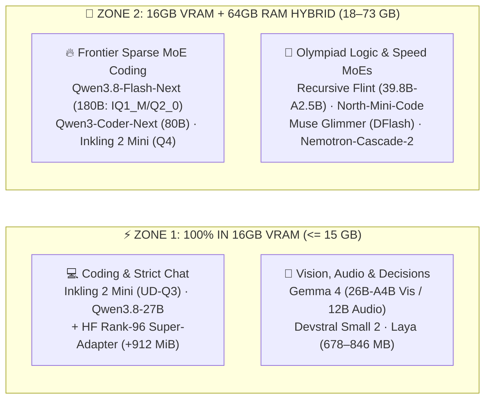

← [Ch 01: Cloud APIs](01-cloud-apis.md) &nbsp;|&nbsp; [🏠 Cover](../README.md) &nbsp;|&nbsp; [Ch 03: Multimodal](03-multimodal-sensory.md) →

# Chapter 02 · Local AI Models (16GB VRAM + 64GB RAM)

> [!IMPORTANT]
> **Verdict:** Never spill dense >16GB models into system RAM (the PCIe cliff). Keep dense 24B–27B brains + Harness Adapters 100% inside 16GB VRAM (Zone 1), and exploit your 64GB DDR5 RAM exclusively for sparse MoEs activating 2.5B–6B parameters per token (Zone 2).
> **Read this chapter if:** You are selecting local LLMs, coding adapters, or System-1 decision models for a 16GB GPU + 64GB RAM workstation (or Apple Silicon Mac).



<br>

## 1. Local Text, Coding & Reasoning Roster (Zone 1 & Zone 2)

| Role & Memory Zone | Verified Local Models | Origin, License & Footprint | Benchmark Proof & Hardware Gotcha |
| :--- | :--- | :--- | :--- |
| **Looped MoE Coding Star**<br><sub>Zone 1 (`Q3`) & Zone 2 (`Q4`/`Q8`)</sub> | **`Inkling 2 Mini`**<br><sub>**26.4B** total / **3.4B** base (**5.4B** eff.) · **1M ctx**</sub><br><sub>24 layers (middle 12 looped 3×) + `DSpark` drafter</sub> | `US` · `Apache-2.0` + AUP<br><sub><kbd>7.76–22.87 GB</kbd> GGUF (`UD-Q4_K_XL` **17.6 GB** + `639 MB` vision)</sub> | 🏆 **79.2%** SWE-bench Verified, **77.9%** SWE-Pro v2 Hard, **0.703** IPW (*lab-reported*; 20.1 AA Index).<br>⚠️ Trails `Qwen3.8-27B` on strict chat (`50%` MultiChallenge, `-8.6` AA-Omniscience); requires Unsloth runtime + `--spec-draft-n-max 2`. |
| **Pure 16GB VRAM Kings**<br><sub>Zone 1 · <= 15 GB Footprint</sub> | **`Qwen3.8-27B`** · `Dense Vision+Text`<br><sub>Beats Flint on Terminal-Bench (**73.0**) & SWE-Pro (**94.9**)</sub><br>**`Gemma 4 (26B-A4B)`** · `Text+Vision Only`<br><sub>**3.8B active** · ~140 tok/s in 16GB VRAM</sub> | `CN` · `Apache-2.0`<br>`US` · `Apache-2.0`<br><sub><kbd>13–15 GB</kbd> (`IQ4_XS` / `UD-IQ3_S`)</sub> | ✅ **`Qwen3.8-27B`** is #1 for strict instruction-following & dense coding.<br>⚠️ **Gemma 4 Audio Trap:** Only `E2B`/`E4B`/`12B` process audio—`26B-A4B` is **Text + Vision only**. |
| **Harness-Adapted 27B LoRAs**<br><sub>Zone 1 · +304–912 MiB over Base</sub> | **`Qwen3.8-27B-super-adapter`** (`rank-96`)<br><sub>Merged `pi` + `Hermes` + `OpenCode` LoRA (wt ½)</sub><br>**`Qwen3.8-27B-{pi|hermes|opencode}-adapted`** | `HF` · `Apache-2.0`<br><sub><kbd>+304–912 MiB</kbd> GGUF (`--lora`) or `MLX-6bit` (Mac)</sub> | 🏆 **Thinking On:** **55.5%→63.5%** mean pass@1 (**31–48%** fewer tool calls). **Thinking Off (`pi`):** **39.2%→64.7%** SWE-Pro hard-51 (**56–72%** fewer calls).<br>⚠️ Pick specialist w/ thinking off, super-adapter w/ thinking on; mild pre-tool reasoning leakage (`arXiv:2610.14270`). |
| **Rescued 180B Frontier Flash**<br><sub>Zone 2 Ceiling · 66–73 GB Total</sub> | **`Qwen3.8-Flash-Next`**<br><sub>**180B** (125B MoE + 51B N-gram + 4B MTP) / **6B active**</sub><br><sub>Unsloth Dynamic v3.1 (`UD-IQ1_S` / `IQ1_M` / `Q2_0`)</sub> | `CN` · `qwen-community-1.0`<br><sub><kbd>66.4–70.5 GB</kbd> + **1.9–2.8 GB** MTP (9–13 GB OS margin)</sub> | 🏆 **91.9** DeepSWE 1.1; 51B N-gram prefetches asynchronously from 64GB DDR5 at near-GPU speed.<br>⚠️ **Hard Cap:** Never load `UD-Q2_K_XL` (79.6 GB) on 16+64 GB—leaves 0 GB for OS/KV cache. |
| **Hybrid Agentic Coders**<br><sub>Zone 2 · 19–49 GB Sparse MoE</sub> | **`Qwen3-Coder-Next (80B-A3B)`** (~49 GB)<br>**`Recursive Flint (39.8B-A2.5B)`** (~25 GB)<br>**`North-Mini-Code-1.0 (30B-A3B)`** (~19 GB) | `CN/US/CA` · `Apache-2.0`<br><sub><kbd>19–49 GB</kbd> (`UD-Q4_K_XL`) · 2.5B–3B active</sub> | 🏆 `80B-A3B`: 512-expert workhorse; `North-Mini-Code`: multi-harness specialist.<br>⚠️ `Flint` scores (**89.7%** SWE-Pro v2) are *vendor-reported* and trail `Qwen3.8-27B` on Unsloth evals. |
| **Olympiad Logic, Agents & Speed**<br><sub>Zone 1 & 2 · 4–24 GB</sub> | **`Nemotron-Cascade-2 (30B-A3B)`** (90.9% AIME)<br>**`Meta Muse Glimmer (30B + DFlash)`** (~20 GB)<br>**`Nemotron-3.5-Bolt (74B-A9B)`** (24 GB 2-bit QAT)<br>**`DiffusionGemma (26B-A4B)`** & **`Devstral Small 2`** | `US/EU` · `Apache-2.0` / `OpenMDW`<br><sub><kbd>15–24 GB</kbd> · `DFlash` 16-tok drafter</sub> | 🏆 `Muse Glimmer` (**94.7%** AIME, **65.9%** OSWorld) drafts 16 tokens/pass; `DiffusionGemma` denoises 256-tok blocks in parallel. |

## 2. System-1 Local Decision Models (Non-Autoregressive)

| Role & Job | Verified Local Models | Memory & Latency | Wiring & Calibration Gotcha |
| :--- | :--- | :--- | :--- |
| **Zero-Token Agent Gates**<br><sub>Tool safety, trace audit, memory</sub> | **`Laya`** (`convaiinnovations/laya`)<br><sub>• `laya-typed-decisions` (**846 MB**)<br>• `laya-multilingual` (**678 MB**, 100+ langs)</sub> | <kbd>678–846 MB</kbd> (CPU/NPU/WebGPU)<br><sub>⚡ **<100–500ms** · 64 questions/pass</sub> | 🔌 Serve via **Unsloth Decision API** (`localhost:8888`, `typesafe-sdk`) or `laya.cpp`.<br>⚠️ Threshold on `probabilities` (not `confidence`); review borderline *superseded vs contradicted* cases. |
| **Custom 16K Clef-Head**<br><sub>Domain-tuned local classifier</sub> | **`Qwen3.5-4B` / `Qwen3.8` / `Gemma 4`**<br><sub>+ `Clef Head` via `Unsloth DecisionTrainer`</sub> | <kbd>3–15 GB VRAM</kbd><br><sub>⚡ Single pass up to **16,384 tok**</sub> | 🏆 1-epoch 4-bit LoRA (`r=16`/`64`) lifts routing accuracy from ~35% zero-shot to **78%–81%** with zero output tokens generated. |

<details>
<summary>🛠️ <b>Click to expand Local 16GB+64GB Launch Profiles (`forage --local`)</b></summary>
<br>

```bash
# Print any pre-tuned launch command directly from the catalog:
python scripts/build.py forage inkling-coding --local
python scripts/build.py forage qwen-27b-super-adapter --local
python scripts/build.py forage qwen-27b-pi-specialist --local
python scripts/build.py forage qwen-flash-180b --local
python scripts/build.py forage laya-decision --local
```
</details>

---

← [Ch 01: Cloud APIs](01-cloud-apis.md) &nbsp;|&nbsp; [🏠 Cover](../README.md) &nbsp;|&nbsp; [Ch 03: Multimodal](03-multimodal-sensory.md) →
