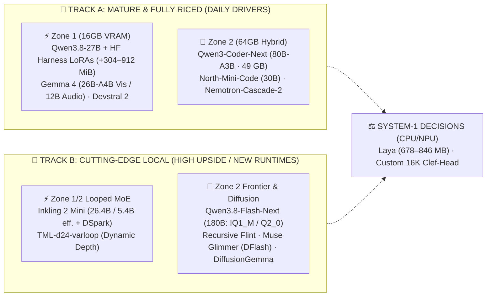

← [Ch 01: Cloud APIs](01-cloud-apis.md) &nbsp;|&nbsp; [🏠 Cover](../README.md) &nbsp;|&nbsp; [Ch 03: Multimodal](03-multimodal-sensory.md) →

# Chapter 02 · Local AI Models (16GB VRAM + 64GB RAM)

> [!IMPORTANT]
> **Verdict:** Separate your local stack into two tracks: Mature & Fully Riced daily drivers (Qwen3.8-27B + Harness Adapters, Qwen3-Coder-Next, Gemma 4) vs. Cutting-Edge experimental architectures (Inkling 2 Mini looped MoE, varloop, DiffusionGemma, Muse Glimmer) that require newer runtimes and stricter turn caps.
> **Read this chapter if:** You are selecting local LLMs, harness LoRA adapters, or System-1 decision models for a 16GB GPU + 64GB RAM workstation (or Apple Silicon Mac).



<br>

## 1. Track A · Mature & Fully Riced (Battle-Tested Daily Drivers)

| Role & Memory Zone | Verified Mature Stack | Origin, License & Footprint | Benchmark Proof & Tuning Gotcha |
| :--- | :--- | :--- | :--- |
| **Riced 27B + Harness LoRAs**<br><sub>Zone 1 · 100% in 16GB VRAM</sub> | **`Qwen3.8-27B`** (Base Vision+Text)<br>+ **`Qwen3.8-27B-{pi|hermes|opencode}-adapted`**<br>+ **`Qwen3.8-27B-super-adapter`** (`rank-96`) | `CN/HF` · `Apache-2.0`<br><sub><kbd>14–15 GB</kbd> (`IQ4_XS`) + <kbd>304–912 MiB</kbd> LoRA (`--lora`) or Mac `MLX-6bit`</sub> | 🏆 **Thinking Off (`pi`):** **39.2%→64.7%** SWE-Pro hard-51 (**56–72%** fewer tool calls). **Thinking On (`super`):** **55.5%→63.5%** mean pass@1.<br>⚠️ Adapters were RL-trained on BF16; verify quant fidelity (`Q8_0`/`IQ4_XS`) and expect mild pre-tool reasoning leakage (`arXiv:2610.14270`). |
| **Mature Hybrid MoE Coders**<br><sub>Zone 2 · 19–49 GB Sparse MoE</sub> | **`Qwen3-Coder-Next (80B-A3B)`** (~49 GB)<br>**`North-Mini-Code-1.0 (30B-A3B)`** (~19 GB)<br>**`Nemotron-Cascade-2 (30B-A3B)`** (90.9% AIME) | `CN/CA/US` · `Apache-2.0` / `NVIDIA Open`<br><sub><kbd>19–49 GB</kbd> (`UD-Q4_K_XL`) · 3B active</sub> | 🏆 Standard `llama.cpp` / `ik_llama.cpp` support with predictable `--n-cpu-moe` sweeps and zero custom kernel breakage.<br>⚠️ Always keep `-ngl 99` so Attention + KV stay on GPU. |
| **Fast General, Vision & Audio**<br><sub>Zone 1 · 8–15 GB VRAM</sub> | **`Gemma 4 (26B-A4B)`** · `Text+Vision Only`<br><sub>**3.8B active** · ~140 tok/s in 16GB VRAM</sub><br>**`Gemma 4 (12B)`** (Audio+Vis) · **`Devstral Small 2`** | `US/EU` · `Apache-2.0`<br><sub><kbd>8–15 GB</kbd> (`Q4_K_M` / `IQ4_XS`)</sub> | ✅ Zero-drama daily generalists across `llama.cpp`, `vLLM`, and `MLX`.<br>⚠️ **Gemma 4 Audio Trap:** Only `E2B`/`E4B`/`12B` process audio—`26B-A4B` is **Text + Vision only**. |

## 2. Track B · Cutting-Edge Local (Experimental Architectures & High Upside)

| Experimental Frontier | Cutting-Edge Local Models | Origin, License & Footprint | Why Watch / Test + Early-Adopter Gotcha |
| :--- | :--- | :--- | :--- |
| **Looped Transformer MoEs**<br><sub>Zone 1 (`Q3`) & Zone 2 (`Q4`/`NVFP4`)</sub> | **`Inkling 2 Mini`** (**26.4B** / **3.4B** base / **5.4B** eff.)<br><sub>Middle 12 layers looped 3× + `DSpark` drafter · 1M ctx</sub><br>**`TML-d24-varloop-research`** (variable loops) | `US` · `Apache-2.0` + AUP<br><sub><kbd>7.76–22.87 GB</kbd> (`UD-Q4_K_XL` **17.6 GB** + `639 MB` vision)</sub> | 🏆 **79.2%** SWE-bench Verified, **48.2%** DeepSWE v1.1, **0.703** IPW (*lab-reported*). Runs up to **60 tok/s** on 16GB RTX 5060 Ti via `Basalt`.<br>⚠️ Needs Unsloth/Basalt runtime; can loop while debugging (cap turns/tokens); weaker factual recall & non-English; sandbox file ops. |
| **180B N-Gram Prefetch Ceiling**<br><sub>Zone 2 Ceiling · 66–73 GB Total</sub> | **`Qwen3.8-Flash-Next`**<br><sub>**180B** (125B MoE + 51B N-gram + 4B MTP) / **6B active**</sub><br><sub>Unsloth Dynamic v3.1 (`UD-IQ1_S` / `IQ1_M` / `Q2_0`)</sub> | `CN` · `qwen-community-1.0`<br><sub><kbd>66.4–70.5 GB</kbd> + **1.9–2.8 GB** MTP (9–13 GB OS margin)</sub> | 🏆 **91.9** DeepSWE 1.1; 51B N-gram table prefetches asynchronously from 64GB DDR5 at near-GPU speed.<br>⚠️ **Hard Cap:** Never load `UD-Q2_K_XL` (79.6 GB) on 16+64 GB—leaves 0 GB for OS/KV. |
| **Block-Diffusion & Native 2-Bit**<br><sub>Zone 2 · 18–25 GB</sub> | **`Meta Muse Glimmer (30B + DFlash)`** (~20 GB)<br>**`DiffusionGemma (26B-A4B)`** (256-tok parallel)<br>**`Recursive Flint (39.8B-A2.5B)`** · **`Nemotron Bolt 74B`** | `US` · `Apache-2.0` / `OpenMDW`<br><sub><kbd>18–25 GB</kbd> (`DFlash` 16-tok drafter / 2-bit QAT)</sub> | 🏆 `Muse Glimmer` (**94.7%** AIME) drafts 16 tokens/pass; `DiffusionGemma` denoises parallel blocks.<br>⚠️ `Flint` scores (**89.7%** SWE-Pro v2) are *vendor-reported* and trail `Qwen3.8-27B` on Unsloth evals. |

## 3. System-1 Local Decision Models (Non-Autoregressive)

| Role & Job | Verified Local Models | Memory & Latency | Wiring & Calibration Gotcha |
| :--- | :--- | :--- | :--- |
| **Zero-Token Agent Gates**<br><sub>Tool safety, trace audit, memory</sub> | **`Laya`** (`convaiinnovations/laya`)<br><sub>• `laya-typed-decisions` (**846 MB**)<br>• `laya-multilingual` (**678 MB**, 100+ langs)</sub> | <kbd>678–846 MB</kbd> (CPU/NPU/WebGPU)<br><sub>⚡ **<100–500ms** · 64 questions/pass</sub> | 🔌 Serve via **Unsloth Decision API** (`localhost:8888`, `typesafe-sdk`) or `laya.cpp`.<br>⚠️ Threshold on `probabilities` (not `confidence`); review borderline *superseded vs contradicted* cases. |
| **Custom 16K Clef-Head**<br><sub>Domain-tuned local classifier</sub> | **`Qwen3.5-4B` / `Qwen3.8` / `Gemma 4`**<br><sub>+ `Clef Head` via `Unsloth DecisionTrainer`</sub> | <kbd>3–15 GB VRAM</kbd><br><sub>⚡ Single pass up to **16,384 tok**</sub> | 🏆 1-epoch 4-bit LoRA (`r=16`/`64`) lifts routing accuracy from ~35% zero-shot to **78%–81%** with zero output tokens generated. |

<details>
<summary>🛠️ <b>Click to expand Local Foraging Commands (Mature Riced vs. Cutting-Edge)</b></summary>
<br>

```bash
# Track A: Mature & Fully Riced Daily Drivers
python scripts/build.py forage qwen-27b-super-adapter --local
python scripts/build.py forage qwen-27b-pi-specialist --local
python scripts/build.py forage qwen-coder-80b --local
python scripts/build.py forage laya-decision --local

# Track B: Cutting-Edge Local Experiments
python scripts/build.py forage inkling-coding --local
python scripts/build.py forage qwen-flash-180b --local
```
</details>

---

← [Ch 01: Cloud APIs](01-cloud-apis.md) &nbsp;|&nbsp; [🏠 Cover](../README.md) &nbsp;|&nbsp; [Ch 03: Multimodal](03-multimodal-sensory.md) →
