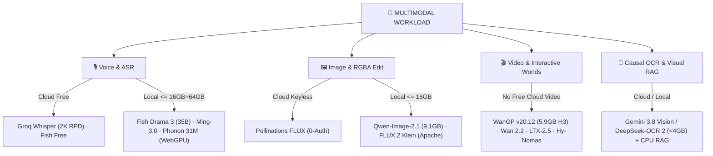

← [Ch 02: Local Models](02-local-16vram-64ram.md) &nbsp;|&nbsp; [🏠 Cover](../README.md) &nbsp;|&nbsp; [Ch 04: Harnesses](04-harnesses-protocols.md) →

# Chapter 03 · Multimodal, Voice, Video & World Models

> [!IMPORTANT]
> **Verdict:** Use zero-card cloud APIs for fast audio STT (Groq Whisper), multi-PDF vision (Gemini 3.8 Flash), and keyless FLUX drafts— but pivot immediately to local open weights for RGBA editing, directed multi-speaker TTS, interactive world models, and 1080p video.
> **Read this chapter if:** You need to decide when to call a free cloud sensory endpoint vs. running local media models inside 16GB VRAM + 64GB RAM.



<br>

## 1. Unified Cloud-Free vs. Local Pivot Matrix

| Modality & Job | Top Verified Models | Free Cloud vs. Local Footprint | Why It Wins & License / Hardware Gotcha |
| :--- | :--- | :--- | :--- |
| **Image Gen & Native RGBA**<br><sub>2048px typography & 10-ref lock</sub> | **`Qwen-Image-2.1` (7B DiT)**<br><sub>#1 VDEBench · Native RGBA layers</sub><br>**`FLUX.2 Klein`** · **`FLUX.1 Kontext`**<br>**`SenseNova-U1.5 (8B)`** (4K infographics) | ☁️ [**Pollinations**](https://pollinations.ai/) (<kbd>Keyless</kbd> FLUX)<br>🖥️ <kbd>8–14 GB VRAM</kbd> (`2.1` = **9.1 GB** Q4) | ✅ Separate `Qwen-Image-2.1` (7B, fits 16GB easily) from `nvidia/Qwen-Image-Flash` (20.4B DiT, needs RAM offload).<br>⚠️ `2.1` is `Qwen Research` (non-commercial); use **`FLUX.2 Klein` (`Apache-2.0`)** commercially. |
| **Video + Audio & World Models**<br><sub>1080p video & WASD walkable worlds</sub> | **`Wan 2.2 (5B & A14B)`** · `Apache-2.0`<br>**`LTX-2.5 (22B Video+Audio)`** · `Kandinsky 6.0 Lite`<br>**`Tencent Hy-Nomas`** (Interactive World Model) | ☁️ **No Permanent Free Cloud Video**<br><sub>(MiniMax $5 trial only)</sub><br>🖥️ <kbd>5.9–15 GB VRAM</kbd> + 64GB RAM swap | 🏆 **`WanGP v20.12`** Extreme Chunker runs 15s 1080p `Hailuo H3` in **5.9 GB VRAM**.<br>🏆 **`Hy-Nomas`** generates WASD-walkable worlds on 1 GPU (pair w/ `LTX-2.5` for audio). |
| **Directed Voice, TTS & Duplex**<br><sub>16-speaker acting & 4.9ms WebGPU</sub> | **`Fish Audio Drama 3 (35B-A3B)`** (1245 Elo)<br>**`Ming-3.0-tts`** & **`ZONOS3 Mini`** (43 langs)<br>**`Phonon 31M`** (64.5 MB) · **`Kyutai Moshi`** | ☁️ [**Fish Audio**](https://fish.audio/) (<kbd>No Card</kbd> Fair-Use)<br>🖥️ <kbd>0.06–20 GB</kbd> (`Drama 3` in Zone 2) | 🏆 **`Phonon 31M`** (`Apache-2.0`, English-only; `40M` is `CC BY-NC`) runs in browser WebGPU at **115×–130× RT (4.9ms)**.<br>🏆 **`Drama 3`** (`Fish Community <$500K`) supports 16 speakers + word inpainting via `SGLang-Omni`. |
| **Speech-to-Text & Alignment**<br><sub>Real-time ASR + word timestamps</sub> | **`Whisper-Large-v3-Turbo`** (`MIT`)<br>**`Qwen3-ASR (1.7B)` + `ForcedAligner-0.6B`**<br>**`Deepgram Nova-3`** (Streaming) | ☁️ [**Groq**](https://console.groq.com/) (**2K RPD / 28.8K s/day**)<br>🖥️ <kbd>2–3 GB VRAM</kbd> (10× real-time) | 🏆 `Qwen3-ASR` + `ForcedAligner` delivers single-pass word timestamps locally.<br>⚠️ Chunk audio files >25 MB before calling Groq. |
| **Causal OCR, GUI & Visual RAG**<br><sub>PDF reading order & zero-VRAM RAG</sub> | **OCR:** **`DeepSeek-OCR 2 (3B)`** · `olmOCR-2`<br>**GUI:** **`UI-TARS (7B)`** · `North Micro Vision`<br>**RAG:** **`EmbeddingGemma 2`** · **`Qwen3-VL-Embed`** | ☁️ **Gemini 3.8 Vision** / **NIM VLM**<br>🖥️ <kbd>1.5–10 GB</kbd> (Run RAG on CPU RAM) | ✅ `DeepSeek-OCR 2` uses Visual Causal Flow for multi-column tables (<4 GB VRAM). Pin `EmbeddingGemma 2` in 64GB RAM so RAG uses **0 MB VRAM**. |

<details>
<summary>🛠️ <b>Click to expand Zero-Auth Image & Groq Whisper Quick-Calls</b></summary>
<br>

```bash
# 1. Zero-Auth Keyless FLUX Image (Pollinations)
curl -L "https://image.pollinations.ai/prompt/minimalist_swiss_grid_ai_blueprint?width=1024&height=1024&model=flux&nologo=true" -o blueprint.jpg

# 2. Free Whisper-Large-v3 Audio Transcription (Groq — 2,000 RPD Free)
curl "https://api.groq.com/openai/v1/audio/transcriptions" \
  -H "Authorization: Bearer $GROQ_API_KEY" \
  -F "model=whisper-large-v3" -F "file=@audio.mp3"
```
</details>

---

← [Ch 02: Local Models](02-local-16vram-64ram.md) &nbsp;|&nbsp; [🏠 Cover](../README.md) &nbsp;|&nbsp; [Ch 04: Harnesses](04-harnesses-protocols.md) →
