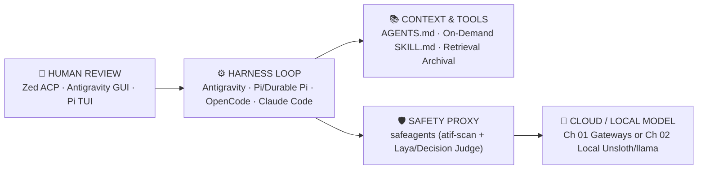

← [Ch 03: Multimodal](03-multimodal-sensory.md) &nbsp;|&nbsp; [🏠 Cover](../README.md) &nbsp;|&nbsp; [Ch 05: Backends & Flags](05-backends-flags-silicon.md) →

# Chapter 04 · Agent Harnesses, Protocols & Safety

> [!IMPORTANT]
> **Verdict:** The model gets the credit, but the harness decides whether multi-hour agent loops finish cleanly or burn tokens. Pair modular harnesses (Antigravity, Pi/Durable Pi, Zed ACP) with on-demand Skills, retrieval Context Archival, and a `safeagents` proxy.
> **Read this chapter if:** You are wiring coding/research agents, designing `AGENTS.md`/`SKILL.md` bundles, or sandboxing tool calls.



<br>

## 1. Agent Harnesses, IDEs & Durable Execution

| Harness / Platform | Core Architecture | Standout Capabilities (Nov 2026) | Best Pairing & Gotcha |
| :--- | :--- | :--- | :--- |
| **Google Antigravity**<br><sub>`2.0 Desktop` · `CLI` · `SDK`</sub> | Unified Google agentic harness<br><sub>Shared config across GUI + CLI</sub> | Live w/ **`Gemini 4 Hydrogen`** (fast Everyday/Thinking + Task mode), **`3.8 Flash`**, & **`4 Argon/Carbon/Neon`**; `/agents` parallel subagents, `ctrl+k` approval, `@conversation` import. | ✅ Export directly from AI Studio Build into local Antigravity with full context intact. |
| **Pi (`v0.83`) & `Durable Pi`**<br><sub>`pi.dev` · `disler/durable-pi`</sub> | MIT minimalist TUI/RPC/SDK +<br><sub>SQLite crash-resumable backend</sub> | Built-in **`MCP + Codemode`** (JS sandbox without context bloat), `/tree` branching, **atomic shared JSON app state**, background compaction (200K/250K), live mid-run tool hot-swap. | 🏆 Reference harness for `Inkling 2 Mini` (**71.6%** TB2.1) & HF's `Qwen3.8-27B-pi-adapted` (**64.7%** SWE-Pro hard-51). |
| **Zed Editor + `ACP`**<br><sub>Agent Client Protocol (`Apache-2.0`)</sub> | Native IDE multi-file review UI<br><sub>Zero Zed server telemetry</sub> | Official **ACP Registry** unifies `Pi`, `Claude Agent`, `Codex`, `Gemini CLI`, `OpenCode`, `Cursor`, & `Poolside` while forwarding local MCP servers. | ✅ Eliminates terminal diff blindness when running local or cloud CLI coding agents. |
| **OpenCode · Claude Code · Hermes**<br><sub>Vendor-agnostic & swarm CLIs</sub> | Terminal agent loops +<br><sub>Pre/post shell lifecycle hooks</sub> | `Claude Code` wires cleanly to local models via **Unsloth's Anthropic endpoint**; `OpenCode` & `Hermes` both have official HF RL harness adapters on `Qwen3.8-27B`. | ⚠️ OpenCode & Hermes do not auto-compact like `Pi` by default—watch for rapid context overflow on giant repos. |

## 2. Protocols, Skills, Context & Runtime Safety

| Pattern / Tool | Standard / Endpoint | Why It Beats Legacy Approaches | Production Guardrail |
| :--- | :--- | :--- | :--- |
| **`safeagents` Proxy & Plugins**<br><sub>`huggingface/safeagents`</sub> | Transparent OpenAI/Anthropic proxy<br><sub>Works w/ Claude Code, Pi, Hermes, OpenCode</sub> | 3-stage guard: request checks, `atif-scan` (10–20ms on Apple Silicon), + optional **Decision Model judge**; Hub plugins (`hf://harness-hub/qwen-safeagents-plugin`). | 🏆 Audited **1.3M** RL tool calls & blocked **647** suspicious calls during HF harness-adapter training. |
| **Progressive Skills (`SKILL.md`)**<br><sub>vs. Bloated MCP Tool Lists</sub> | `skills/<name>/SKILL.md` +<br><sub>`Pi` / `Antigravity` / `Deepy Skills`</sub> | Loads instructions & scripts **on demand** instead of stuffing 30+ MCP schemas into the system prompt (which destroys KV prompt caching). | ✅ Use `Pi` **MCP + Codemode** when you need complex multi-tool orchestration in a JS sandbox. |
| **Layered Context Files**<br><sub>Global -> Repo -> Subdir</sub> | `AGENTS.md` · `CLAUDE.md`<br><sub>`llms.txt` · `llms-full.txt`</sub> | Gives agents deterministic foraging routes and repo invariants in <500 tokens before reading a single source file. | ⚠️ Never let `AGENTS.md` grow into a 5,000-token manual—keep micro-details in on-demand skills. |
| **Retrieval Context Archival**<br><sub>vs. Lossy Rolling Summaries</sub> | Unsloth Archival · `Durable Pi`<br><sub>`/tree` + `search_history`</sub> | Archives old turns to searchable SQLite/vector history at 200K tokens rather than overwriting nuances via destructive summarization. | ✅ Pair with `Laya` + `all-MiniLM-L6-v2` (23 MB) for auditable memory invalidation ledgers. |

<details>
<summary>🛠️ <b>Click to expand `safeagents` Transparent Proxy Quickstart</b></summary>
<br>

```bash
# Put safeagents between any local/cloud harness (Pi, OpenCode, Claude Code) and your LLM server
safeagents start http://localhost:8000 \
  --plugin hf://harness-hub/qwen-safeagents-plugin
```
</details>

---

← [Ch 03: Multimodal](03-multimodal-sensory.md) &nbsp;|&nbsp; [🏠 Cover](../README.md) &nbsp;|&nbsp; [Ch 05: Backends & Flags](05-backends-flags-silicon.md) →
