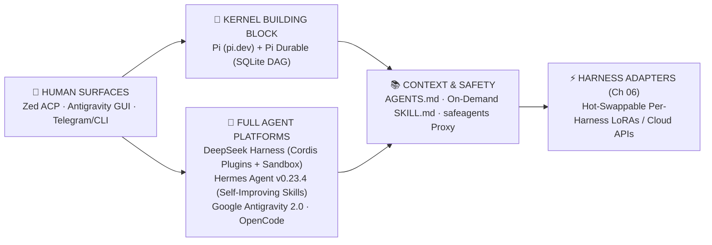

← [Ch 03: Multimodal](03-multimodal-sensory.md) &nbsp;|&nbsp; [🏠 Cover](../README.md) &nbsp;|&nbsp; [Ch 05: Backends & Flags](05-backends-flags-silicon.md) →

# Chapter 04 · Agent Harnesses, Protocols & Safety

> [!IMPORTANT]
> **Verdict:** Organize harnesses by architectural role: treat Pi / Pi Durable as your minimal building-block kernel, DeepSeek Harness (dsh) as the Cordis plugin-everything platform, and Hermes Agent as the self-improving autonomous daemon—all shielded by safeagents.
> **Read this chapter if:** You are choosing an agent loop kernel, deploying autonomous personal/coding harnesses, or wiring `SKILL.md` & safety proxies.



<br>

## 1. Agent Harnesses by Architectural Role

| Role & Harness | Core Architecture | Standout Capabilities (Nov 2026) | Best Pairing & Gotcha |
| :--- | :--- | :--- | :--- |
| **🧱 Building-Block Kernel**<br>**`Pi` (`pi.dev`) + `Pi Durable`**<br><sub>MIT · TUI / RPC / SDK</sub> | Minimal hackable loop you own +<br><sub>SQLite crash-resumable state</sub> | Transparent context assembly, built-in **`MCP + Codemode`** (JS sandbox), `/tree` DAG session branching, atomic shared JSON app state, background compaction (200K/250K), live mid-run tool hot-swap. | 🏆 Highest-scoring target for HF `Qwen3.8-27B-pi-adapted` (**64.7%** SWE-Pro hard-51) & `Inkling 2 Mini`.<br>⚠️ Intentionally omits built-in approval gates—pair w/ `safeagents` or sandboxes. |
| **🧩 Plugin-Everything Platform**<br>**`DeepSeek Harness` (`dsh`)**<br><sub>MIT · 287K+ ★ · `deepseek-ai`</sub> | **Cordis** (*Everything is a Plugin*)<br><sub>Web (`npx @deepseek-ai/dsh web`) & Desktop</sub> | Lets you **swap the agent loop itself** as a plugin, **Creator Mode** (author live plugins in chat), read-only-by-default **built-in sandbox**, trace inspector, cron tasks, & first-party plugins driving **Claude Code / Codex** as sub-agents. | ✅ Supports DeepSeek, Anthropic, OpenAI, Moonshot, Z.ai, & local OpenAI-compat servers.<br>⚠️ Fast-moving developer preview (`0.2.3-alpha.2`)—pin plugin versions. |
| **🌱 Self-Improving Daemon**<br>**`Hermes Agent` (`v0.23.4`)**<br><sub>MIT · 266K+ ★ · `NousResearch`</sub> | Persistent learning loop +<br><sub>Multi-surface (Desktop/VPS/Telegram)</sub> | #1 globally on OpenRouter token volume; persistent memory + **autonomous skill creation**, 40+ tools, ACP support, cron scheduler, isolated subagents, & disk archival of pruned tool outputs. | 🏆 Official HF Harness Adapter target (`Qwen3.8-27B-hermes-adapted` & `LFM2.5-24B`).<br>⚠️ Does not auto-compact aggressively like `Pi`—cap context/thinking tokens on giant repos. |
| **🖥️ IDE & Vendor Harnesses**<br>**`Google Antigravity` · `Zed ACP` · `OpenCode`** | Native multi-file review UI +<br><sub>Agent Client Protocol (`Apache-2.0`)</sub> | **Antigravity:** Live w/ **`Gemini 4 Hydrogen`** (Everyday/Thinking + Task mode), `3.8 Flash`, & `4 Argon/Carbon/Neon`. **Zed ACP Registry:** Unifies `Pi`, `Claude`, `Codex`, `Gemini`, & `OpenCode` w/ zero server telemetry. | ✅ Wire `Claude Code` or `OpenCode` to local `Qwen3.8-27B-super-adapter` via Unsloth's Anthropic/OpenAI endpoints. |

## 2. Protocols, Skills, Context & Runtime Safety

| Pattern / Tool | Standard / Endpoint | Why It Beats Legacy Approaches | Production Guardrail |
| :--- | :--- | :--- | :--- |
| **`safeagents` Proxy & Plugins**<br><sub>`huggingface/safeagents`</sub> | Transparent OpenAI/Anthropic proxy<br><sub>Works w/ Pi, Hermes, OpenCode, Claude</sub> | 3-stage guard: request checks, `atif-scan` (10–20ms on Apple Silicon), + optional **Decision Model judge**; Hub plugins (`hf://harness-hub/qwen-safeagents-plugin`). | 🏆 Audited **1.3M** RL tool calls & blocked **647** suspicious calls during HF harness-adapter training. |
| **Progressive Skills (`SKILL.md`)**<br><sub>vs. Bloated MCP Tool Lists</sub> | `skills/<name>/SKILL.md` +<br><sub>`obra/superpowers` · `Deepy Skills`</sub> | Loads instructions & scripts **on demand** instead of stuffing 30+ MCP schemas into the system prompt (which destroys KV prompt caching). | ✅ Use `Pi` **MCP + Codemode** when you need complex multi-tool orchestration in a JS sandbox. |
| **Layered Context & Archival**<br><sub>vs. Lossy Rolling Summaries</sub> | `AGENTS.md` · `llms.txt`<br><sub>Unsloth Archival · `Durable Pi`</sub> | Gives deterministic repo invariants in <500 tokens and archives old turns to searchable SQLite/vector history at 200K tokens rather than destructive summarization. | ✅ Pair with `Laya` + `all-MiniLM-L6-v2` (23 MB) for auditable memory invalidation ledgers. |

<details>
<summary>🛠️ <b>Click to expand `DeepSeek Harness`, `safeagents` & `Pi` Quickstarts</b></summary>
<br>

```bash
# 1. Launch DeepSeek Harness Web UI (Cordis plugin platform)
npx @deepseek-ai/dsh web

# 2. Wrap any local/cloud harness (Pi, Hermes, OpenCode, Claude Code) behind safeagents
safeagents start http://localhost:8000 \
  --plugin hf://harness-hub/qwen-safeagents-plugin
```
</details>

---

← [Ch 03: Multimodal](03-multimodal-sensory.md) &nbsp;|&nbsp; [🏠 Cover](../README.md) &nbsp;|&nbsp; [Ch 05: Backends & Flags](05-backends-flags-silicon.md) →
