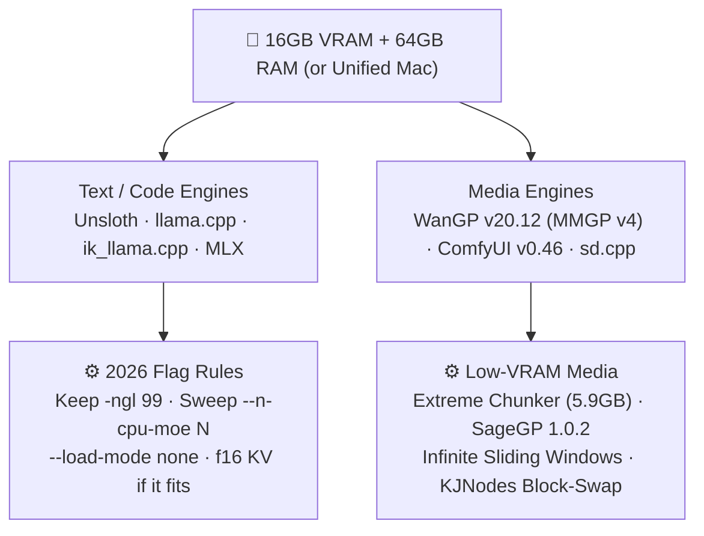

← [Ch 04: Harnesses](04-harnesses-protocols.md) &nbsp;|&nbsp; [🏠 Cover](../README.md) &nbsp;|&nbsp; [Ch 06: Adaptation & RL](06-adaptation-frontier.md) →

# Chapter 05 · Backends, Quantization & 2026 Flag Bible

> [!IMPORTANT]
> **Verdict:** Serving kernels and memory flags matter as much as model weights: `--n-cpu-moe` unlocks 64GB RAM MoEs without touching `-ngl`, Unsloth accelerates looped & VRAM-exceeding GGUFs 1.9×–3×, and `WanGP v20.12` squeezes 1080p video into 5.9 GB VRAM.
> **Read this chapter if:** You are configuring local inference servers, tuning `llama.cpp`/`ik_llama.cpp`/`WanGP`, or optimizing for Linux, NVIDIA, or Apple Silicon.



<br>

## 1. Inference Studios, Engines & Low-VRAM Media Backends

| Backend / Runtime | Target Workload | Key Breakthroughs (Nov 2026) | Strict Compatibility Gotcha |
| :--- | :--- | :--- | :--- |
| **Unsloth Runtime & Studio**<br><sub>`v0.1.923-beta` (Tauri + CLI)</sub> | Local LLMs, Decisions, & RL/LoRA<br><sub>OpenAI + Anthropic API server</sub> | **1.9×** faster `Inkling 2 Mini`, **3×** faster VRAM-exceeding MoE GGUFs, **4.1×** faster `Laya`, `AsyncGRPO`, retrieval Context Archival, AMD NPU, & `FastWan`. | ✅ **Mandatory** for `Inkling 2 Mini` looped-layer GGUFs and self-healing JSON/XML tool calls. |
| **`llama.cpp` vs `ik_llama.cpp`**<br><sub>Mainline vs. SOTA Perf Fork</sub> | GGUF CPU + GPU hybrid inference<br><sub>CUDA, Metal, Vulkan, ROCm</sub> | `ik_llama.cpp` leads bleeding-edge kernels: **FlashMLA**, **IQK AVX-512 (`HAVE_FANCY_SIMD`)**, Trellis quants (`IQ2_KS`/`IQ3_KT`), dynamic MoE caching. | ⚠️ `ik_llama.cpp` is **CPU + NVIDIA CUDA only**; avoid `-rtr` on k-quants w/ MoE offload & avoid raw `f16` `_XL` tensors. |
| **`WanGP v20.12` + `MMGP v4`**<br><sub>`deepbeepmeep/WanGP`</sub> | Low-VRAM Video, Image & Avatars<br><sub>`Wan 2.2`, `H3`, `LTX-2.5`, `SenseNova`</sub> | **Extreme Chunker** (**5.9 GB VRAM** for 15s 1080p H3), **`pi-H3` DWD** (2–4 steps), **Infinite Sliding Windows**, **`SageGP 1.0.2`**, `Deepy Prime` MCP + `Deepy Apps`. | ✅ Install `WGPKernels 1.5.0` & `SageGP 1.0.2` (PyTorch 2.10; Triton 3.6+ for RTX 50xx adaptive Sage2/3). |
| **`ComfyUI v0.46` & `SGLang-Omni`**<br><sub>Node graphs & multimodal serving</sub> | Custom media pipelines & TTS<br><sub>`Fish Drama 3`, `Qwen-Image-2.1`</sub> | `ComfyUI v0.46`: `SenseNova`, `RMBG 3.0`, RAFT `Video Deflicker`, `KJNodes` block-swap; `SGLang-Omni` serves `Fish Audio Drama 3`. | 💡 Use `stable-diffusion.cpp` for lightweight CLI `Qwen-Image-2.1` (`Q4_K_M`, 9.1 GB VRAM). |

## 2. Acceleration, Quantization & The 2026 Flag Bible

| Mechanic / Flag | Exact Syntax / Spec | What It Does Under the Hood | Critical Tuning Trap |
| :--- | :--- | :--- | :--- |
| **The `--n-cpu-moe` Sweep**<br><sub>Zone 2 Hybrid MoE Law</sub> | `-ngl 99 -fa on --n-cpu-moe N` | Pins **100% of Attention + KV cache** on your 16GB GPU while pushing only sparse FFN experts of the first `N` layers to 64GB DDR5 RAM. | ⚠️ **Never lower `-ngl` on MoEs.** Sweep `N` down by 2 until VRAM spills, then step up by 1–2. |
| **Unified Load Mode**<br><sub>Replaces `--no-mmap` / `--mlock`</sub> | `--load-mode none` or `mlock`<br><sub>Env: `LLAMA_ARG_LOAD_MODE`</sub> | Replaces deprecated `--no-mmap` / `--mlock` flags in modern `llama.cpp` to prevent OS page-cache thrashing on 64GB RAM loads. | ⚠️ If partial MoE offload + CUDA graphs outputs gibberish, add **`-cuda graphs=0`**. |
| **KV Cache Quantization**<br><sub>Memory-fitting vs. Speed</sub> | `-ctk q8_0 -ctv q8_0`<br><sub>Requires `-fa on` (Flash Attn)</sub> | Halves KV cache VRAM so 24B–27B dense models (`Qwen3.8-27B`) and 120K MoE contexts fit cleanly inside 16GB VRAM. | ⚠️ **Not a speed boost:** Keep `f16` KV cache whenever it fits in VRAM; use `q8_0` only to prevent RAM spill. |
| **Next-Gen Multi-Token Tech**<br><sub>`DFlash` · `DSpark` · `MTP` · `N-gram`</sub> | `--spec-draft-n-max 2` (Inkling)<br><sub>`Dynamic v3.1` (`UD-*`) quants</sub> | `DFlash` drafts **16 tokens/pass** (`Muse Glimmer`/`Bolt`); `DSpark` (1 GB) accelerates `Inkling 2 Mini`; `N-gram` prefetches 51B tables from RAM (`Qwen3.8-Flash`). | ⚠️ On `Inkling 2 Mini`, raising `--spec-draft-n-max` above 2 can degrade looped-layer acceptance. |

## 3. OS, Sandboxing & Silicon-Exclusive Stacks

| OS / Silicon Tier | Key Engines & Kernels | Exclusive Performance / Safety Edge | Hardware Reality Check |
| :--- | :--- | :--- | :--- |
| **Linux (First-Class Host)**<br><sub>CUDA · ROCm · Zen 4/5 AVX-512</sub> | `Bwrap` Sandbox · `ik_llama.cpp`<br><sub>Kernel Hugepages · `HAVE_FANCY_SIMD`</sub> | Fastest 64GB DDR5 MoE streaming (AVX-512 IQK kernels) + Unsloth OS-enforced **`Bwrap`** bash/python sandboxing. | ✅ Preferred host OS for 16GB NVIDIA + 64GB DDR5 hybrid MoE workstations. |
| **NVIDIA Ada / Blackwell**<br><sub>RTX 40xx / 50xx & DGX Spark</sub> | `NVFP4` · `SageGP 1.0.2`<br><sub>`FlashMLA` · CUDA Graphs</sub> | RTX 50xx gets native `NVFP4` + adaptive `Sage2/3 GP` precision; RTX 20xx–40xx gain `SageGP` Extreme Chunker kernels for `WanGP`. | ⚠️ Update to PyTorch 2.10 + Triton 3.6+ for Blackwell `sage3 gp` adaptive modes. |
| **macOS (Apple Silicon / Mac mini)**<br><sub>Unified Memory + `Seatbelt`</sub> | `MLX` (`mlx-lm` / `mlx-vlm`)<br><sub>Unsloth Mac **2.8×** Speculative</sub> | Zero PCIe copy bottleneck up to unified RAM ceiling + macOS **`Seatbelt`** sandbox; runs `Qwen3.8-27B-super-adapter-MLX` at ~65 tok/s (4-bit). | ⚠️ Prompt prefill lags dedicated NVIDIA Tensor Cores; 32GB+ unified RAM recommended for 27B MLX. |
| **AMD NPU, Windows & WebGPU**<br><sub>Tri-Hybrid & Zero-Server Browser</sub> | Unsloth AMD NPU · Win **`MXC`**<br><sub>WebGPU (`Phonon 31M` / `Laya`)</sub> | Run `Laya` decisions on AMD NPU/CPU or `Phonon 31M` TTS at **130× RT (4.9ms)** directly in browser WebGPU while GPU stays 100% free. | ✅ Windows users get native **`MXC`** sandboxing in Unsloth Studio and Redtash1 one-click `WanGP` builds. |

<details>
<summary>🛠️ <b>Click to expand Copy-Paste 2026 Sweep & Verification Commands</b></summary>
<br>

```bash
# 1. Zone 2 Heavy Coding MoE Sweep (Attention 100% on 16GB GPU, 29 Expert Layers in 64GB RAM)
GGML_CUDA_GRAPH_OPT=1 llama-server \
  -m Qwen3-Coder-Next-UD-Q4_K_XL.gguf \
  -ngl 99 -fa on -c 120000 --load-mode none \
  --n-cpu-moe 29 --batch-size 4096 --ubatch-size 4096 \
  -ctk q8_0 -ctv q8_0 --temp 0

# 2. Zone 1 Pure 16GB VRAM Dense Brain + HF Rank-96 Super-Adapter
llama-server -m Qwen3.8-27B-IQ4_XS.gguf \
  --lora Qwen3.8-27B-super-adapter-F16.gguf \
  -ngl 99 -fa on -c 65536 -ctk q8_0 -ctv q8_0
```
</details>

---

← [Ch 04: Harnesses](04-harnesses-protocols.md) &nbsp;|&nbsp; [🏠 Cover](../README.md) &nbsp;|&nbsp; [Ch 06: Adaptation & RL](06-adaptation-frontier.md) →
