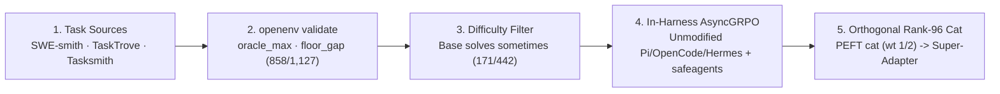

← [Ch 05: Backends & Flags](05-backends-flags-silicon.md) &nbsp;|&nbsp; [🏠 Cover](../README.md) &nbsp;|&nbsp; [🪦 Appendix: Graveyard](99-graveyard.md) →

# Chapter 06 · Adaptation, Harnessed RL & Frontier Leads

> [!IMPORTANT]
> **Verdict:** Freezing a strong 27B base model and training lightweight RL LoRA adapters inside the unmodified shipping harness delivers double-digit pass@1 gains while slashing tool calls by more than half—and orthogonal LoRAs merge with zero retraining.
> **Read this chapter if:** You want to adapt open weights to your exact coding harness, build validated RL task sets, or track frontier self-improvement research.



<br>

## 1. Harnessed Agentic RL & Super-Adapter Stack

| Component / Artifact | Primary Source & Stack | Verified Performance & Efficiency | Key Caveat & Tuning Rule |
| :--- | :--- | :--- | :--- |
| **In-Harness RL Pipeline**<br><sub>Unmodified shipping harness</sub> | [HF Harness Adapters](https://huggingface.co/blog/harness-adapters-at-scale)<br><sub>`OpenEnv` · `Harbor` · `TRL AsyncGRPO` · `Agent Lightning` (`2608.17528`)</sub> | Token/logprob capture proxy between `Pi 1.5.2` / `OpenCode 2.2.7` / `Hermes v0.22.6` and vLLM (2×B200); `pi` lifts SWE-Pro hard-51 **39.2%→64.7%** (**56–72%** fewer tool calls). | ⚠️ Use `all-linear` LoRA, LR **`2e-5`** (`1e-4` collapses rollouts), tool bonus `0.1`, repo-family interleaving, & maxed `--token-budget` (**1.2×–2.3×** groups/step). |
| **Task Filtering & Validation**<br><sub>Data quality over raw volume</sub> | `Repo2RLEnv` (`Tasksmith`) +<br><sub>`SWE-smith` · `TaskTrove` · `termgrade` (`871` tasks)</sub> | `openenv validate` passed **858/1,127** Hub tasks; base-model difficulty check kept **171/442** (*solved sometimes*), lifting step-50 GRPO reward to **0.81** vs **0.63**. | ✅ Always run `oracle_max`, `floor_gap`, `canary_floor`, & `episode_determinism`—caught broken verifiers including `regex-log`. |
| **Orthogonal Rank-96 Super-Adapter**<br><sub>Zero-retraining multi-harness merge</sub> | `harness-hub/Qwen3.8-27B-super-adapter`<br><sub>`PEFT cat` · `Task Arithmetic` (`2212.04089`) · `TIES` (`2306.01708`) · `KnOTS` (`2410.19735`)</sub> | Cosine sim `~0.01–0.02` enables rank-96 concat at weight **`½`**: beats base on **6/6** pairs thinking off (**39.5%→49.0%**) & **5/6** thinking on (**55.5%→63.5%**). | ⚠️ Weight `1` over-applies updates; pick specialist LoRA if thinking off on one harness; OOD `AutomationBench` stays near base noise (`23.7%` vs `23.0%`). |
| **Thinking Leakage & Transfer**<br><sub>Cross-harness & hybrid behavior</sub> | `arXiv:2610.14270` ·<br><sub>`harness-adapters-trajectories` bucket</sub> | `pi` adapter transfers cleanly to OpenCode (**44.8%→54.0%**) & Hermes (**46.3%→56.1%**) w/ ~45% fewer tool calls; community reports compatibility w/ `Swift-1.5`. | ⚠️ Non-thinking RL induces short pre-tool reasoning traces (*thinking leakage*)—stays net-positive under fixed token budgets. |

## 2. Frontier Research & Underground Playbooks

| Lead / Playbook | Primary Source | Why It Matters Right Now | How to Experiment Today |
| :--- | :--- | :--- | :--- |
| **Gradient-Free Self-Rewriting**<br><sub>Weight Editing via Reasoning</sub> | UIUC (`arXiv:2611.21885`)<br><sub>Published Nov 16–20, 2026</sub> | Demonstrates an LLM diagnosing failures via pure reasoning and rewriting its own weights across sessions with **zero gradients or training runs**. | 🔬 Track for persistent local agents that permanently patch recurring coding mistakes. |
| **Variable-Loop Test-Time Compute**<br><sub>Dynamic Depth per Token</sub> | `thinkingmachines/TML-d24-varloop-research` | Companion to `Inkling 2 Mini` allowing you to dial `loop_num_passes` at inference time—trading latency for reasoning depth without swapping models. | 🧪 Pair with a `Laya` complexity router to run easy queries in 1 loop and hard bugs in 3+ loops. |
| **Playable Worlds + Auto-Directed Video**<br><sub>`Hy-Nomas` + `Deepy Apps`</sub> | `Tencent-Hunyuan/Hy-Nomas`<br>`WanGP v20.12 Deepy Apps` | Generates WASD-navigable interactive worlds on 1 GPU (`Hy-Nomas`) and packages generated video/audio assets into playable 3D `.wgpapp` scenes (`Deepy Apps`). | 🎬 Wire Antigravity or Claude Code into `Deepy Prime` via MCP to auto-direct, inspect frames, and iterate. |
| **Zero-Cost Local Claude Code Loop**<br><sub>Anthropic Proxy + Decision Gate</sub> | Unsloth Anthropic API +<br>`safeagents` + `Laya` (`localhost:8888`) | Point `Claude Code` or `OpenCode` to local `Inkling 2 Mini` / `Qwen3.8-27B-super-adapter` while gating shell calls through `safeagents` + `Laya`. | 🛡️ Cap output tokens/turns on `Inkling 2 Mini` to prevent repetitive debug loops. |

<details>
<summary>🛠️ <b>Click to expand OpenEnv Validation & vLLM Multi-LoRA Serving Commands</b></summary>
<br>

```bash
# 1. Validate any Harbor RL task against oracle_max, floor_gap, canary_floor, & determinism
openenv validate path/to/task --sandbox hf-sandbox

# 2. Serve the rank-96 Super-Adapter over frozen Qwen3.8-27B in vLLM
vllm serve Qwen/Qwen3.8-27B --enable-lora --max-lora-rank 128 \
  --lora-modules super=harness-hub/Qwen3.8-27B-super-adapter
```
</details>

---

← [Ch 05: Backends & Flags](05-backends-flags-silicon.md) &nbsp;|&nbsp; [🏠 Cover](../README.md) &nbsp;|&nbsp; [🪦 Appendix: Graveyard](99-graveyard.md) →
