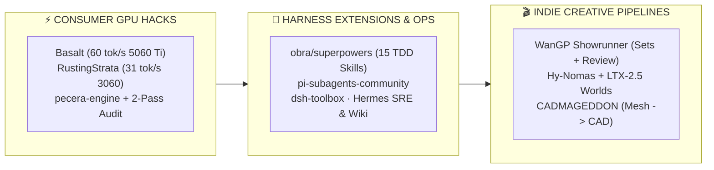

← [Ch 06: Harness Adapters & RL](06-adaptation-frontier.md) &nbsp;|&nbsp; [🏠 Cover](../README.md) &nbsp;|&nbsp; [Ch 08: Frontier Watch](08-frontier-watch.md) →

# Chapter 07 · Community Field Notes (IRL Builds & Workflows)

> [!IMPORTANT]
> **Verdict:** The biggest real-world gains rarely come from raw model drops alone—they come from community alt-engines (3×–6× faster on 12–16GB GPUs), discipline skill packs (obra/superpowers), two-pass audit loops, and multi-tool indie pipelines chained together on consumer hardware.
> **Read this chapter if:** You want to see what builders are actually shipping IRL with 12–16GB GPUs, Pi/Hermes/dsh extensions, and local media chains.



<br>

## 1. Underground 12–16GB Engine Hacks & Audit Loops

| Community Project | Hardware & Stack | Verified IRL Results | Practical Takeaway (`⚠️ Gotcha`) |
| :--- | :--- | :--- | :--- |
| **`Basalt` (`0.5.5+`) & `RustingStrata`**<br><sub>Alt-engines for `Inkling 2 Mini`</sub> | RTX 3060 12GB · RTX 5060 Ti 16GB<br><sub>NVFP4 + `DSpark` native kernels</sub> | `Basalt` hits **up to 60 tok/s on a 16GB RTX 5060 Ti** (spilling cold experts to RAM only on long chats) & **613 tok/s** on 5090. `RustingStrata` hits **31 tok/s on RTX 3060 12GB** (vs 9–10 tok/s stock `llama.cpp`). | 🔥 Proves community engines already unlock 3×–6× speedups on looped MoEs.<br>⚠️ Rapidly evolving single-GPU engines—pin working git commits. |
| **`pecera-engine` + Hermes Self-Check**<br><sub>r/LocalLLaMA indie build (Nov 2026)</sub> | Single 12GB RTX 4070 Ti +<br><sub>`Inkling 2 Mini` (`mixC` 10.8 GiB) + Hermes</sub> | Rebased `realugbun` fused CUDA glue-op kernels onto `llama.cpp` (**76–80 tok/s**); paired w/ **3,000-tok thinking cap + 5 self-check skills + 2nd audit session** to score **47/89 (52.8%)** on TB2.0. | 🏆 **Reusable IRL Pattern:** Capping thinking tokens + forcing a fresh 2nd-pass audit session eliminates small-model debug loops. |
| **Cross-Derivative LoRA & Mac MLX Builds**<br><sub>HF `harness-hub` community</sub> | `Qwen3.8-27B` adapters +<br><sub>`Swift-1.5` · `netprojects` MLX-6bit</sub> | Builders confirmed HF's tiny 304–912 MiB LoRAs transfer cleanly to **`Qwen3.8` derivatives (`Swift-1.5`)** and packaged **MTP-preserving `MLX-6bit`** Mac builds (~65 tok/s 4-bit). | 💡 Test HF harness adapters against your favorite `Qwen3.8` community fine-tunes before training from scratch. |

## 2. Community Skill Packs, Harness Extensions & Production Ops

| Community Effort | Target Harness(es) | What People Ship IRL | Adoption Rule (`⚠️ Gotcha`) |
| :--- | :--- | :--- | :--- |
| **`obra/superpowers`**<br><sub>Jesse Vincent · + Hermes port</sub> | `Pi` · `Antigravity` · `Hermes`<br><sub>`OpenCode` · `Claude Code` · `Codex`</sub> | 15 discipline skills enforcing **Brainstorm → Chunked Spec → Red/Green TDD → Fresh Subagent per Task → Systematic Debugging → Verification Before Completion** for 2+ hour autonomous runs. | 🏆 Highest-ROI skill pack for stopping agent drift.<br>⚠️ On Hermes, use `obra-superpowers-hermes` (`hermes-tools.md`), not raw Claude Code tool names. |
| **`pi-subagents-community`**<br><sub>`npm:pi-subagents-community`</sub> | `Pi` (`v1.0+`) | Adds Claude Code-style parallel sub-agents, a navigable fleet widget, mid-run steering, & JS orchestration (`agent()`, `parallel()`, `pipeline()`) without bloating `Pi`'s minimal kernel. | ✅ Keeps `Pi` lean while unlocking multi-agent orchestration on demand. |
| **`wanbinyu-harness-toolbox`**<br><sub>`dsh-launcher` · `dsh-plugins` · `dsh-theone`</sub> | `DeepSeek Harness` (`dsh`) | Bilingual Cordis plugin catalog w/ SHA-256 verified assets, Windows updater preserving `%USERPROFILE%\.dsh` data, and an experimental LAN Android client. | ⚠️ Independent community repo; check peer compatibility after `dsh` alpha updates. |
| **IRL Production Ops Patterns**<br><sub>Hermes & OpenClaw builders</sub> | `Hermes Agent` · `OpenClaw`<br><sub>`Pi Durable` + Obsidian</sub> | • **SRE:** `Hermes Incident Commander` & PR review triage (~30% shorter review cycles).<br>• **Knowledge:** Obsidian + `Defuddle` + `LLM Wiki` memory.<br>• **Research:** Cron 200–500 source digests (6–8 hrs/wk → 30 min edit). | ⚠️ **#1 IRL Failure Mode:** Never jump to 100% autonomy on day 1—graduate from *agent drafts, human approves* to *agent ships, human audits 10–20% weekly*. |

## 3. Local Indie Media, Interactive Worlds & Hardware Chains

| Community Pipeline | Chained Local Tools | What Creators Build IRL | License / Hardware Catch (`⚠️ Gotcha`) |
| :--- | :--- | :--- | :--- |
| **Indie Film & Music Video Studio**<br><sub>`WanGP Showrunner` + `hoodtronik` fork</sub> | `WanGP v20.12` + `Qwen-Image-2.1`<br><sub>+ `MiniMax H3` / `Wan 2.2`</sub> | Multi-shot local stories using recurring location **Sets** (consistent rooms across cuts), per-shot start/end previz guides, cast-card voice checks, & 1-click **Deep Review** lip/continuity audits. | ✅ Runs on 8–16GB GPUs via Extreme Chunker + MMGP v4.<br>⚠️ Community Showrunner forks track specific upstream commits. |
| **Walkable Worlds + Sound & Mesh→CAD**<br><sub>Community creators & hardware hackers</sub> | `Hy-Nomas` + `EVOKE` + `LTX-2.5`<br><sub>+ `CADMAGEDDON` (Mesh → CAD)</sub> | Chains `Hy-Nomas` WASD worlds into **`LTX-2.5`** for video-conditioned audio & interactive roleplay; hardware makers use **`CADMAGEDDON`** locally to reverse 3D meshes into editable parametric CAD. | ⚠️ `Hy-Nomas`/`EVOKE` use NVIDIA PixelUMM (**non-commercial previs/pitch use only**). |

<details>
<summary>🛠️ <b>Click to expand Community Extension Install Snippets</b></summary>
<br>

```bash
# 1. Install parallel sub-agents & pipeline orchestration into Pi
pi install npm:pi-subagents-community

# 2. Clone obra/superpowers discipline skill pack (check README for harness-specific install)
git clone https://github.com/obra/superpowers.git
```
</details>

---

← [Ch 06: Harness Adapters & RL](06-adaptation-frontier.md) &nbsp;|&nbsp; [🏠 Cover](../README.md) &nbsp;|&nbsp; [Ch 08: Frontier Watch](08-frontier-watch.md) →
