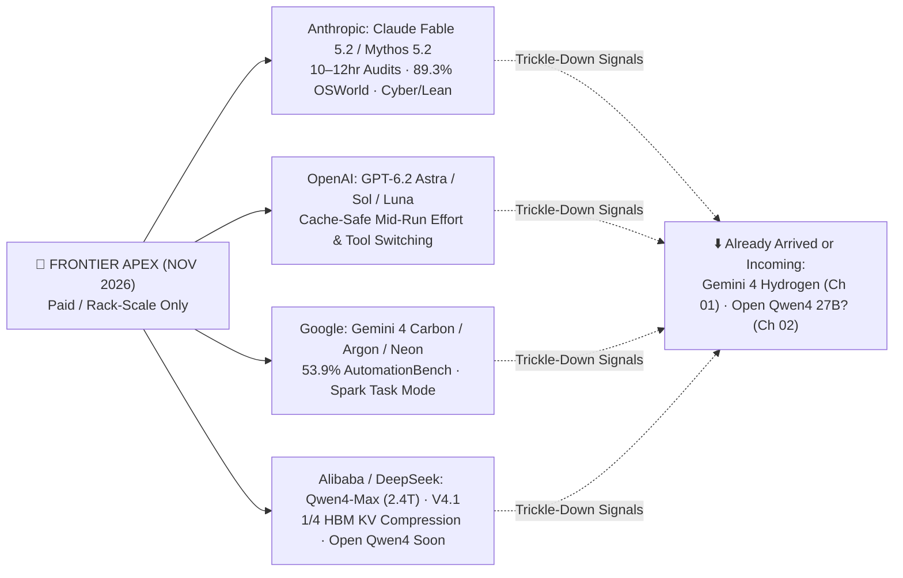

← [Ch 07: Community IRL](07-community-irl.md) &nbsp;|&nbsp; [🏠 Cover](../README.md) &nbsp;|&nbsp; [🪦 Appendix: Graveyard](99-graveyard.md) →

# Chapter 08 · Frontier Watch (Monitor-Only Apex Radar)

> [!IMPORTANT]
> **Verdict:** This chapter tracks the absolute apex of closed and rack-scale AI strictly to monitor capability ceilings, harness/caching breakthroughs, and open-weight trickle-down signals—never mixing paid or datacenter giants into Ch 01 ($0 Cloud) or Ch 02 (16GB+64GB Local).
> **Read this chapter if:** You want a clean radar of what Anthropic, OpenAI, Google DeepMind, Alibaba, and DeepSeek just shipped at the frontier and what will trickle down next.

> [!NOTE]
> **Monitor-Only Radar:** Entries below track the paid/rack-scale capability frontier for research and trickle-down signals. They are intentionally excluded from `Ch 01` ($0 Cloud) and `Ch 02` (16GB VRAM + 64GB RAM Local).

 

## 1. Apex Frontier Radar (Verified Nov 2026)

| Lab & Model Family | Latest Apex Release | Verified Ceiling & Architectural Signals | Trickle-Down Signal to Watch (`⚠️ Monitor-Only`) |
| :--- | :--- | :--- | :--- |
| **Anthropic** Paid API / Enterprise | **`Claude Fable 5.2`** & **`Mythos 5.2`** Nov 9, 2026 · + `Opus/Sonnet/Haiku 5.5` | **1M ctx / 128K out.** `Fable 5.2`: **49.1%** FrontierCode 2.0, **69.9%** FrontierSWE v2, **74.6%** TB-Science, **89.3%** OSWorld 2.1, **74.2%** HLE w/ tools. `Mythos 5.2`: restricted cyber/science sibling (1,000-agent Lean proofs). | 🔭 Sets the bar for **10–12 hr autonomous audits** and strict self-calibration (refusing unmeasured guesses); note tighter bio/cyber safeguard refusals on `Fable 5.2`. |
| **OpenAI** Paid API / Codex / Bedrock | **`GPT-6.2 Astra`** & **`GPT-6.2 Sol`** Nov 17, 2026 · + `GPT-6 Luna` workhorse | `Astra` leads complex coding/science/computer-use (+ Ultrafast mode); `Sol` catches ~2× real code review issues vs `6.1 Sol`. **API Caching Leap:** switch reasoning effort & toggle tools mid-chat **without breaking prompt cache**. | 🔭 **Harness Pattern to Steal:** Cache-preserving effort/tool switching & explicit prefix breakpoints are exact features to track for local `vLLM`/`llama.cpp` + `Pi`. |
| **Google DeepMind** Gemini App Pro/Ultra / API | **`Gemini 4 Carbon`** & **`4 Argon`** + `Gemini 4 Neon` (Desktop/Copilot) | Leads autonomous workflow execution (**53.9%** AutomationBench for `4 Carbon` vs `Fable 5.2` 51.4%), powering multi-step **Task mode (`Gemini Spark`)** on Pro/Ultra plans. | ⬇️ **Trickle-Down Live Now:** **`Gemini 4 Hydrogen`** (Everyday & Thinking) already brought Gemini 4 speed down into `Ch 01` Free Tier. |
| **Alibaba & DeepSeek** Rack-Scale & Open-Weight Apex | **`Qwen4-Max` (2.4T)** *(Nov 16)* **`DeepSeek-V4.1-Flash` (552B)** *(V4.1-Pro pending)* | `Qwen4-Max`: **2.4T params**, 1M ctx, 262K CoT, `$0.075/M` cache hit. `DeepSeek-V4.1-Flash`: asymmetric Causal Encoder–Decoder (**8B active in / 16B out**, **1/4 HBM KV cache**). | 🔥 **#1 Local Watchlist:** Alibaba confirmed **smaller open-weight Qwen4 models are coming**—prime candidates to supersede `Qwen3.8-27B` in `Ch 02`. |

---

← [Ch 07: Community IRL](07-community-irl.md) &nbsp;|&nbsp; [🏠 Cover](../README.md) &nbsp;|&nbsp; [🪦 Appendix: Graveyard](99-graveyard.md) →
