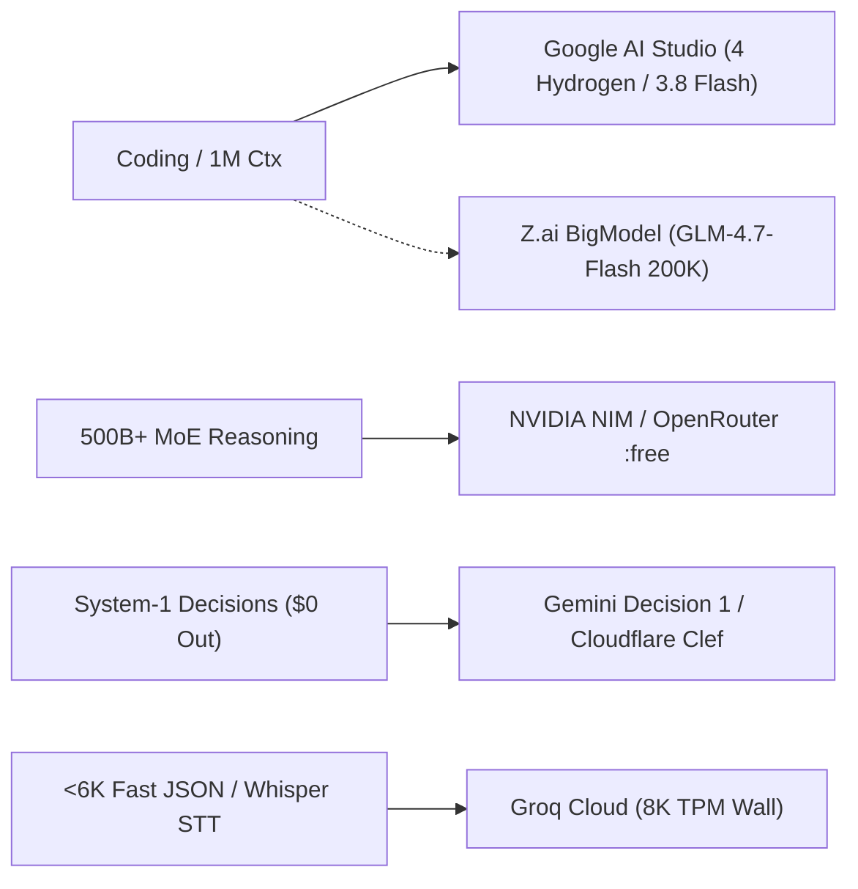

[🏠 Hub](../README.md) &nbsp;·&nbsp; **☁️ Cloud** &nbsp;·&nbsp; [🖥️ Local](../book/local.md) &nbsp;·&nbsp; [⚙️ Harnesses & RL](../book/harnesses-and-rl.md) &nbsp;·&nbsp; [📘 Playbooks](../book/playbooks.md) &nbsp;·&nbsp; [🧭 Spokes](../book/spokes.md) &nbsp;·&nbsp; [📡 Radar](../book/radar.md) &nbsp;·&nbsp; [🪦 Graveyard](../book/graveyard.md)

# ☁️ Zero-Card Cloud Gateways & Grounding

> [!IMPORTANT]
> Every gateway below is verified card-free and carries a `volatile` 21-day TTL. Expired gateways are automatically gated out of `llms.txt` until re-verified.

## 1. Verified Gateways (Quota Cards)

### [**Google AI Studio (Gemini 4 Hydrogen & 3.8 Flash)**](https://aistudio.google.com/) · 🟢 `Fresh`
- **Quota:** No Card: Free per-project (4 Hydrogen, 3.8 Flash 1M ctx) + Decision 1 (200 RPM / 10K RPD) · **Default Model:** `gemini-3.8-flash` · **Env Key:** `GEMINI_API_KEY`
- **Endpoint:** `https://generativelanguage.googleapis.com/v1beta/openai/`
- 🏆 Gemini 4 Hydrogen (Everyday & Thinking) launched Nov 2026 across Free, Plus, Pro & Ultra
- 🏆 Gemini Decision 1 evaluates up to 1,000 typed questions per prefill pass with $0 output tokens
- ⚠️ Gemini 2.5 retires Dec 1, 2026; 4 Argon/Carbon/Neon, Batch, & Search Grounding are paid-only.
- ⚠️ Free tier prompts may be logged outside EU/UK/CH; redact sensitive PII.
- *Verified `2026-11-27` (TTL `21d`)*

### [**Z.ai BigModel (GLM-4.7-Flash)**](https://open.bigmodel.cn/) · 🟢 `Fresh`
- **Quota:** No Card: Completely Free Flash tier (200K ctx / 128K out) · **Default Model:** `glm-4.7-flash` · **Env Key:** `ZHIPU_API_KEY`
- **Endpoint:** `https://open.bigmodel.cn/api/paas/v4/`
- 🏆 GLM-4.7-Flash (MIT) scores 79.5 tau2-Bench with a 200K context window
- ⚠️ Only glm-4.7-flash is permanently free; the GLM-5.x line is billed and fails on $0 balances.
- *Verified `2026-11-27` (TTL `21d`)*

### [**NVIDIA NIM Developer Catalog**](https://build.nvidia.com/) · 🟢 `Fresh`
- **Quota:** No Card: ~40 RPM Developer Prototyping Catalog · **Default Model:** `deepseek-ai/deepseek-v4.1-flash` · **Env Key:** `NVIDIA_API_KEY`
- **Endpoint:** `https://integrate.api.nvidia.com/v1`
- 🏆 Hosts 552B DeepSeek-V4.1-Flash and Nemotron-3.5-Super-VL serverless
- ⚠️ Prototyping-only license with occasional cold-start queues on giant MoEs.
- *Verified `2026-11-27` (TTL `21d`)*

### [**OpenRouter (:free)**](https://openrouter.ai/) · 🟢 `Fresh`
- **Quota:** 20 RPM, 50 RPD ($0) -> 1,000 RPD (>=10 credits balance) · **Default Model:** `openrouter/free` · **Env Key:** `OPENROUTER_API_KEY`
- **Endpoint:** `https://openrouter.ai/api/v1`
- 🏆 Aggregates free frontier hosts; also offers Inkling 2 Mini via io.net at $0.08/M in, $0.35/M out
- ⚠️ Negative balance returns HTTP 402 even on :free routes; poll GET /api/v1/key.
- *Verified `2026-11-27` (TTL `21d`)*

### [**Groq Cloud LPU**](https://console.groq.com/) · 🟢 `Fresh`
- **Quota:** No Card: LLMs 30 RPM / 1K RPD / 8K TPM; Whisper 2K RPD / 28.8K audio sec/day · **Default Model:** `qwen/qwen3.8-27b` · **Env Key:** `GROQ_API_KEY`
- **Endpoint:** `https://api.groq.com/openai/v1`
- 🏆 Verified active free LLMs: qwen/qwen3.8-27b, gpt-oss-120b, gpt-oss-20b, and Whisper-Large-v3
- ⚠️ Strict 8,000 TPM wall causes 429s on coding agents; keep prompts under 6K tokens or use for STT.
- *Verified `2026-11-27` (TTL `21d`)*

### [**Cloudflare Workers AI (Clef & Clairic)**](https://developers.cloudflare.com/workers-ai/) · 🟢 `Fresh`
- **Quota:** No Card: 10,000 Neurons/day free (resets 00:00 UTC) · **Default Model:** `@cf/cloudflare/clef` · **Env Key:** `CLOUDFLARE_API_TOKEN`
- **Endpoint:** `https://api.cloudflare.com/client/v4/accounts/${CF_ACCOUNT_ID}/ai/v1`
- 🏆 Non-autoregressive Clef, Clef-Omni (audio/video), and Clairic (zero-output typed extraction)
- ⚠️ Legacy Workers AI catalog models were hard-retired Nov 20, 2026 (HTTP 410).
- *Verified `2026-11-27` (TTL `21d`)*

### [**Pollinations AI (Keyless Fallback)**](https://pollinations.ai/) · 🟢 `Fresh`
- **Quota:** Keyless Zero-Auth Fair-Use IP Quota (Text, FLUX Image, Audio) · **Default Model:** `openai` · **Env Key:** `Keyless`
- **Endpoint:** `https://text.pollinations.ai/openai`
- 🏆 Instant zero-key fallback for sandbox chat and FLUX REST images
- ⚠️ Shared public endpoint; never transmit credentials or sensitive data.
- *Verified `2026-11-27` (TTL `120d`)*

## 2. Grounding, Search & Academic RAG

| Tool & Health | Quota & Capability | Key Gotcha |
| :--- | :--- | :--- |
| [**Firecrawl (Keyless Skill & API)**](https://www.firecrawl.dev/) · 🟢 `Fresh` | **Keyless onboarding skill + 500 credits on signup** — Lowest web-scraping token bloat on OpenBenchmarks (7,456 median tokens/task) | ⚠️ Keyless mode is IP-rate-limited; pass API key for burst crawls. |
| [**Jina Reader (r.jina.ai / s.jina.ai)**](https://jina.ai/reader/) · 🟢 `Fresh` | **Keyless prefix + 10M free tokens with API key** — Zero-SDK URL/PDF-to-Markdown conversion and keyless search prefix | ⚠️ Rate-limited without API key on high-frequency loops. |
| [**Exa 3.0 Neural Search**](https://exa.ai/) · 🟢 `Fresh` | **No Card: $10/mo recurring credits + $10 bonus (10 QPS search)** — Resets 1st of every month (~2,500 Lite searches) with 50 concurrent agent runs | ⚠️ Deep research mode burns monthly credits faster than Lite mode. |
| [**OpenAlex Academic Graph**](https://openalex.org/) · 🟢 `Fresh` | **Keyless: 100,000 requests/day forever** — 250M+ scholarly works, citation graphs, and open-access PDFs | ⚠️ Pass ?mailto=you@domain.com in URLs to enter the fast polite pool. |

## 3. Cloud Fallback Chains

- **`coding-agent`:** `google-ai-studio` → `zhipu-bigmodel` → `openrouter-free` → `nvidia-nim` → `pollinations`
- **`repo-1m`:** `google-ai-studio` → `zhipu-bigmodel`
- **`deep-reason`:** `nvidia-nim` → `google-ai-studio` → `openrouter-free` → `pollinations`
- **`fast-json`:** `groq-cloud` → `google-ai-studio` → `cloudflare-workers-ai` → `pollinations`
- **`decision-gate`:** `google-ai-studio` → `cloudflare-workers-ai`
- **`voice-stt`:** `groq-cloud`

---

[🏠 Hub](../README.md) &nbsp;·&nbsp; **☁️ Cloud** &nbsp;·&nbsp; [🖥️ Local](../book/local.md) &nbsp;·&nbsp; [⚙️ Harnesses & RL](../book/harnesses-and-rl.md) &nbsp;·&nbsp; [📘 Playbooks](../book/playbooks.md) &nbsp;·&nbsp; [🧭 Spokes](../book/spokes.md) &nbsp;·&nbsp; [📡 Radar](../book/radar.md) &nbsp;·&nbsp; [🪦 Graveyard](../book/graveyard.md)
