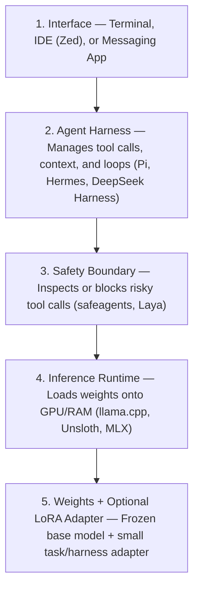

[Home](../README.md) / Orientation / How a Modern AI Stack Fits Together

*Last verified: 2026-11-27 · All tracked links healthy ([System Status](../STATUS.md))*

# How a Modern AI Stack Fits Together

If you are new to running open-weight models or coding agents, the vocabulary can blur together quickly. A practical AI setup is not one monolithic program—it is five replaceable layers working in sequence.

## What Each Layer Does

1. **Base Model (Weights):** The trained neural network (for example, `Qwen3.8-27B` or `Inkling 2 Mini`). You can access capable models through a [zero-card cloud API](../reference/cloud-free-tiers.md) or run open weights privately on your own hardware.
2. **Adapter (Optional LoRA):** A small add-on file (26 MB to 912 MB) loaded alongside a frozen base model to specialize it for a specific agent harness or policy without duplicating the 15 GB base file. See [Harness Adapters Research](../research/harness-adapters.md).
3. **Inference Runtime:** The serving engine (`llama.cpp`, `Unsloth`, or Apple `MLX`) that loads model files into GPU VRAM or unified memory and exposes an OpenAI- or Anthropic-compatible HTTP endpoint.
4. **Safety Boundary:** An optional proxy (`safeagents`) or lightweight non-autoregressive decision model (`Laya`) sitting between the harness and your shell/files so autonomous tool calls are audited before execution.
5. **Agent Harness:** The control loop (`Pi`, `DeepSeek Harness`, `Hermes Agent`, `OpenCode`) that sends prompts, executes file edits or shell commands, compacts long context, and feeds results back to the model.

---

**Continue reading:** [Zero-Card Cloud APIs](../reference/cloud-free-tiers.md) · [Local AI Workstation Guide](../guides/local-ai-workstation.md)
