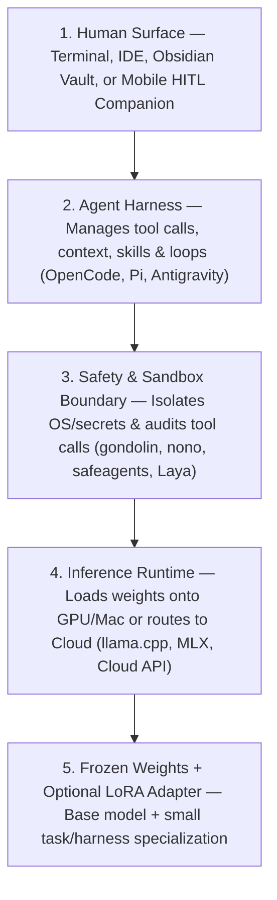

[Home](../README.md) / Orientation / How a Modern AI Stack Fits Together

<!-- swissknife:begin status-banner -->
*Last verified: 2026-11-27 · All tracked links healthy ([System Status](../STATUS.md)) · [For AI Agents (`llms.txt`)](../llms.txt)*
<!-- swissknife:end -->

# How a Modern AI Stack Fits Together

A practical AI setup is not one giant monolith—it is **five replaceable layers** working in sequence. Understanding these boundaries lets you swap any single piece (for example, changing from a cloud API to a local GPU, or switching from `OpenCode` to `Pi`) without throwing away the rest of your workflow.

## What Each Layer Owns

1. **Weights + Optional Adapter (Layer 5):** The trained neural network (`Qwen3.8-27B`, `Qwen3-Coder-Next`, or cloud `gemini-4-hydrogen`). Locally, you can attach a tiny **LoRA adapter** (26 MB to 912 MB) onto a frozen 15 GB base model to specialize it for a specific agent harness without duplicating the full checkpoint.
2. **Inference Runtime (Layer 4):** The serving engine (`llama.cpp`, Apple `MLX`, or `Unsloth`) that loads model files into GPU VRAM or unified memory and exposes a standard OpenAI- or Anthropic-compatible HTTP server on `127.0.0.1`.
3. **Safety & Sandbox Boundary (Layer 3):** Optional isolation (`gondolin` micro-VM or `nono` Seatbelt/Landlock) and runtime tool auditing (`safeagents`, `Laya 0.5`) ensuring autonomous commands cannot leak secrets or damage your system.
4. **Agent Harness (Layer 2):** The control loop (`OpenCode`, `Pi`, `Antigravity`, `Hermes Agent`, `DeepSeek Harness`) that sends prompts, calls MCP tools, compacts long transcripts, and feeds command output back to the model.
5. **Human Surface & Memory (Layer 1):** Where *you* interact—your terminal, IDE, plain-Markdown Obsidian/Git knowledge vault, or your phone acting as a remote approval and voice-steering surface.

---

**Continue reading:** [Newcomer & Student Onboarding](start-here-newcomer.md) · [The Personal AI Fabric](../worlds/personal-ai-fabric.md) · [Why This Stack](why-this-stack.md)
