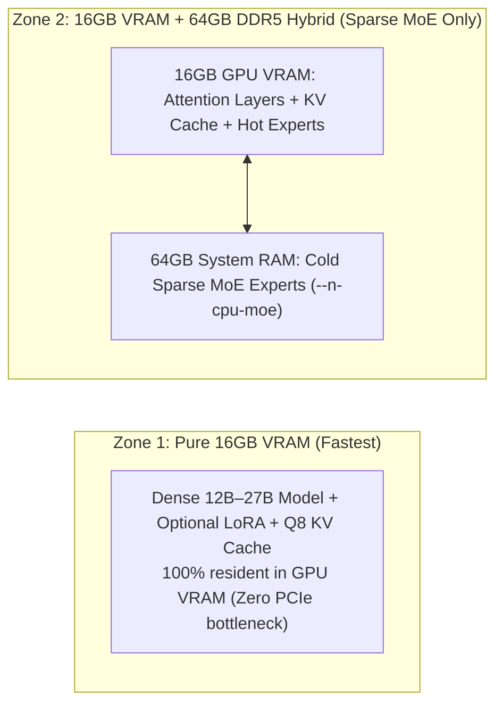

[Home](../README.md) / Guides / Local AI Workstation Guide

*Last verified: 2026-11-27 · All tracked links healthy ([System Status](../STATUS.md))*

# Local AI Workstation Guide

Running capable AI models locally comes down to one physical constraint: **memory bandwidth**. Models that fit inside GPU VRAM run fast; dense models that spill into system RAM slow to a crawl—unless they use a sparse Mixture-of-Experts (MoE) architecture.

## How the 16GB VRAM + 64GB RAM Memory Split Works



- **Apple Silicon Macs (Unified Memory):** CPU and GPU share one memory pool, eliminating the PCIe split. Use `mlx-lm` or `llama.cpp` Metal; 32GB+ unified memory is comfortable for 27B models.
- **Why dense 70B models are excluded:** Offloading a dense 70B model onto 64GB system RAM forces every token through CPU memory bandwidth (~2–4 tok/s). Sparse MoEs (`Qwen3-Coder-Next`, `Inkling 2 Mini`) activate only 3B–5.4B parameters per token, staying responsive in hybrid mode.

> [!WARNING]
> **Common Local Pitfall — Ollama's 4K Default Context Trap:** Below 24 GiB VRAM, Ollama defaults to a **4,096-token context window** (32K on 24–48 GiB, 256K only on 48 GiB+), which silently causes coding agents to drop system instructions and break tool loops. In addition, Ollama's OpenAI-compatible `/v1/chat/completions` endpoint has a reported hang issue on `qwen3.8:27b`. For agentic coding, prefer `llama-server` (with explicit `-c 32768` or `-c 65536`) or `mlx_lm.server` on Apple Silicon.

## Two Local Tracks: Keep Them Separate

1. **Mature Daily Drivers:** Battle-tested models with predictable runtime flags and verified LoRA adapters. Use these for daily work.
2. **Experimental Architectures:** Newer looped-layer or extreme-quant models with high upside but rougher edges (such as debug-loop sensitivity). Test these in a sandbox before relying on them.

## Recommended Starter Setups

### Mature Daily Drivers

#### [Qwen3.8-27B (Dense Vision + Text)](https://huggingface.co/Qwen/Qwen3.8-27B)

Apache-2.0 27B dense model serving as the primary 16GB VRAM and Apple Silicon coding backbone, hosting both Hugging Face's RL harness adapters and compact uncensored LoRAs.

- **When to use:** Daily-driver local coding, strict instruction following, and single-backbone multi-LoRA serving.
- **Memory footprint:** 14.5 GB (IQ4_XS, Zone 1 16GB VRAM) / ~16 GB (Mac MLX 4-bit)
- **License:** Apache-2.0
- **Evidence:** Primary evaluation
- **Compatible hot-swappable adapters:** [Qwen3.8-27B Rank-96 Super-Adapter (HF Harness Hub)](https://huggingface.co/harness-hub/Qwen3.8-27B-super-adapter), [Qwen3.8-27B 26MB Uncensored LoRA (Rank-3)](https://huggingface.co/Securelayer7/Qwen3.8-27B-Uncensored-Abliterated)
- **Limitation:** On 16GB GPUs, keep quantization at IQ4_XS with Q8 KV cache so weights never spill over PCIe.
- **Limitation:** Avoid Ollama's /v1/chat/completions endpoint with qwen3.8:27b due to reported hangs; use llama-server or mlx_lm.server.

<details>
<summary>Launch command (16GB VRAM / CUDA / llama-server)</summary>

```bash
llama-server -m Qwen3.8-27B-IQ4_XS.gguf -ngl 99 -fa on -c 32768 -ctk q8_0 -ctv q8_0 --port 8000
```

</details>

<details>
<summary>Launch command (Apple Silicon Mac / MLX)</summary>

```bash
mlx_lm.server --model netprojects/Qwen3.8-27B-super-adapter-MLX-6bit --port 8000
```

</details>

#### [Qwen3-Coder-Next (80B-A3B Sparse MoE)](https://huggingface.co/unsloth/Qwen3-Coder-Next-GGUF)

Sparse 512-expert Mixture-of-Experts coding model activating only 3B parameters per token, making 80B-class capacity practical in 16GB VRAM + 64GB DDR5 hybrid mode.

- **When to use:** Larger repository reasoning and multi-file refactoring on 16GB GPU + 64GB RAM workstations or 64GB+ Macs.
- **Memory footprint:** 49 GB (UD-Q4_K_XL, Zone 2 16GB VRAM + 64GB RAM)
- **License:** Apache-2.0
- **Evidence:** Official documentation
- **Limitation:** Keep -ngl 99 so Attention and KV cache stay on GPU; offload cold experts only via --n-cpu-moe.

<details>
<summary>Launch command (16GB VRAM / CUDA / llama-server)</summary>

```bash
GGML_CUDA_GRAPH_OPT=1 llama-server -m Qwen3-Coder-Next-UD-Q4_K_XL.gguf -ngl 99 -fa on -c 120000 --load-mode none --n-cpu-moe 29 -ctk q8_0 -ctv q8_0 --temp 0
```

</details>

#### [Gemma 4 Family (26B-A4B Vision & 12B Tri-Modal)](https://ai.google.dev/gemma)

Fast Apache-2.0 open-weight family offering ~140 tok/s text+vision throughput on 16GB VRAM (26B-A4B) and native local audio understanding (12B).

- **When to use:** High-speed local general chat, vision inspection, or local audio analysis.
- **Memory footprint:** 8.5 GB (12B) to 14 GB (26B-A4B, Zone 1 16GB VRAM)
- **License:** Apache-2.0
- **Evidence:** Official documentation
- **Limitation:** Only E2B, E4B, and 12B process audio—the 26B-A4B MoE checkpoint is Text + Vision only.

#### [NousResearch Hermes 4 (14B / 4.3-36B Neutral)](https://huggingface.co/NousResearch/Hermes-4-14B)

Neutral-aligned open-weight models designed to follow operator-defined system prompt policies without baked-in blanket refusals.

- **When to use:** Self-hosted deployments where you want predictable operator-controlled behavior rather than abliterated weight surgery.
- **Memory footprint:** 9 GB (14B Q4) / 22 GB (36B Hybrid)
- **License:** Apache-2.0
- **Evidence:** Vendor / lab claim
- **Limitation:** Always write explicit safety boundaries in your system prompt if exposing the model beyond solo local use.

<details>
<summary>Launch command (16GB VRAM / CUDA / llama-server)</summary>

```bash
llama-server -m Hermes-4-14B-Q4_K_M.gguf -ngl 99 -fa on -c 32768 --port 8000
```

</details>

### Experimental Local Architectures

#### [Inkling 2 Mini (26.4B Looped Transformer MoE)](https://huggingface.co/unsloth/Inkling-2-Mini-GGUF)

Experimental looped-layer MoE that iterates its middle 12 layers three times (3.4B base / 5.4B effective active, 1M context), now supported natively in mainline llama.cpp (#32218) alongside Unsloth.

- **When to use:** Experimenting with high-efficiency looped coding architectures inside 16GB-18GB memory budgets.
- **Memory footprint:** 13-18 GB (UD-Q3/Q4 + DSpark drafter)
- **License:** Apache-2.0 + AUP
- **Evidence:** Vendor / lab claim
- **Limitation:** Published 79.2% SWE-bench Verified and 48.2% DeepSWE v1.1 scores are lab-reported; trails Qwen3.8-27B on strict chat (50% MultiChallenge).
- **Limitation:** Can enter repetitive debug loops—cap max turns/thinking tokens and run inside a filesystem sandbox.

<details>
<summary>Launch command (16GB VRAM / CUDA / llama-server)</summary>

```bash
llama-server -hf unsloth/Inkling-2-Mini-GGUF:UD-Q4_K_M --port 8000
```

</details>

### Lightweight Decision & Safety Models (CPU / NPU)

#### [Laya 0.5 (Multimodal System-1 Decision Model)](https://github.com/NandhaKishorM/laya)

Compact non-autoregressive scorer evaluating up to 64 typed decisions in a single forward pass (<100-500ms on CPU/NPU/WebGPU), with v0.5 adding 73,728-token image/audio/video support.

- **When to use:** Fast zero-output-token tool-safety checks, routing gates, and memory verification without occupying GPU VRAM.
- **Memory footprint:** 678-846 MB (CPU / NPU / WebGPU)
- **License:** Apache-2.0
- **Evidence:** Official documentation
- **Limitation:** Threshold decisions on calibrated probabilities rather than raw confidence scores; the optional vegaml-learn add-on is non-commercial.

<details>
<summary>Launch command (16GB VRAM / CUDA / llama-server)</summary>

```bash
pip install -U laya && unsloth serve-decision convaiinnovations/laya-typed-decisions --port 8888
```

</details>

---

**Continue reading:** [Local Models Reference](../reference/local-models.md) · [Harnesses & Inference Runtimes](../reference/harnesses-and-runtimes.md) · [Harness Adapters Research](../research/harness-adapters.md)
