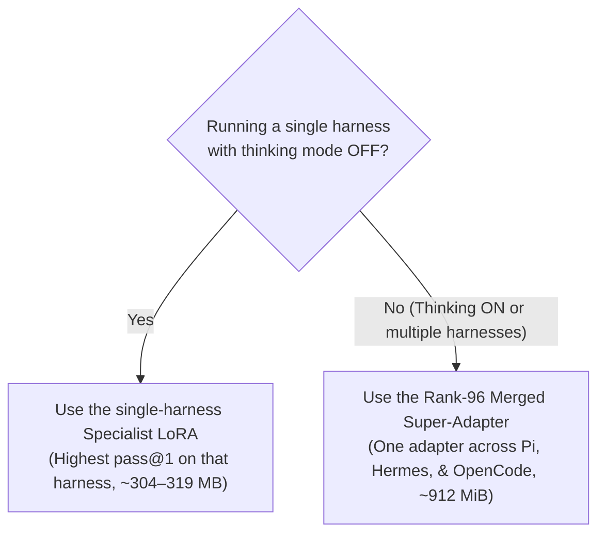

[Home](../README.md) / Research / Harness Adapters & In-Harness RL

<!-- swissknife:begin status-banner -->
*Last verified: 2026-11-28 · All tracked links healthy · 1 upstream release(s) queued ([System Status](../STATUS.md)) · [For AI Agents (`llms.txt`)](../llms.txt)*
<!-- swissknife:end -->

# Harness Adapters & In-Harness Reinforcement Learning

A central empirical finding in 2026 agent engineering is that **adapting a frozen mid-sized model to a specific harness** often delivers larger accuracy gains and far lower token cost than upgrading to a heavier unadapted model.

> **Benchmark comparability note:** Vendor-reported scores for `Qwen3.8-27B` are measured inside Qwen's own internal harness. In Hugging Face's independent reproduction inside unmodified `Pi` (thinking off), base `Qwen3.8-27B` scored **39% pass@1** on Terminal-Bench 2.1 using **2.9K tokens/task**—and attaching an RL-trained LoRA lifted it to **55% pass@1** while cutting usage to **1.5K tokens/task**.

## Choosing the Right Adapter



## Primary Evaluation Evidence (SWE-bench Pro, TB2.1 & AutomationBench OOD Control)

<!-- swissknife:begin eval-tables id=qwen38-super-adapter -->
**Reproduced SWE-bench Pro & Terminal-Bench 2.1 Results (Qwen3.8-27B)**

| Evaluation Mode | Base Qwen3.8-27B | Specialist LoRA | Rank-96 Super-Adapter | Tool-Call Reduction |
| :--- | :--- | :--- | :--- | :--- |
| Thinking Off (mean across 6 harness-bench pairs) | 39.5% | pi SWE-Pro: 64.7% (vs 39.2%) | 49.0% (beats base 6/6) | -53% to -73% calls |
| Thinking On / xhigh (mean across 6 pairs) | 55.5% | Trained with thinking off | 63.5% (wins 5/6, ties 1) | -31% to -48% SWE-Pro |
| Cross-Harness Transfer (pi LoRA -> other loops) | 44.8% OC / 46.3% Hermes | 54.0% OC / 56.1% Hermes | Also transfers to Swift-1.5 | ~45% fewer calls |

**Out-of-Distribution Control: 300 AutomationBench Tasks (Non-SWE Agent Loop)**

| Model Variant | pass@1 (All Assertions) | vs. Base | Partial Credit | vs. Base |
| :--- | :--- | :--- | :--- | :--- |
| Base Qwen3.8-27B | 23.0% | — | 62.2% | — |
| pi Specialist (step 160) | 27.0% | +4.0 | 66.2% | +4.0 |
| OpenCode Specialist (step 150) | 25.3% | +2.3 | 65.2% | +3.0 |
| Rank-96 Merged Super-Adapter | 23.7% | +0.7 | 60.6% | -1.6 |
| Hermes Specialist (step 160) | 17.7% | -5.3 | 56.6% | -5.6 |
<!-- swissknife:end -->

## Serving the Rank-96 Super-Adapter

<!-- swissknife:begin recipe id=qwen38-super-adapter -->
<details>
<summary>Launch command — Qwen3.8-27B Rank-96 Super-Adapter (HF Harness Hub) (CUDA / llama.cpp / CLI)</summary>

```bash
llama-server -m Qwen3.8-27B-IQ4_XS.gguf --lora Qwen3.8-27B-super-adapter-F16.gguf -ngl 99 -fa on -c 65536 -ctk q8_0 -ctv q8_0 --host 127.0.0.1 --port 8080
```

</details>

<details>
<summary>Launch command — Qwen3.8-27B Rank-96 Super-Adapter (HF Harness Hub) (Apple Silicon / MLX)</summary>

```bash
mlx_lm.server --model netprojects/Qwen3.8-27B-super-adapter-MLX-6bit --host 127.0.0.1 --port 8080
```

</details>
<!-- swissknife:end -->

## In-Harness RL Difficulty-Filtering Ablation (`OpenEnv` + `TRL AsyncGRPO`)

Training inside unmodified shipping harnesses via a token/logprob capture proxy depends heavily on filtering out tasks the base model *always* or *never* solves:

<!-- swissknife:begin eval-tables id=hf-in-harness-rl -->
**TB2.1 Difficulty-Filtering Ablation (Qwen3.8-27B · LoRA AsyncGRPO · 32 tasks/arm · 8xH200 · Base TB2.1: 35.9%)**

| Experimental Arm | Task Filtering Rule | Steps Completed | Train Reward (Steps 1-5 -> Last 5) |
| :--- | :--- | :--- | :--- |
| A1 Unvalidated | 24 accepted + 8 failed openenv validate | 40 (timed out at step 48) | 0.64 -> 0.67 |
| A2 Validated | 32 validated, no difficulty filter | 50 (completed) | 0.56 -> 0.70 |
| A3 Unqualified | 32 validated base always or never solves | 25 (timed out at step 26) | 0.60 -> 0.63 |
| A4 Qualified | 32 validated base solves sometimes | 50 (completed) | 0.62 -> 0.81 |
<!-- swissknife:end -->

## All Tracked Adapters & RL Artifacts

<!-- swissknife:begin table tag=rl-research -->
| Entry | Best Used For | Key Specs | Evidence | Primary Limitation |
| :--- | :--- | :--- | :--- | :--- |
| [Qwen3.8-27B Pi Specialist LoRA (~319 MB)](https://huggingface.co/harness-hub/Qwen3.8-27B-pi-adapted-GGUF) | Rung 1 of the Pi Ricing Journey when running Pi with thinking mode OFF on local Qwen3.8-27B. | +319 MB LoRA on frozen Qwen3.8-27B | Primary evaluation | HF BF16 vLLM evals jumped 39.2% -> 64.7% SWE-Pro and 39% -> 55% TB2.1, but GGUF quants have not been formally re-evaluated in llama.cpp (Q8_0 stays closer to BF16 than Q4). |
| [Qwen3.8-27B Rank-96 Super-Adapter (HF Harness Hub)](https://huggingface.co/harness-hub/Qwen3.8-27B-super-adapter) | Serving multiple harnesses from one 15 GB base model, or running with thinking mode enabled (xhigh). | +912 MiB LoRA (+304-319 MiB for single-harness specialist) | Primary evaluation | When running a single harness with thinking off, prefer its specialist LoRA (e.g., pi 64.0% vs 46.0% SWE-Pro hard-51). |
| [Qwen3.8-27B 26MB Uncensored LoRA (Rank-3)](https://huggingface.co/Securelayer7/Qwen3.8-27B-Uncensored-Abliterated) | Authorized security testing or unfiltered local experimentation without duplicating 15 GB of base weights. | +26 MB LoRA on frozen Qwen3.8-27B | Field observation | Abliterated adapters cannot refuse destructive tool actions; always isolate behind safeagents and Laya 0.5. |
| [In-Harness RL Recipe & HF Collection (OpenEnv + Harbor + TRL AsyncGRPO)](https://huggingface.co/collections/harness-hub/qwen38-27b-harness-adapters) | Reproducing harness-specific RL on private codebases or tracking newly published harness adapters. | Apache-2.0 | Primary evaluation | Requires all-linear LoRA, LR 2e-5 (1e-4 collapses rollouts), tool bonus 0.1, and excluding all-pass/all-fail tasks. |
<!-- swissknife:end -->

---

**Continue reading:** [Pi Ricing Workshop](../guides/pi-workshop.md) · [21-Day Watch List](watch-list.md)
