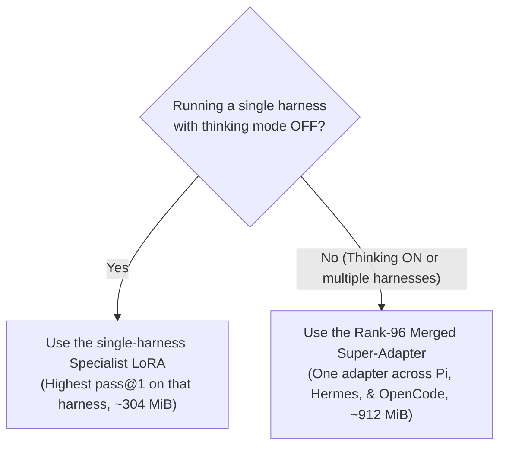

[Home](../README.md) / Research / Harness Adapters & In-Harness RL

*Last verified: 2026-11-27 · All tracked links healthy ([System Status](../STATUS.md))*

# Harness Adapters & In-Harness Reinforcement Learning

A central empirical finding in 2026 agent engineering is that **adapting a frozen mid-sized model to a specific harness** often delivers larger accuracy gains and far lower token cost than moving to a heavier unadapted model.

> **Note on benchmark comparability:** Vendor-reported scores for `Qwen3.8-27B` are measured on Qwen's own internal harness. In Hugging Face's independent reproduction using the `pi` harness with thinking off, base `Qwen3.8-27B` scored **39% pass@1** on Terminal-Bench 2.1 using **2.9K tokens/task**—and adding an RL-trained LoRA lifted it to **55% pass@1** while cutting usage to **1.5K tokens/task**.

## Choosing the Right Adapter



## Verified Adapters & Methodology

### [Qwen3.8-27B Rank-96 Super-Adapter (HF Harness Hub)](https://huggingface.co/harness-hub/Qwen3.8-27B-super-adapter)

Zero-retraining orthogonal rank-96 merge (PEFT combination_type=cat, weight 0.5) combining Pi, Hermes, and OpenCode RL LoRA adapters on one frozen Qwen3.8-27B backbone.

- **When to use:** Serving multiple agent harnesses from one frozen 15 GB base model, or running with thinking mode enabled (xhigh).
- **Evidence tier:** Primary evaluation · verified 2026-11-27
- **Observation:** Per-harness RL updates are nearly orthogonal (cosine similarity ~0.01-0.02), allowing rank concatenation without retraining.
- **Observation:** Community testing confirmed transfer onto Qwen3.8 derivatives such as Swift-1.5 and MTP-preserving Apple Silicon MLX builds.
- **Caveat / boundary:** When running a single harness with thinking off, prefer its specialist LoRA (e.g., pi 64.0% vs 46.0% on SWE-bench Pro hard-51).
- **Caveat / boundary:** Adapters were trained on BF16 weights; verify GGUF quant fidelity and expect brief pre-tool thinking leakage (arXiv:2610.14270).
- **Caveat / boundary:** Merge weight 0.5 was selected using TB2.1, introducing slight optimistic bias on that benchmark; Hermes specialist shows a mild OOD dip on AutomationBench.

**Reproduced SWE-bench Pro & Terminal-Bench 2.1 Results (Qwen3.8-27B)**

| Evaluation Mode | Base Qwen3.8-27B | Specialist LoRA | Rank-96 Super-Adapter | Tool-Call Reduction |
| :--- | :--- | :--- | :--- | :--- |
| Thinking Off (mean across 6 harness-bench pairs) | 39.5% | pi SWE-Pro: 64.7% (vs 39.2%) | 49.0% (beats base 6/6) | -53% to -73% calls |
| Thinking On / xhigh (mean across 6 pairs) | 55.5% | Trained with thinking off | 63.5% (wins 5/6, ties 1) | -31% to -48% SWE-Pro |
| Cross-Harness Transfer (pi LoRA -> other loops) | 44.8% OC / 46.3% Hermes | 54.0% OC / 56.1% Hermes | Also transfers to Swift-1.5 | ~45% fewer calls |

**Out-of-Distribution Control: 300 AutomationBench Tasks (Non-SWE Agent Loop)**

| Model Variant | pass@1 (All Assertions) | vs. Base | Partial Credit | vs. Base |
| :--- | :--- | :--- | :--- | :--- |
| Base Qwen3.8-27B | 23.0% | — | 62.2% | — |
| pi Specialist (step 160) | 27.0% | +4.0 | 66.2% | +4.0 |
| OpenCode Specialist (step 150) | 25.3% | +2.3 | 65.2% | +3.0 |
| Rank-96 Merged Super-Adapter | 23.7% | +0.7 | 60.6% | -1.6 |
| Hermes Specialist (step 160) | 17.7% | -5.3 | 56.6% | -5.6 |

<details>
<summary>Show serving command (llama-server / vLLM)</summary>

```bash
llama-server -m Qwen3.8-27B-IQ4_XS.gguf --lora Qwen3.8-27B-super-adapter-F16.gguf -ngl 99 -fa on -c 65536 -ctk q8_0 -ctv q8_0
```

</details>

<details>
<summary>Show serving command (Apple Silicon Mac / MLX)</summary>

```bash
mlx_lm.server --model netprojects/Qwen3.8-27B-super-adapter-MLX-6bit --port 8000
```

</details>

### [Qwen3.8-27B 26MB Uncensored LoRA (Rank-3)](https://huggingface.co/Securelayer7/Qwen3.8-27B-Uncensored-Abliterated)

Lightweight 26 MB rank-3 LoRA (built on Apple Silicon) removing built-in refusals on top of the exact same frozen Qwen3.8-27B base model.

- **When to use:** Authorized security testing, red-teaming, or unfiltered local experimentation without storing a second 15 GB checkpoint.
- **Evidence tier:** Field observation · verified 2026-11-27
- **Caveat / boundary:** Abliterated adapters cannot refuse destructive tool actions; always isolate behind safeagents and Laya 0.5.

### [In-Harness RL Recipe (OpenEnv + Harbor + TRL AsyncGRPO)](https://huggingface.co/blog/harness-adapters-at-scale)

Reusable reinforcement-learning pipeline that trains LoRAs directly inside unmodified shipping harnesses via a token/logprob capture proxy rather than re-implementing agent loops.

- **When to use:** Reproducing harness-specific RL on your own private repositories or task benchmarks.
- **Evidence tier:** Primary evaluation · verified 2026-11-27
- **Observation:** openenv validate passed 858 of 1,127 candidate tasks; filtering to tasks the base model solves sometimes (171/442) produced the decisive GRPO reward jump.
- **Caveat / boundary:** Requires all-linear LoRA, learning rate 2e-5 (1e-4 collapses rollouts), tool bonus 0.1, and strict exclusion of all-pass/all-fail GRPO tasks.

**TB2.1 Difficulty-Filtering Ablation (Qwen3.8-27B · LoRA AsyncGRPO · 32 tasks/arm · 8xH200 · Base TB2.1: 35.9%)**

| Experimental Arm | Task Filtering Rule | Steps Completed | Train Reward (Steps 1-5 -> Last 5) |
| :--- | :--- | :--- | :--- |
| A1 Unvalidated | 24 accepted + 8 failed openenv validate | 40 (timed out at step 48) | 0.64 -> 0.67 |
| A2 Validated | 32 validated, no difficulty filter | 50 (completed) | 0.56 -> 0.70 |
| A3 Unqualified | 32 validated base always or never solves | 25 (timed out at step 26) | 0.60 -> 0.63 |
| A4 Qualified | 32 validated base solves sometimes | 50 (completed) | 0.62 -> 0.81 |

---

**Continue reading:** [Local AI Workstation Guide](../guides/local-ai-workstation.md) · [21-Day Watch List](watch-list.md)
