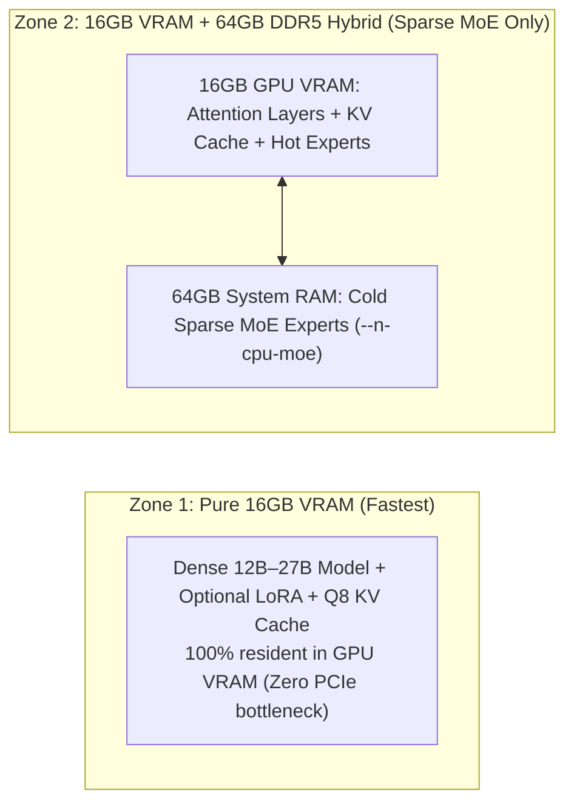

[Home](../README.md) / Compute Worlds / Discrete GPU PC

<!-- swissknife:begin status-banner -->
*Last verified: 2026-11-27 · All tracked links healthy ([System Status](../STATUS.md)) · [For AI Agents (`llms.txt`)](../llms.txt)*
<!-- swissknife:end -->

# Discrete GPU PC (16GB VRAM + 64GB RAM)

A consumer workstation with a **16GB NVIDIA GPU and 64GB DDR5 RAM** delivers the fastest Tensor Core prompt prefill, hybrid sparse MoE reasoning, and **all heavy local media generation** (`WanGP`, `ComfyUI`, `Wan 2.2`, `TRELLIS v1`). Everything hinges on one physical law: **memory bandwidth**.

## The Zone 1 / Zone 2 Memory Split



- **Why dense 70B models are excluded:** Spilling a dense 70B checkpoint onto system RAM forces every token through CPU memory bandwidth (~2–4 tok/s). Sparse MoEs (`Qwen3-Coder-Next`, activating 3B of 80B) stay genuinely usable in Zone 2.

---

## Two Critical Local Runtime Traps

> [!WARNING]
> **1. Ollama's 4K Default Context Trap:** Below 24 GiB VRAM, Ollama defaults to a **4,096-token context window** (32K on 24–48 GiB, 256K only on 48 GiB+), silently causing coding agents to drop system prompts and break tool loops. In addition, Ollama's `/v1/chat/completions` endpoint has a reported hang issue on `qwen3.8:27b`. Prefer explicit `llama-server` flags (`-c 32768` or `-c 65536`).

> [!WARNING]
> **2. The 16GB LLM + ComfyUI Coexistence Trap (`llama.cpp#19379`):** Letting `llama-server` auto-sleep via `--sleep-idle-seconds` unloads weights *but leaves ~600 MiB of dormant CUDA context VRAM attached per model*. On a single 16GB GPU, explicitly **Unload** your LLM via `Pi`'s `/llama` menu before queuing heavy `ComfyUI`/`WanGP` video renders—or split the LLM onto a Mac mini/Cloud and target your GPU PC over Tailscale.

---

## Starter Launch Recipes (Zone 1 & Zone 2)

<!-- swissknife:begin recipe id=qwen3.8-27b -->
<details>
<summary>Launch command — Qwen3.8-27B (Dense Vision + Text) (CUDA / llama.cpp / CLI)</summary>

```bash
llama-server -m Qwen3.8-27B-IQ4_XS.gguf -ngl 99 -fa on -c 32768 -ctk q8_0 -ctv q8_0 --host 127.0.0.1 --port 8080
```

</details>

<details>
<summary>Launch command — Qwen3.8-27B (Dense Vision + Text) (Apple Silicon / MLX)</summary>

```bash
mlx_lm.server --model netprojects/Qwen3.8-27B-super-adapter-MLX-6bit --host 127.0.0.1 --port 8080
```

</details>

Built-in upstream check: `curl -s http://127.0.0.1:8080/health`
<!-- swissknife:end -->

<!-- swissknife:begin recipe id=qwen3-coder-next -->
<details>
<summary>Launch command — Qwen3-Coder-Next (80B-A3B Sparse MoE) (CUDA / llama.cpp / CLI)</summary>

```bash
GGML_CUDA_GRAPH_OPT=1 llama-server -m Qwen3-Coder-Next-UD-Q4_K_XL.gguf -ngl 99 -fa on -c 120000 --load-mode none --n-cpu-moe 29 -ctk q8_0 -ctv q8_0 --host 127.0.0.1 --port 8080 --temp 0
```

</details>
<!-- swissknife:end -->

## Verified GPU Workstation Models

<!-- swissknife:begin table world=gpu-pc kind=model -->
| Entry | Best Used For | Key Specs | Evidence | Primary Limitation |
| :--- | :--- | :--- | :--- | :--- |
| [Wan 2.2 (5B & A14B Apache-2.0 Video)](https://huggingface.co/Wan-AI/Wan2.2-TI2V-5B) | Commercial-safe local video generation on consumer NVIDIA GPUs. | 6-15 GB VRAM via WanGP MMGP v4 | Official documentation | Newer Wan 3.0 and Wan 2.6 releases remain closed cloud APIs with no published local weights. |
| [Qwen-Image-2.1 (7B DiT Native RGBA)](https://huggingface.co/Qwen/Qwen-Image-2.1) | Non-commercial design assets, typography, and layered transparent image editing. | 4.2-9.1 GB VRAM (INT8 / leejet GGUF) | Official documentation | Non-commercial license; swap to Apache-2.0 FLUX.2 Klein for commercial production graphics. |
| [Qwen3.8-27B (Dense Vision + Text)](https://huggingface.co/Qwen/Qwen3.8-27B) | Daily-driver local coding, strict instruction following, and single-backbone multi-LoRA serving. | 14.5 GB (IQ4_XS, Zone 1 16GB VRAM) / ~16 GB (Mac MLX 4-bit) | Primary evaluation | On 16GB GPUs, keep quantization at IQ4_XS with Q8 KV cache so weights never spill over PCIe. |
| [Qwen3-Coder-Next (80B-A3B Sparse MoE)](https://huggingface.co/unsloth/Qwen3-Coder-Next-GGUF) | Deeper multi-file repository reasoning on 16GB GPU + 64GB RAM workstations or 64GB+ Macs. | 49 GB (UD-Q4_K_XL, Zone 2 16GB VRAM + 64GB RAM) | Official documentation | Keep -ngl 99 so Attention and KV cache stay in GPU VRAM; offload cold experts only via --n-cpu-moe. |
| [Gemma 4 Family (12B Tri-Modal & 26B-A4B Vision)](https://ai.google.dev/gemma) | 8GB-12GB laptops needing local chat/audio, or ultra-fast 16GB vision and general chat. | 8.5 GB (12B) to 14 GB (26B-A4B) | Official documentation | Only E2B, E4B, and 12B process audio; the 26B-A4B MoE checkpoint is Text + Vision only. |
| [NousResearch Hermes 4 (14B / 4.3-36B Neutral)](https://huggingface.co/NousResearch/Hermes-4-14B) | Self-hosted deployments needing predictable operator-controlled behavior rather than abliteration. | 9 GB (14B Q4) / 22 GB (36B Hybrid) | Vendor / lab claim | Always author explicit safety policies in your system prompt if exposing the endpoint beyond solo local use. |
| [Inkling 2 Mini (26.4B Looped Transformer MoE)](https://huggingface.co/unsloth/Inkling-2-Mini-GGUF) | Testing high-efficiency looped coding architectures inside 16GB-18GB memory budgets. | 13-18 GB (UD-Q3/Q4) | Vendor / lab claim | Published 79.2% SWE-bench Verified and 48.2% DeepSWE v1.1 figures are lab-reported; trails Qwen3.8-27B on strict chat. |
| [Laya 0.5 (Multimodal System-1 Decision Model)](https://github.com/NandhaKishorM/laya) | Fast zero-output-token tool-safety gating, routing, and memory relevance checks without using GPU VRAM. | 678-846 MB (CPU / NPU / WebGPU) | Official documentation | Threshold decisions on calibrated probabilities rather than raw confidence scores; optional vegaml-learn add-on is non-commercial. |
<!-- swissknife:end -->

---

**Continue reading:** [Local Media Studio](../guides/media-studio.md) · [The Personal AI Fabric](personal-ai-fabric.md) · [Harness Adapters Research](../research/harness-adapters.md)
