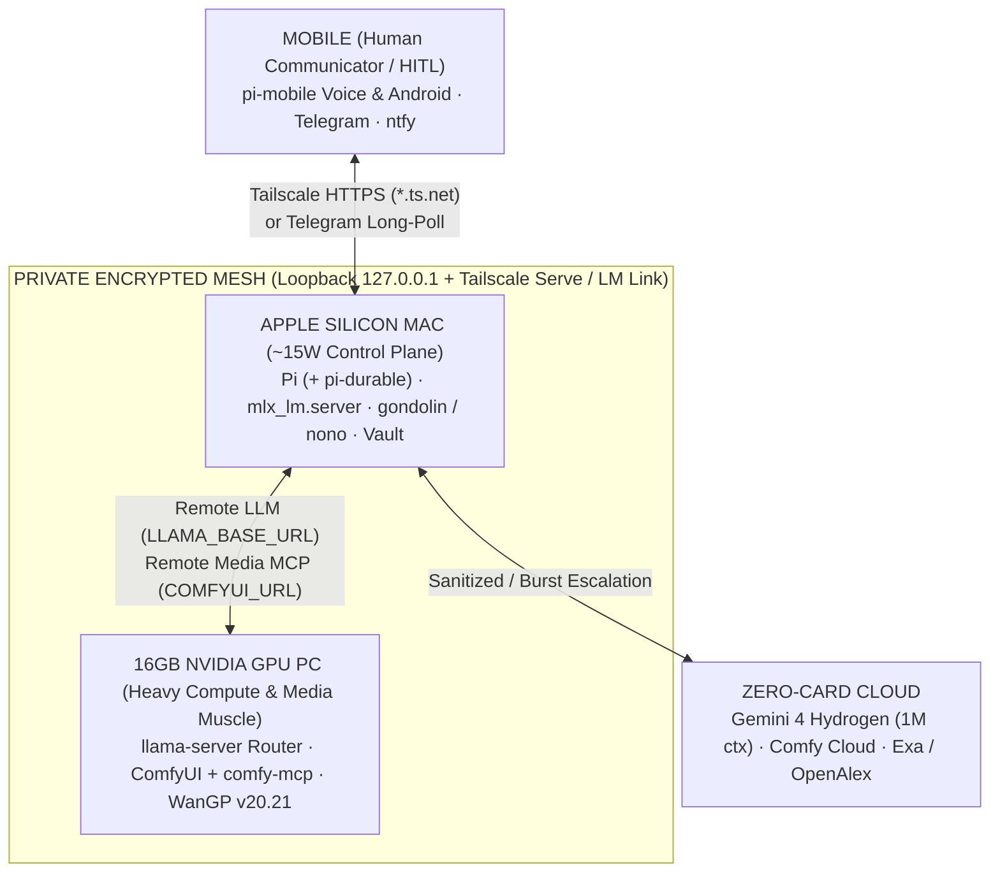

[Home](../README.md) / Compute Worlds / The Personal AI Fabric

<!-- swissknife:begin status-banner -->
*Last verified: 2026-11-28 · All tracked links healthy ([System Status](../STATUS.md)) · [For AI Agents (`llms.txt`)](../llms.txt)*
<!-- swissknife:end -->

# The Personal AI Fabric

Separating compute by physics eliminates almost every single-machine limitation—*provided* your devices can talk to each other cleanly without punching holes in your home router.



---

## Core Interconnect Slot & Protocols

<!-- swissknife:begin slot id=interconnect-fabric -->
**Active Anchor — [Tailscale Serve (Loopback-to-Tailnet HTTPS Mesh)](https://tailscale.com/kb/1312/serve)**

Zero-port WireGuard overlay exposing 127.0.0.1-bound local servers (llama-server, mlx_lm.server, ComfyUI, pi-mobile) privately inside your tailnet with automatic HTTPS and ACL tags.

- **When to use:** Developer standard for connecting Mac mini, NVIDIA GPU PC, and Android/iOS phones without opening router ports.
- **Evidence:** Official documentation · verified 2026-11-28
- **Why this pick:** [Connect Compute Worlds via Loopback + Tailscale Serve (Dev) & LM Link (Zero-Config)](../docs/why-this-stack.md#adr-why-tailscale-and-lm-link)
- **Limitation:** Automatic Let's Encrypt HTTPS certificates log machine.<tailnet>.ts.net hostnames in public CT logs; use neutral box names (e.g., box-a).
<!-- swissknife:end -->

<!-- swissknife:begin table kind=fabric -->
| Entry | Best Used For | Key Specs | Evidence | Primary Limitation |
| :--- | :--- | :--- | :--- | :--- |
| [Tailscale Serve (Loopback-to-Tailnet HTTPS Mesh)](https://tailscale.com/kb/1312/serve) | Developer standard for connecting Mac mini, NVIDIA GPU PC, and Android/iOS phones without opening router ports. | Encrypted Private Mesh (Dev Standard) | Official documentation | Automatic Let's Encrypt HTTPS certificates log machine.<tailnet>.ts.net hostnames in public CT logs; use neutral box names (e.g., box-a). |
| [LM Link (Tailscale tsnet Zero-VPN GPU Sharing)](https://lmstudio.ai/docs/lmlink) | Newcomers and students wanting to borrow their home desktop GPU from a thin laptop without configuring Tailscale ACLs. | Zero-Config Userspace GPU Bridge | Official documentation | Free during Preview; paid tiers are planned at General Availability (use Tailscale Serve for permanent open control). |
<!-- swissknife:end -->

<!-- swissknife:begin recipe id=tailscale-serve -->
<details>
<summary>Launch command — Tailscale Serve (Loopback-to-Tailnet HTTPS Mesh) (CUDA / llama.cpp / CLI)</summary>

```bash
tailscale serve --bg http://127.0.0.1:8080
```

</details>

Built-in upstream check: `tailscale serve status`
<!-- swissknife:end -->

---

## Five Hybrid Patterns Where Connecting Worlds Wins

1. **Quiet Agent + Heavy Media Studio (`Mac mini` $\rightarrow$ `16GB GPU PC`):** Run `Pi` + `Qwen3.8-27B` silently on the Mac mini via `mlx_lm.server`, and point `Comfy-Org/comfy-mcp` (`COMFYUI_URL`) at your NVIDIA GPU PC over Tailscale. Solves both **Mac MPS video/FP8 failures** and **single-GPU 16GB OOMs** at once.
2. **Pocket-Steered Overnight Runs (`Mobile` $\leftrightarrow$ `Mac mini` $\rightarrow$ `Cloud Search`):** Keep `Pi Durable` running inside `gondolin`/`nono` on a ~15W Mac mini while approving tool calls or dropping whiteboard photos/PDFs from `pi-mobile` or Telegram anywhere.
3. **Travel Laptop Power-Borrowing (`Thin Laptop` $\rightarrow$ `Home GPU` or `Cloud`):** Borrow your home desktop GPU privately via `LM Link` (`lms link enable`, zero VPN setup) or `tailscale serve`, and fall back to `$0` Google AI Studio (`gemini-4-hydrogen`) when your home rig is asleep.
4. **95/5 Privacy-First Engineering (`Local Mac / GPU` + `Sanitized Cloud`):** Keep proprietary repos, binaries, and personal Obsidian vaults 100% local on `Qwen3.8-27B` + `Laya 0.5`; switch `/model` to `gemini-4-hydrogen` or `NVIDIA NIM` only for sanitized public architecture or literature tasks.
5. **Mobile Field Capture $\rightarrow$ Durable Knowledge Vault (`Mobile` $\rightarrow$ `Mac mini`):** Capture voice notes, photos, or web links on your phone into Telegram or `pi-mobile`, letting your home agent clean and file them into your plain-Markdown Obsidian/Git vault.

---

**Continue reading:** [Security & Trust Boundaries](../docs/security-and-trust.md) · [Pi Ricing Workshop](../guides/pi-workshop.md)
